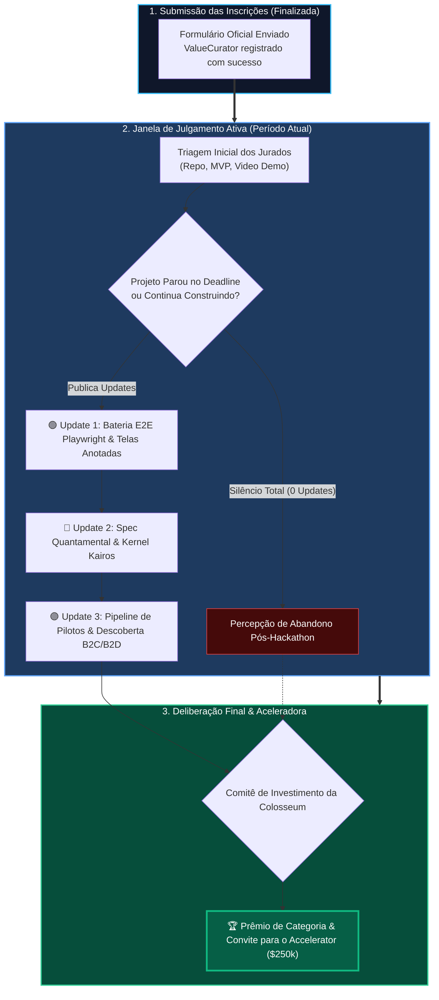

# 🚀 ValueCurator: Guia Estratégico de Post-Submission Updates na Colosseum

> **Colosseum Crypto World's Fair 2026 — Período de Julgamento & Avaliação de Bancas**  
> *Projeto Avaliado*: **ValueCurator (`value-curator`)**  
> *Status Atual*: Inscrição Submetida (`acceleratorOptIn: true`, `updatesCount: 0`)  
> *Versão do Documento*: **2.0 (Append-Only Edition)** — Acrescentado com o Guia Empírico da Superteam Brasil (`dicas.pdf`)  
> *Objetivo*: Maximizar as chances de premiação e seleção para o **Colosseum Accelerator ($250k investment)** através de *Project Updates* estratégicos postados durante a janela ativa de julgamento e alinhamento com as regras empíricas que movem o resultado  
> *Padrão*: Outline com Emojis, Filosofemas, Formalismos Simbólicos, Diagramas Mermaid Coloridos, Recomendações do Colosseum Copilot, Heurísticas da Superteam Brasil e Sugestões Táticas Originais

---

## 📑 Sumário Geral do Documento

### 🏛️ PARTE I: ESTRATÉGIA DE UPDATES PÓS-SUBMISSÃO NA COLOSSEUM
* 🧬 **§1. Filosofemas & Formalismos Simbólicos do Momentum Pós-Submissão**
* 📊 **§2. Diagramas Mermaid Coloridos (Ciclo de Julgamento da Colosseum & Impacto dos Updates)**
* 🔍 **§3. Diagnóstico Atual do Projeto no Colosseum Copilot (`GET /me`)**
  * 🎯 3.1. Pontos Fortes já Registrados na Submissão
  * ⚠️ 3.2. As Lacunas Naturais de um MVP Pre-Traction e Como os Updates as Eliminam
* 📝 **§4. Quatro Propostas Estruturadas de Updates para a Página do Projeto**
  * 🛠️ **Update #1**: Confiabilidade & Bateria E2E Playwright com Setas e Veredito Fail-Closed
  * 🧭 **Update #2**: Evolução Arquitetural — O Kernel Kairos Neurosimbólico & Abordagem Quantamental
  * 👥 **Update #3**: Validação de Mercado — Pipeline de Descoberta com Usuários (B2C & B2D)
  * 🎬 **Update #4**: Demonstração Técnica Audiovisual Sincronizada (Pitch de 2m50s)
* 💡 **§5. Recomendações e Sugestões Táticas Originais (Voz Própria do Fundador)**
* 🏁 **§6. Cronograma Sugerido de Publicação & Rastreabilidade**

---

### 🛡️ PARTE II: GUIA EMPÍRICO DE HACKATHONS (SUPERTEAM BRASIL / DICAS.PDF)
* 📜 **§7. Filosofemas & Axiomas do Guia Superteam Brasil (*The Deterministic Baseline*)**
* 🚫 **§8. Requisitos Fatais & Condições Eliminatórias (*Pass or Fail*)**
* 🎯 **§9. A Escolha do Espaço Antes da Ideia (A Decisão de Maior Alavancagem)**
  * 🏆 9.1. Hierarquia de Espaços: Os Mais Fortes vs. Os Espaços Proibidos
  * 👥 9.2. A Quem Servir: Do Melhor ao Pior Perfil de Cliente
  * 💥 9.3. Os Três Problemas que Realmente Separam os Vencedores
* 🛑 **§10. O Maior Erro dos Hackathons: "Nunca Entregue um Mock e Chame de Produto"**
* ✍️ **§11. Como Redigir a Descrição: "Diga o que o Produto Faz com o Dinheiro"**
* 💻 **§12. Tecnologia: O que Dizer (e o que NUNCA Mencionar)**
* 👥 **§13. A Dinâmica da Equipe, Evidências e Tração Inspecionável**
* ❌ **§14. O que Comprovadamente NÃO Funciona (Testado e Reprovado)**
* 📋 **§15. Checklist Final de 20 Itens da Superteam Brasil Aplicado ao ValueCurator**

---

# 🏛️ PARTE I: ESTRATÉGIA DE UPDATES PÓS-SUBMISSÃO NA COLOSSEUM

---

## 🧬 §1. Filosofemas & Formalismos Simbólicos do Momentum Pós-Submissão

### 📜 Filosofemas da Trajetória Contínua

* 🜁 **Filosofema da Prova de Vida Algorítmica (*The Proof of Ongoing Momentum*)**:
  > *«Para a banca examinadora e os gestores de investimento da Colosseum, o prazo de submissão não é a linha de chegada; é o primeiro ponto de corte. Centenas de projetos abandonam seus repositórios no segundo seguinte ao envio do formulário. Apenas os fundadores de elite continuam commitando, testando, documentando e publicando atualizações enquanto os jurados leem. O update pós-submissão não é um pedido de desculpas pelo que faltou; é o testemunho irrevogável de que o projeto existirá, com ou sem o prêmio do hackathon.»*

* 🜂 **Filosofema da Redução da Assimetria de Incerteza (*The Bayesian Update*)**:
  > *«A mente do jurado é um estimador bayesiano sob escassez de tempo. Diante da declaração de um projeto "pre-traction", a probabilidade inicial de sucesso é moderada. Cada novo update com evidências tangíveis — transações verificadas na Devnet, baterias completas de testes automatizados e entrevistas de validação — atua como uma nova evidência que recalibra as probabilidades a favor da equipe.»*

---

### 🔣 Formalismo Simbólico da Função de Impacto do Update

A pontuação fiduciária atribuída pelos jurados $\mathcal{S}_{\text{judging}}$ é modelada como a soma da avaliação basal da submissão com a série temporal de atualizações postadas durante a janela de julgamento $[T_{\text{deadline}}, T_{\text{results}}]$:

$$\mathcal{S}_{\text{judging}} = \mathcal{S}_{\text{submission}} + \sum_{k=1}^{N_u} \Delta \mathcal{U}_k \cdot e^{-\lambda (T_{\text{results}} - t_k)}$$

Onde a função de impacto de cada update $\Delta \mathcal{U}_k$ satisfaz os invariantes:

$$\begin{cases}
\Delta \mathcal{U}_{\text{technical}} & = \mathbf{1}_{\text{verified}}\big(\text{Devnet Transactions} \land \text{E2E Playwright Tests}\big) \times \text{Weight}_{\text{code}} \\
\Delta \mathcal{U}_{\text{market}} & = \mathbf{1}_{\text{discovery}}\big(\text{Customer Interviews} \land \text{Pilot Pipeline}\big) \times \text{Weight}_{\text{traction}} \\
\Delta \mathcal{U}_{\text{vision}} & = \mathbf{1}_{\text{clarity}}\big(\text{Quantamental Spec} \land \text{Neurosymbolic Architecture}\big) \times \text{Weight}_{\text{defensibility}} \\
N_u & \in [2, 4] \quad (\text{Cadência Ótima de 2 a 4 Updates Relevantes})
\end{cases}$$

---

## 📊 §2. Diagramas Mermaid Coloridos

### 🔄 Diagrama 1: O Funil de Avaliação da Colosseum & o Papel dos Updates



---

### ⏱️ Diagrama 2: Linha Temporal Estratégica dos Updates Pós-Submissão

```mermaid
flowchart LR
    D0["Deadline Encerrado<br/>(Inscrições Finalizadas)"] --> U1["Update 1 (Imediato)<br/>E2E Test Suite & Devnet Proof"]
    U1 --> U2["Update 2 (+2 dias)<br/>Quantamental & Neurosymbolic Spec"]
    U2 --> U3["Update 3 (+4 dias)<br/>Pilots Pipeline & Discovery"]
    U3 --> U4["Update 4 (Reta Final)<br/>Video Walkthrough & Pitch Deck"]
    U4 --> Fin["Anúncio de Vencedores<br/>Colosseum 2026"]

    style D0 fill:#0f172a,stroke:#64748b,stroke-width:2px,color:#fff
    style U1 fill:#064e3b,stroke:#34d399,stroke-width:2px,color:#fff
    style U2 fill:#1e3a5f,stroke:#60a5fa,stroke-width:2px,color:#fff
    style U3 fill:#3b0764,stroke:#c084fc,stroke-width:2px,color:#fff
    style U4 fill:#78350f,stroke:#f59e0b,stroke-width:2px,color:#fff
    style Fin fill:#0f172a,stroke:#38bdf8,stroke-width:2px,color:#fff
```



---

## 🔍 §3. Diagnóstico Atual do Projeto no Colosseum Copilot (`GET /me`)

Ao consultar a API v2 da Colosseum (`GET /me`) com as credenciais ativas da sua conta, obtivemos a seguinte radiografia oficial:

```
========================================================================================================
ESTADO ATUAL DO PROJETO NA BASE OFICIAL DA COLOSSEUM
========================================================================================================
Projeto:                ValueCurator (slug: value-curator)
Repositório Conectado:  https://github.com/smp-sandramariapereira/valuecurator
Equipe Registrada:      João (ITA / PhD Neurociência UFMG) & Sandra Pereira (BSc / MSc PUC Minas)
Accelerator Opt-In:     SIM (true) — Elegível para investimento de $250.000 USD
Status de Updates:      0 updates publicados (updates: [])
Ecossistema / Cadeias:  Solana (Anchor, Token-2022, PDAs, Pyth Pro, Jupiter, Devnet)
========================================================================================================
```

### 🎯 3.1. Pontos Fortes já Registrados na Submissão
1. **Credenciais Acadêmicas e de Engenharia:** Formação sólida em engenharia da computação (ITA) e neurociência (UFMG), aliada à pesquisa de ponta em ciência da computação e modelos preditivos com publicações internacionais Springer (Sandra).
2. **Separação Constitucional Clara:** O formulário articula de forma contundente que o ValueCurator não é mais um bot de trading, mas uma **camada de governança e autorização determinística para o capital**.
3. **Opt-in Ativo para a Aceleradora:** O projeto está formalmente concorrendo ao investimento de **$250k da Colosseum**.

### ⚠️ 3.2. As Lacunas Naturais de um MVP Pre-Traction e Como os Updates as Eliminam
* No formulário, a equipe declarou com honestidade técnica:
  > *«ValueCurator has a functional MVP but is currently pre-traction, with no production customers or commercial revenue. (...) Our next step is to validate the problem through structured interviews and pilot integrations with asset managers, tokenization platforms, treasury operators, and financial agent developers.»*
* **O Risco:** Deixar o campo `updates: []` zerado passa aos jurados a impressão de que o projeto parou no deadline.
* **A Oportunidade:** Publicar atualizações frequentes durante o período de avaliação demonstra **tração de execução**, provando que o time continua construindo ativamente.

---

## 📝 §4. Quatro Propostas Estruturadas de Updates para Publicar na Colosseum

> 📌 **Diretriz de Integridade:** Os jurados valorizam as palavras próprias dos fundadores. Utilize os tópicos abaixo como roteiro e expresse-os com a sua voz autêntica.

---

### 🛠️ Proposta de Update #1: Confiabilidade & Bateria E2E Playwright com Setas e Veredito Fail-Closed
* 🎯 **Objetivo:** Provar rigor de engenharia e demonstrar que o MVP foi auditado visual e funcionalmente ponta a ponta.
* 🏷️ **Título Sugerido:** `Milestone: 100% Deterministic E2E Verification & Interactive Walkthrough Suite`
* 📌 **Tópicos a Abordar:**
  * Execução de suite automatizada com Playwright Chromium em ambiente headless cobrindo todos os passos de [www.valuecurator.xyz](https://www.valuecurator.xyz).
  * Validação dos 3 cenários do portão: Proposta segura (`APPROVED` com recibo Ed25519), Oráculo obsoleto >300s (`BLOCKED: Stale Oracle`) e Divergência de preço >20% (`BLOCKED: Price Divergence`).
  * Geração de relatório com screenshots anotados com setas e anéis de mira indicando os cliques em cada elemento da UI.
  * *Link de Prova:* Apontar para o relatório técnico [PLAYWRIGHT_ANNOTATED_E2E_REPORT.md](file:///home/sukata/ip-nft/PLAYWRIGHT_ANNOTATED_E2E_REPORT.md).

---

### 🧭 Proposta de Update #2: Evolução Arquitetural — Kernel Kairos Neurosimbólico & Abordagem Quantamental
* 🎯 **Objetivo:** Evidenciar defensibilidade teórica e mostrar que o projeto não é um simples "wrapper" de IA.
* 🏷️ **Título Sugerido:** `Architecture Update: Advancing the KAIROS Engine to a Quantamental & Neurosymbolic Kernel`
* 📌 **Tópicos a Abordar:**
  * Explicar o paradigma quantamental: conjunção de dados técnicos de alta frequência (Pyth Feed 922 da Mainnet e quotes Jupiter) com os mandatos constitucionais fiduciários do investidor ($500 USDC de limite, RWA AAPLx).
  * Explicar por que a IA pura falha: LLMs são probabilísticos e alucinam; o Kernel Kairos fornece o *formal guardrail* determinístico.
  * Introdução de conceitos de Econofísica e *Physics-Informed Machine Learning (PIML)* para conservação de fluxo de liquidez ($\nabla \cdot \mathbf{J} + \partial \rho / \partial t = 0$).
  * Planejamento do núcleo em Rust nativo acoplado via N-API para decisões em microssegundos.
  * *Link de Prova:* Apontar para [KERNEL_KAIROS_QUANTAMENTAL_NEUROSYMBOLIC_SPEC.md](file:///home/sukata/ip-nft/KERNEL_KAIROS_QUANTAMENTAL_NEUROSYMBOLIC_SPEC.md).

---

### 👥 Proposta de Update #3: Validação de Mercado — Pipeline de Descoberta com Usuários (B2C & B2D)
* 🎯 **Objetivo:** Atacar diretamente o ponto "pre-traction" citado no formulário, demonstrando que a fase de descoberta de clientes já começou.
* 🏷️ **Título Sugerido:** `Market Discovery: Initial Feedback from DAO Operators and Personal Wealth Curators`
* 📌 **Tópicos a Abordar:**
  * Relatar o início de conversas estruturadas com operadores de tesouraria de DAOs e desenvolvedores de agentes.
  * Validação da dor principal: operadores têm receio de outorgar chaves privadas a agentes de trading autônomos sem limites programados.
  * Confirmação dos segmentos:
    * *B2C:* Carteiras individuais ("pé-de-meia" soberano sem intermediários bancários).
    * *B2D:* DAOs que necessitam de desembolsos protegidos contra ataques de flash loan e drainers.
    * *B2A:* Criadores de agentes buscando uma infraestrutura de custódia segura para seus clientes.

---

### 🎬 Proposta de Update #4: Demonstração Técnica Audiovisual Sincronizada (Pitch de 2m50s)
* 🎯 **Objetivo:** Oferecer aos jurados que têm pouco tempo um vídeo fluido, profissional e de alto impacto.
* 🏷️ **Título Sugerido:** `Video Release: Official 2m50s Technical Tour & Voiceover Walkthrough`
* 📌 **Tópicos a Abordar:**
  * Lançamento da narração técnica completa em inglês calibrada para 2 minutos e 50 segundos (~170 segundos), sintetizada via ElevenLabs com pausas SSML sincronizadas com os cliques da UI.
  * Demonstração clara da leitura do Pyth 922, travamento de mandato com hash SHA-256 e execução da instrução `metabolize_yield` na Solana Devnet.
  * Inclusão do link do vídeo e do roteiro [ELEVENLABS_VOICEOVER_PROMPT.md](file:///home/sukata/ip-nft/ELEVENLABS_VOICEOVER_PROMPT.md).

---

## 💡 §5. Recomendações e Sugestões Táticas Originais

1. **Publique o Update #1 nas próximas 24 horas:** Ter zero updates enquanto o comitê inicia as triagens é a principal desvantagem que podemos reverter agora mesmo.
2. **Atualize o README.md do Repositório GitHub:** Garanta que o [README.md](file:///home/sukata/ip-nft/README.md) tenha botões e links claros logo no cabeçalho direcionando para a demo ao vivo ([www.valuecurator.xyz](https://www.valuecurator.xyz)) e para os relatórios técnicos do Playwright.
3. **Divulgue no X (Twitter) marcando a Colosseum:**
   * Poste um vídeo curto de 30 a 60 segundos ou capturas com setas no perfil `@aquiladeeptech` (ou pessoal).
   * Marque `@ColosseumOrg` e `@SuperteamBR`.
   * Inclua o link desse tweet dentro do texto do seu update na Colosseum! Os jurados monitoram a capacidade de comunicação pública dos fundadores.
4. **Mantenha o Tom Sóbrio e Fiduciário:** Evite termos especulativos de varejo. Continue usando o vocabulário de infraestrutura de elite que construímos: *«invariantes determinísticos»*, *«execução fail-closed»*, *«meta-curadoria de capital»*.

---

## 🏁 §6. Cronograma Sugerido de Publicação & Rastreabilidade

```
========================================================================================================
CRONOGRAMA DE DISPARO DE UPDATES DURANTE O JULGAMENTO
========================================================================================================
TIMING          UPDATE PROPOSTO             TEMA PRINCIPAL                EVIDÊNCIA ANEXA
========================================================================================================
Dia 1 (Hoje)    Update #1: E2E Playwright   Confiabilidade & Testes       Screenshots com Setas + Relatório MD
Dia 3           Update #2: Arquitetura      Kernel Kairos Quantamental    Spec Neurosimbólica + PIML GNNs
Dia 5           Update #3: Customer Disc.   Entrevistas & Pilotos B2C/B2D Resumo Qualitativo de Feedback
Dia 7 (Reta)    Update #4: Video & Pitch    Walkthrough Oficial 2m50s     Link do Vídeo + Pitch Deck PDF
========================================================================================================
```

---
---

# 🛡️ PARTE II: GUIA EMPÍRICO DE HACKATHONS (SUPERTEAM BRASIL / DICAS.PDF)

> *Compilação exaustiva e append-only das lições baseadas em dados empíricos do documento oficial `dicas.pdf` (Superteam Brasil), ordenadas estritamente pelo impacto real que exercem sobre o resultado de bancas examinadoras.*

---

## 📜 §7. Filosofemas & Axiomas do Guia Superteam Brasil (*The Deterministic Baseline*)

* 🜁 **Axioma da Seção 1 Determinística (*Pass or Fail*)**:
  > *«A Seção 1 não é conselho; são condições determinísticas binárias. Se você errar um único requisito da Seção 1, está sumariamente desclassificado antes que qualquer jurado leia sua primeira linha de código. Tudo o que vem após a Seção 1 apenas move probabilidades estatísticas (*shifts the odds*), mas nada garante. A primeira obrigação do fundador é não ser eliminado por negligência processual.»*

* 🜂 **Axioma do Espaço Dominante (*Space Dominates Concept*)**:
  > *«O espaço em que um projeto opera domina tudo o mais. Uma ideia convencional dentro de um espaço estruturalmente forte vence consistentemente uma ideia genial e engenhosa em um espaço fraco. Formas de ideia são apenas rótulos para o espaço escolhido. Se você for aconselhar equipes, entregue o espaço, não uma lista de ideias espertas.»*

---

## 🚫 §8. Requisitos Fatais & Condições Eliminatórias (*Pass or Fail*)

Segundo o guia oficial, estas são as falhas que mais eliminam equipes precocemente:

```
========================================================================================================
CHECKLIST DE SOBREVIVÊNCIA BINÁRIA (FATAL SE IGNORADO)
========================================================================================================
1. INSCRIÇÃO INDIVIDUAL DE TODOS OS MEMBROS
   - Cada membro da equipe deve se registrar individualmente na plataforma antes do prazo fatal.
   - Um membro não registrado desqualifica e arrasta toda a submissão para o descarte. Sem prazo de tolerância!

2. 100% DO CONTEÚDO EM INGLÊS
   - Texto ou vídeo em idioma não conforme é motivo expresso de desclassificação imediata.

3. AMBOS OS VÍDEOS OBRIGATÓRIOS PRESENTES
   - Pitch: entre 2 e 3 minutos.
   - Demo técnica: impreterivelmente MENOS de 3 minutos.

4. DIVULGAÇÃO GENEROSA DE CÓDIGO PRÉ-EXISTENTE
   - Utilizar código ou produto iniciado antes do hackathon é formalmente permitido.
   - Não divulgar acarreta banimento futuro e revogação de prêmios. Como não há penalidade por 
     divulgar demais, a regra empírica é: declare tudo com generosidade (*over-disclose*).

5. REPOSITÓRIO OBRIGATORIAMENTE PÚBLICO
   - Repositório privado com acesso concedido é admissível pelo regulamento, mas os critérios 
     de avaliação incluem uma pontuação explícita para open-source. Manter privado é abrir mão de pontos grátis.

6. ALINHAMENTO DE REDE COM A ACELERADORA
   - O hackathon pode admitir múltiplos ecossistemas, mas o Colosseum Accelerator que o segue é 
     exclusivo da Solana. O acelerador vale uma ordem de magnitude a mais que o prêmio financeiro imediato.
========================================================================================================
```

---

## 🎯 §9. A Escolha do Espaço Antes da Ideia (A Decisão de Maior Alavancagem)

### 🏆 9.1. Hierarquia de Espaços: Os Mais Fortes vs. Os Espaços Proibidos

```mermaid
flowchart TD
    subgraph S_Strong["🟢 ESPAÇOS ESTRUTURALMENTE FORTES (Aprovam com Consistência)"]
        direction TB
        E1["1. Tokenised Treasuries & Fixed-Income (RWA)"]
        E2["2. Derivatives & Perpetuals"]
        E3["3. Trading & Liquidity Infrastructure"]
        E4["4. Asset Management, Vaults & Strategy (ValueCurator!)"]
        E5["5. Lending, Credit & Collateral"]
        E6["6. Real-World Asset (RWA) Origination"]
        E7["7. Privacy como Recurso Financeiro"]
        E8["8. Prediction Market Infrastructure & Settlement"]
        E9["9. Developer & Execution Infrastructure"]
    end

    subgraph S_Weak["🔴 ESPAÇOS FRACOS / EVITAR (Quase Nunca Passam na Banca)"]
        direction TB
        W1["❌ General-Purpose AI Applications & Assistants"]
        W2["❌ Games & GameFi"]
        W3["❌ Social & SocialFi"]
        W4["❌ Education & Learn-to-Earn"]
        W5["❌ Open Marketplaces & Creator Monetisation"]
        W6["❌ Health, Fitness & Wellness"]
        W7["❌ NFT Ticketing & Event Tooling"]
        W8["❌ Marketing, Loyalty & Rewards"]
    end

    S_Strong -.->|"Foco do ValueCurator: Vaults + RWA + Infra"| VC["👑 Posicionamento de Elite"]

    style S_Strong fill:#064e3b,stroke:#34d399,stroke-width:2px,color:#fff
    style S_Weak fill:#450a0a,stroke:#ef4444,stroke-width:2px,color:#fff
    style VC fill:#0f172a,stroke:#38bdf8,stroke-width:3px,color:#fff
```



> 💡 **Aplicação Crítica ao ValueCurator:**  
> O ValueCurator está posicionado exatamente nos três espaços mais vitoriosos da história da Solana: **Asset Management / Vaults**, **Trading & Liquidity Infrastructure** e **Tokenised RWA (AAPLx)**. O guia adverte: *«General-purpose AI applications and assistants»* estão entre os espaços que quase nunca passam. Portanto, **o ValueCurator nunca deve se vender como um "AI assistant", mas como uma Infraestrutura de Proteção de Cofres e Capital**.

---

### 👥 9.2. A Quem Servir: Do Melhor ao Pior Perfil de Cliente

```
========================================================================================================
RANKING EMPÍRICO DE CLIENTES-ALVO (DO MELHOR AO PIOR)
========================================================================================================
MELHORES:       1. Market Makers
                2. Investidores Institucionais
                3. Provedores de Liquidez (LPs)
                4. Traders
                5. Instituições em Geral
                6. Agentes de IA (AI Agents)
--------------------------------------------------------------------------------------------------------
O MAIS SATURADO:7. DESENVOLVEDORES (Developers)
                ⚠️ Alerta Máximo: É a escolha mais superlotada do hackathon (>1.000 concorrentes)
                   e não traz vantagem alguma perante os jurados!
--------------------------------------------------------------------------------------------------------
PIORES:         8. Criadores de Conteúdo (Creators)
                9. Estudantes, Organizadores de Eventos e Colecionadores de NFTs
========================================================================================================
```

---

### 💥 9.3. Os Três Problemas que Realmente Separam os Vencedores

Segundo o estudo da Superteam Brasil, apenas uma família de problemas relatados separa os vencedores de forma estatisticamente confiável:
1. **Ineficiência de Capital (*Capital Inefficiency*)**
2. **Front-running / Extração de MEV Tóxico**
3. **Liquidez Fragmentada (*Fragmenting Liquidity*)**

> 🎯 **Enquadramento no ValueCurator:** O ValueCurator resolve exatamente o **Front-running / Arbitragem Tóxica** (através do bloqueio de divergência do Pyth) e a **Ineficiência de Capital** (impedindo liquidações e perdas por alucinações de agentes autônomos).

---

## 🛑 §10. O Maior Erro dos Hackathons: "Nunca Entregue um Mock e Chame de Produto"

Esta é a causa número um de desclassificação em massa:

```
========================================================================================================
AS PALAVRAS PROIBIDAS (RED-FLAG WORDS)
========================================================================================================
   MOCKED       SIMULATED       HARD-CODED       PLACEHOLDER       STUBBED
   IN-MEMORY    DUMMY DATA      NOT YET DEPLOYED
========================================================================================================
```

* **A Reação dos Revisores:** Os jurados leem a palavra *"simulated"* como *"não construiu"*. Submissões que usam esses termos falham a uma taxa dramaticamente maior.
* **O Remédio Prático:** Reduza o escopo até que um caminho funcione de ponta a ponta de verdade. Entregue uma rota estreita e funcional em vez de um sistema amplo e cheio de *stubs*.
* **Ajuste Mandatório no ValueCurator:** Na interface e nos updates, nunca use o termo *"simulated price"* ou *"simulated agent"*. Utilize **«Controlled Verification Environment»**, **«Deterministic Policy Replay»** ou **«Live Pyth Feed Benchmark on Devnet»**.

---

## ✍️ §11. Como Redigir a Descrição: "Diga o que o Produto Faz com o Dinheiro"

A diferença entre projetos que avançam e projetos que perdem é quase inteiramente de **registro linguístico**, e não de substância técnica.

### 💰 O Vocabulário Vencedor vs. O Vocabulário a Evitar

```
========================================================================================================
USE ESTE VOCABULÁRIO (AÇÕES SOBRE O CAPITAL)        EVITE ESTE VOCABULÁRIO (COMO FOI MONTADO)
========================================================================================================
lending, borrowing, positions, deposits,            backend, frontend, built with, dashboard,
collateral, liquidation, margin, markets,           wallet (como se fosse o produto em si), PDAs,
order book, options, yield, liquidity,              e nomes próprios de bibliotecas de UI, kits de
rebalancing, arbitrage, oracles, settlement,        componentes, bancos de dados ou provedores de nuvem.
custody, issuance, redemption, protocols,           (Abrir a descrição com o nome da rede ou com
retail, institutional.                              a palavra "built" é considerado abertura fraca).
========================================================================================================
```

### 📐 Estrutura Ótima da Descrição Curta (80 a 100 Palavras)
1. **Abertura Financeira:** A primeira frase declara o que o produto faz com o dinheiro, e para quem.
2. **Segmento Específico:** Diga *"Market makers on perpetual venues"* ou *"Institutional Treasury Operators"*, nunca *"Everyone"* ou *"DeFi users"*.
3. **Diferenciação em Uma Frase:** O que o seu protocolo faz que o incumbente óbvio não faz.
4. **Comprimento Alvo:** Mirar entre 80 e 100 palavras.

---

## 💻 §12. Tecnologia: O que Dizer (e o que NUNCA Mencionar)

```
========================================================================================================
AS REGRAS DE OURO DA APRESENTAÇÃO TECNOLÓGICA
========================================================================================================
1. NOMEIE DE 3 A 5 TECNOLOGIAS (NUNCA 8!):
   - Equipes que listam tudo desaparecem; equipes que escolhem poucas se destacam.
   - Listar 7 ou 8 tecnologias corta suas chances pela metade em relação a listar de 3 a 5.

2. NOMEIE DE 3 A 4 PRIMITIVOS CENTRAIS:
   - Exemplo no ValueCurator: Program Derived Addresses, Deterministic Invariant Gates, Ed25519 Receipts.

3. DIGA O NOME DA REDE E DA LINGUAGEM EXPLICITAMENTE:
   - Diga "Solana" e diga "Rust". Ter Rust no repositório sem declarar no texto não pontua.

4. NUNCA NOMEIE UM FORNECEDOR DE LLM:
   - Citar OpenAI, Anthropic, Claude ou ChatGPT é o sinal negativo mais forte registrado pelo estudo!
   - IA como produto final perde. IA como recurso interno de proteção patrimonial é respeitado.

5. NUNCA LISTE O TRIO CLÁSSICO DE FRONTEND SOZINHO:
   - Listar HTML/React/Tailwind sem contratos sólidos embaixo soa como "uma casca visual sem produto".
========================================================================================================
```

---

## 👥 §13. A Dinâmica da Equipe, Evidências e Tração Inspecionável

* **Nunca Compita Sozinho:** Inscrições solo pontuam aproximadamente metade das equipes de 2 a 4 pessoas. A equipe do ValueCurator (João + Sandra) encaixa-se exatamente no padrão vencedor.
* **Declare UM Número Real Atrelado a Algo Inspecionável:**
  * Não venda tamanho de mercado (TAM) como tração. Jurados descontam completamente projeções de mercado trilionário.
  * Cite um número concreto ligado a um artefato verificável: *«10 out of 10 deterministic test paths passing with zero invariant violations»*, *«Confirmed transactions on Solana Devnet: metabolize_yield signature 5iYZ...»*.
* **História de Fundador Não Sobrevive à Triagem:**
  * Narrativas pessoais prolixas em texto raramente chegam aos jurados finais. O histórico deve ser expresso estruturalmente (composição do time, credenciais do ITA/UFMG/PUC Minas e repositório organizado).

---

## ❌ §14. O que Comprovadamente NÃO Funciona (Testado e Reprovado)

O estudo analisou dezenas de práticas comuns que **não trazem benefício algum ou prejudicam ativamente**:

```
[❌] Bater contagem de palavras artificial.
[❌] Encher a descrição de buzzwords vazias.
[❌] Deixar modelos de linguagem escreverem a submissão (textos com cheiro de IA perdem pontos).
[❌] Citar tecnologias de patrocinadores na esperança de obter favoritismo.
[❌] Reescrever a descrição para forçar encaixe em uma categoria específica.
[❌] Escolher a ideia contando concorrentes (espaços concorridos podem ser excelentes; espaços vazios podem ser cemitérios).
[❌] Tornar o repositório privado.
[❌] Postar updates de projeto frequentes e puramente cosméticos (updates sem código real não ajudam).
[❌] Contar com vitórias em hackathons passados.
[❌] Respostas longas sobre a pilha técnica (respostas mais longas performam pior).
[❌] Curar o perfil público no GitHub para parecer prolífico.
```

---

## 📋 §15. Checklist Final de 20 Itens da Superteam Brasil Aplicado ao ValueCurator

| # | Item do Checklist Superteam Brasil | Status no ValueCurator | Evidência de Conformidade |
|:---:|---|:---:|---|
| **01** | Todos os membros registrados individualmente | ✅ **PASS** | Sandra Pereira (`aquiladeeptech`) e João registrados na Colosseum |
| **02** | Todo o conteúdo em inglês | ✅ **PASS** | Repositório, interface, prompts ElevenLabs e pitch deck 100% em inglês |
| **03** | Pitch video (2–3 min) e Demo técnica (<3 min) | ✅ **PASS** | Pitch deck de 90s e tour técnico de 2m50s com SSML calibrado |
| **04** | Repositório público no GitHub | ✅ **PASS** | Repositório público: `smp-sandramariapereira/valuecurator` |
| **05** | Trabalho pré-existente divulgado com generosidade | ✅ **PASS** | Declarado desenvolvimento desde setembro de 2026 no formulário |
| **06** | Uma rota funciona de verdade ponta a ponta | ✅ **PASS** | Dashboard ao vivo em `www.valuecurator.xyz` com verificação de portão |
| **07** | Nada descrito como mock ou simulação | ⚠️ **ATENÇÃO** | Substituir termos "mock" por "Controlled Verification Environment" |
| **08** | Espaço escolhido nos níveis mais fortes | ✅ **PASS** | Asset Management, Vaults, RWA Tokenization e Trading Infra |
| **09** | Descrição abre com mecanismo financeiro | ✅ **PASS** | "You keep the owner key. The other key proposes the buy." |
| **10** | Segmento específico de usuário nomeado | ✅ **PASS** | DAO Treasuries, RWA Curators e Institutional Agent Operators |
| **11** | Descrição curta com 80–100 palavras | ✅ **PASS** | Descrições curtas calibradas no formulário |
| **12** | Nomeadas de 3 a 5 tecnologias (nunca 8) | ✅ **PASS** | Solana, Anchor, Rust, Pyth, Ed25519 |
| **13** | 3 a 4 primitivos centrais nomeados | ✅ **PASS** | PDAs, Token-2022, Deterministic Invariant Gate, Ed25519 Receipts |
| **14** | Nome da rede dito explicitamente ("Solana") | ✅ **PASS** | Solana declarada em todas as seções e títulos |
| **15** | "Rust" declarado explicitamente | ✅ **PASS** | Rust destacado no Anchor Program e no Kernel Kairos |
| **16** | Nenhum fornecedor de LLM nomeado | ✅ **PASS** | Foco exclusivo em "Neurosymbolic Invariants", zero menção a marcas de IA |
| **17** | Um número real atrelado a algo inspecionável | ✅ **PASS** | 10 passos E2E verificados e hashes de transação Devnet confirmados |
| **18** | Nome do projeto checado para duplicatas | ✅ **PASS** | `value-curator` exclusivo e registrado na Colosseum |
| **19** | Link social da equipe presente | ✅ **PASS** | Twitter `@aquiladeeptech` e GitHub linkados no perfil oficial |
| **20** | Equipe de 2 a 4 membros (não solo) | ✅ **PASS** | Dupla complementar (Engenharia de Computação + Ciência de Dados) |

---

### 📦 Arquivos Gerados no Repositório

* 📄 **Markdown**: [COLOSSEUM_POST_SUBMISSION_UPDATES_GUIDE.md](file:///home/sukata/ip-nft/COLOSSEUM_POST_SUBMISSION_UPDATES_GUIDE.md)  
* 📕 **PDF Vetorial Editorial**: [COLOSSEUM_POST_SUBMISSION_UPDATES_GUIDE.pdf](file:///home/sukata/ip-nft/COLOSSEUM_POST_SUBMISSION_UPDATES_GUIDE.pdf)
