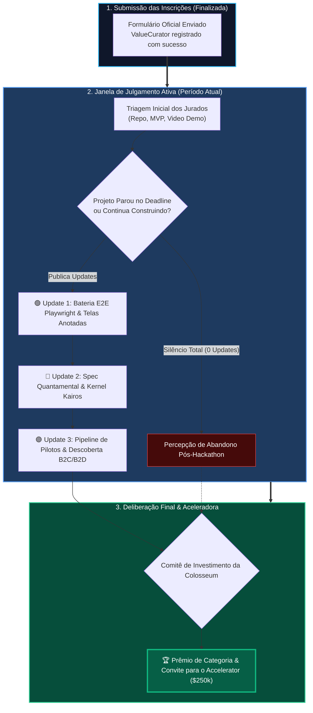

# 🚀 ValueCurator: Guia Estratégico de Post-Submission Updates na Colosseum

> **Colosseum Crypto World's Fair 2026 — Período de Julgamento & Avaliação de Bancas**  
> *Projeto Avaliado*: **ValueCurator (`value-curator`)**  
> *Status Atual*: Inscrição Submetida (`acceleratorOptIn: true`, `updatesCount: 0`)  
> *Objetivo*: Maximizar as chances de premiação e seleção para o **Colosseum Accelerator ($250k investment)** através de *Project Updates* estratégicos postados durante a janela ativa de julgamento  
> *Padrão*: Outline com Emojis, Filosofemas, Formalismos Simbólicos, Diagramas Mermaid Coloridos, Recomendações do Colosseum Copilot e Sugestões Táticas Originais

---

## 📑 Sumário Executivo

* 🧬 **§1. Filosofemas & Formalismos Simbólicos do Momentum Pós-Submissão**
* 📊 **§2. Diagramas Mermaid Coloridos (Ciclo de Julgamento da Colosseum & Impacto dos Updates)**
* 🔍 **§3. Diagnóstico Atual do Projeto no Colosseum Copilot (`GET /me`)**
  * 🎯 3.1. Pontos Fortes já Registrados na Submissão
  * ⚠️ 3.2. As Lacunas Naturais de um MVP Pre-Traction e Como os Updates as Eliminam
* 📝 **§4. Quatro Propostas Estruturadas de Updates para a Página do Projeto**
  * 🛠️ **Update #1**: Confiabilidade & Bateria E2E Playwright com Setas e Veredito Fail-Closed
  * 🧭 **Update #2**: Evolução Arquitetural — O Kernel Kairos Neurosimbólico & Abordagem Quantamental
  * 👥 **Update #3**: Validação de Mercado — Pipeline de Descoberta com Usuários (B2C & B2D)
  * 🎬 **Update #4**: Demonstração Técnica Audiovisual Sincronizada (Pitch de 2m50s)
* 💡 **§5. Recomendações e Sugestões Táticas Originais (Voz Própria do Fundador)**
* 🏁 **§6. Cronograma Sugerido de Publicação & Rastreabilidade**

---

## 🧬 §1. Filosofemas & Formalismos Simbólicos do Momentum Pós-Submissão

### 📜 Filosofemas da Trajetória Contínua

* 🜁 **Filosofema da Prova de Vida Algorítmica (*The Proof of Ongoing Momentum*)**:
  > *«Para a banca examinadora e os gestores de investimento da Colosseum, o prazo de submissão não é a linha de chegada; é o primeiro ponto de corte. Centenas de projetos abandonam seus repositórios no segundo seguinte ao envio do formulário. Apenas os fundadores de elite continuam commitando, testando, documentando e publicando atualizações enquanto os jurados leem. O update pós-submissão não é um pedido de desculpas pelo que faltou; é o testemunho irrevogável de que o projeto existirá, com ou sem o prêmio do hackathon.»*

* 🜂 **Filosofema da Redução da Assimetria de Incerteza (*The Bayesian Update*)**:
  > *«A mente do jurado é um estimador bayesiano sob escassez de tempo. Diante da declaração de um projeto "pre-traction", a probabilidade inicial de sucesso é moderada. Cada novo update com evidências tangíveis — transações verificadas na Devnet, baterias completas de testes automatizados e entrevistas de validação — atua como uma nova evidência que recalibra as probabilidades a favor da equipe.»*

---

### 🔣 Formalismo Simbólico da Função de Impacto do Update

A pontuação fiduciária atribuída pelos jurados $\mathcal{S}_{\text{judging}}$ é modelada como a soma da avaliação basal da submissão com a série temporal de atualizações postadas durante a janela de julgamento $[T_{\text{deadline}}, T_{\text{results}}]$:

$$\mathcal{S}_{\text{judging}} = \mathcal{S}_{\text{submission}} + \sum_{k=1}^{N_u} \Delta \mathcal{U}_k \cdot e^{-\lambda (T_{\text{results}} - t_k)}$$

Onde a função de impacto de cada update $\Delta \mathcal{U}_k$ satisfaz os invariantes:

$$\begin{cases}
\Delta \mathcal{U}_{\text{technical}} & = \mathbf{1}_{\text{verified}}\big(\text{Devnet Transactions} \land \text{E2E Playwright Tests}\big) \times \text{Weight}_{\text{code}} \\
\Delta \mathcal{U}_{\text{market}} & = \mathbf{1}_{\text{discovery}}\big(\text{Customer Interviews} \land \text{Pilot Pipeline}\big) \times \text{Weight}_{\text{traction}} \\
\Delta \mathcal{U}_{\text{vision}} & = \mathbf{1}_{\text{clarity}}\big(\text{Quantamental Spec} \land \text{Neurosymbolic Architecture}\big) \times \text{Weight}_{\text{defensibility}} \\
N_u & \in [2, 4] \quad (\text{Cadência Ótima de 2 a 4 Updates Relevantes})
\end{cases}$$

---

## 📊 §2. Diagramas Mermaid Coloridos

### 🔄 Diagrama 1: O Funil de Avaliação da Colosseum & o Papel dos Updates



---

### ⏱️ Diagrama 2: Linha Temporal Estratégica dos Updates Pós-Submissão

```mermaid
flowchart LR
    D0["Deadline Encerrado<br/>(Inscrições Finalizadas)"] --> U1["Update 1 (Imediato)<br/>E2E Test Suite & Devnet Proof"]
    U1 --> U2["Update 2 (+2 dias)<br/>Quantamental & Neurosymbolic Spec"]
    U2 --> U3["Update 3 (+4 dias)<br/>Pilots Pipeline & Discovery"]
    U3 --> U4["Update 4 (Reta Final)<br/>Video Walkthrough & Pitch Deck"]
    U4 --> Fin["Anúncio de Vencedores<br/>Colosseum 2026"]

    style D0 fill:#0f172a,stroke:#64748b,stroke-width:2px,color:#fff
    style U1 fill:#064e3b,stroke:#34d399,stroke-width:2px,color:#fff
    style U2 fill:#1e3a5f,stroke:#60a5fa,stroke-width:2px,color:#fff
    style U3 fill:#3b0764,stroke:#c084fc,stroke-width:2px,color:#fff
    style U4 fill:#78350f,stroke:#f59e0b,stroke-width:2px,color:#fff
    style Fin fill:#0f172a,stroke:#38bdf8,stroke-width:2px,color:#fff
```



---

## 🔍 §3. Diagnóstico Atual do Projeto no Colosseum Copilot (`GET /me`)

Ao consultar a API v2 da Colosseum (`GET /me`) com os dados autenticados da conta, obtivemos a seguinte radiografia:

```
========================================================================================================
ESTADO ATUAL DO PROJETO NA BASE OFICIAL DA COLOSSEUM
========================================================================================================
Projeto:                ValueCurator (slug: value-curator)
Repositório Conectado:  https://github.com/smp-sandramariapereira/valuecurator
Equipe Registrada:      João (ITA / PhD Neurociência UFMG) & Sandra Pereira (BSc / MSc PUC Minas)
Accelerator Opt-In:     SIM (true) — Elegível para investimento de $250k
Status de Updates:      0 updates publicados (updates: [])
Ecossistema / Cadeias:  Solana (Anchor, Token-2022, PDAs, Pyth Pro, Jupiter, Devnet)
========================================================================================================
```

### 🎯 3.1. Pontos Fortes já Registrados na Submissão
1. **Credenciais Técnicas da Equipe:** Formação de peso em engenharia da computação (ITA) e neurociência (UFMG), combinada com ciência da computação e modelagem preditiva espacial com publicações Springer (Sandra).
2. **Separação Constitucional Clara:** O formulário articula com extrema precisão a tese de que *«autonomia operacional não pode significar soberania sobre o capital»* e que o ValueCurator não é mais um bot de trading, mas uma **camada de autorização determinística**.
3. **Opt-in para a Aceleradora:** O projeto declarou interesse formal e preencheu todos os campos corporativos e de investimento da Colosseum.

### ⚠️ 3.2. As Lacunas Naturais de um MVP Pre-Traction e Como os Updates as Eliminam
* Na submissão, a equipe declarou com muita honestidade:
  > *«ValueCurator has a functional MVP but is currently pre-traction, with no production customers or commercial revenue. (...) Our next step is to validate the problem through structured interviews and pilot integrations with asset managers, tokenization platforms, treasury operators, and financial agent developers.»*
* **A oportunidade de ouro:** Se o projeto deixar o campo `updates: []` zerado, os jurados presumirão que a fase de descoberta ainda não começou. **Se postarmos updates demonstrando o avanço nos testes e na arquitetura, transformamos a promessa do formulário em execução viva.**

---

## 📝 §4. Quatro Propostas Estruturadas de Updates para a Página do Projeto

> ⚠️ **Nota de Integridade do Colosseum Copilot:**  
> *Os jurados da Colosseum valorizam a autenticidade e a voz própria dos fundadores. Utilize as estruturas, tópicos e evidências abaixo como roteiro e adapte os textos finais para as suas próprias palavras antes de postar no portal.*

---

### 🛠️ Proposta de Update #1: Confiabilidade & Bateria E2E Playwright com Setas e Veredito Fail-Closed

* 🎯 **Objetivo:** Provar solidez de engenharia e mostrar que a interface e o portão foram testados ponta a ponta sem falhas.
* 🏷️ **Título Sugerido:** `Milestone: 100% Deterministic E2E Verification & Interactive Walkthrough Suite`
* 📌 **Estrutura & Tópicos a Abordar no Update:**
  * **O que foi feito:** Execução de uma bateria automatizada completa de testes End-to-End via Playwright cobrindo todos os fluxos críticos da aplicação (`www.valuecurator.xyz`).
  * **Cenários Cobertos:**
    1. *Safe proposal:* Validação de conformidade e emissão de recibo assinado em Ed25519.
    2. *Stale oracle (>300s):* Rejeição determinística e bloqueio instantâneo do cofre (*Fail-Closed*).
    3. *Price divergence (>20%):* Escudo protetivo contra arbitragem tóxica e slippage anômalo.
    4. *On-Chain Audit:* Visualização das instruções confirmadas na Solana Devnet (`metabolize_yield`).
  * **Evidência Visual:** Disponibilização de um relatório com capturas de tela anotadas com retículos de mira e setas direcionais, demonstrando cada clique executado pelo autômato.
  * **Link / Prova:** Referenciar o relatório técnico no repositório GitHub (`PLAYWRIGHT_ANNOTATED_E2E_REPORT.md` e PDF vetorial).

---

### 🧭 Proposta de Update #2: Evolução Arquitetural — O Kernel Kairos Neurosimbólico & Abordagem Quantamental

* 🎯 **Objetivo:** Mostrar profundidade teórica defensável, posicionando o projeto na fronteira da Econofísica e da IA de segunda ordem (evitando ser rotulado como simples "wrapper" de bot).
* 🏷️ **Título Sugerido:** `Architecture Update: Advancing the KAIROS Engine to a Quantamental & Neurosymbolic Kernel`
* 📌 **Estrutura & Tópicos a Abordar no Update:**
  * **O Paradigma Quantamental:** Explicar como o ValueCurator cruza microestrutura técnica de mercado (preço institucional e incerteza $\sigma$ do Pyth Feed 922 da Mainnet, quotes da Jupiter DEX) com fundamentos constitucionais fiduciários (mandato do proprietário, teto de risco de $500 USDC, RWA AAPLx).
  * **A Separação Neurosimbólica:** Modelos de linguagem e redes neurais são excelentes para analisar sentimentos e dados não-estruturados, mas alucinam em matemática e regras de custódia. O Kernel Kairos atua como a barreira simbólica determinística.
  * **Econofísica & Leis de Conservação:** Aplicação de conceitos de *Physics-Informed Machine Learning (PIML)* para garantir que a liquidez e o saldo do cofre respeitem a equação de continuidade ($\nabla \cdot \mathbf{J} + \partial \rho / \partial t = 0$), erradicando a probabilidade de ruína existencial.
  * **Próximos Passos de Código:** Migração dos módulos de avaliação lógica para um motor de alta velocidade em Rust nativo acoplado via N-API.

---

### 👥 Proposta de Update #3: Validação de Mercado — Pipeline de Descoberta com Usuários (B2C & B2D)

* 🎯 **Objetivo:** Cumprir a promessa do formulário de submissão sobre customer discovery e demonstrar tração conceitual com potenciais adotantes.
* 🏷️ **Título Sugerido:** `Market Discovery: Initial Feedback from DAO Operators and Personal Wealth Curators`
* 📌 **Estrutura & Tópicos a Abordar no Update:**
  * **Diálogos de Descoberta:** Relatar o início de conversas e entrevistas estruturadas com operadores de tesouraria de DAOs e desenvolvedores de agentes autônomos de trading.
  * **Validação do Problema:** Confirmar que a maior preocupação de gestores hoje não é a falta de estratégias de trading, mas o **medo existencial de entregar chaves privadas irrestritas** para autômatos ou delegar fundos a gestores opacos.
  * **Segmentação Validada:**
    * *B2C:* Usuários individuais buscando um cofre pessoal inviolável ("pé-de-meia" sem intermediários bancários).
    * *B2D:* DAOs interessadas em mandatos de desembolso com verificação oracular automática contra ataques de flash loan e drainers.
    * *B2A:* Criadores de agentes de IA buscando uma infraestrutura de custódia segura para que terceiros confiem capital aos seus robôs.
  * **Compromisso:** Informar que os primeiros acordos de teste piloto (LOIs ou pilotos em Devnet) estão sendo mapeados para a fase de aceleração.

---

### 🎬 Proposta de Update #4: Demonstração Técnica Audiovisual Sincronizada (Pitch de 2m50s)

* 🎯 **Objetivo:** Facilitar a vida dos jurados que preferem assistir a um vídeo dinâmico do que ler páginas de documentação técnica.
* 🏷️ **Título Sugerido:** `Video Release: Official 2m50s Technical Tour & Voiceover Walkthrough`
* 📌 **Estrutura & Tópicos a Abordar no Update:**
  * **Lançamento do Tour em Vídeo:** Apresentação da demonstração técnica audiovisual completa de 2 minutos e 50 segundos (~170s), sincronizada milissegundo a milissegundo com a locução em inglês sintetizada via ElevenLabs.
  * **Destaques do Vídeo:**
    * Demonstração ao vivo do carregamento do Pyth Feed 922.
    * Configuração de limites e cálculo do hash imutável SHA-256 no Mandate Builder.
    * Execução ao vivo dos três cenários no Portão de Políticas (Approved, Stale Blocked, Divergence Blocked).
    * Exibição das transações de custódia em PDAs no programa Anchor da Solana Devnet.
  * **Links Diretos:** Link para o vídeo no YouTube/Loom/X e link para o roteiro com SSML no repositório.

---

## 💡 §5. Recomendações e Sugestões Táticas Originais (Voz Própria do Fundador)

Como parceiro de desenvolvimento neste projeto, identifico algumas ações de altíssimo impacto imediato:

1. **Publique o Primeiro Update nas Próximas 24 Horas:**
   * Ter `updatesCount: 0` é a única fraqueza visível na página pública da Colosseum no momento. Publicar o **Update #1 (E2E Verification & Playwright Suite)** imediatamente mostra atividade profissional.
2. **Atualize o README Principal do Repositório GitHub:**
   * Garanta que o [README.md](file:///home/sukata/ip-nft/README.md) tenha links claros no topo para:
     * O dashboard ao vivo: `https://www.valuecurator.xyz`
     * O relatório ilustrado do Playwright: [`PLAYWRIGHT_ANNOTATED_E2E_REPORT.md`](file:///home/sukata/ip-nft/PLAYWRIGHT_ANNOTATED_E2E_REPORT.md)
     * A especificação quantamental: [`KERNEL_KAIROS_QUANTAMENTAL_NEUROSYMBOLIC_SPEC.md`](file:///home/sukata/ip-nft/KERNEL_KAIROS_QUANTAMENTAL_NEUROSYMBOLIC_SPEC.md)
3. **Engajamento no X (Twitter) e Marcação da Colosseum:**
   * Compartilhe um trecho curto de 30 a 60 segundos do vídeo demo ou screenshots anotados no perfil `@aquiladeeptech` (ou perfil pessoal).
   * Marque `@ColosseumOrg`, `@SuperteamBR` e utilize a hashtag `#ColosseumRadar` / `#ColosseumHackathon`.
   * Inclua o link desse tweet no corpo do update da Colosseum! Os jurados gostam de ver tração social e fundadores que comunicam seu trabalho em público.
4. **Mantenha o Tom Institucional e Sereno:**
   * Evite gírias especulativas de varejo (*"to the moon"*, *"100x gem"*). Mantenha o vocabulário fiduciário e matemático que construímos: *«invariantes determinísticos»*, *«execução fail-closed»*, *«meta-curadoria de capital»*, *«separação constitucional de autoridades»*. Isso separa o ValueCurator de 99% dos competidores.

---

## 🏁 §6. Cronograma Sugerido de Publicação & Rastreabilidade

```
========================================================================================================
CRONOGRAMA DE DISPARO DE UPDATES DURANTE O JULGAMENTO
========================================================================================================
TIMING          UPDATE PROPOSTO             TEMA PRINCIPAL                EVIDÊNCIA ANEXA
========================================================================================================
Dia 1 (Hoje)    Update #1: E2E Playwright   Confiabilidade & Testes       Screenshots com Setas + Relatório MD
Dia 3           Update #2: Arquitetura      Kernel Kairos Quantamental    Spec Neurosimbólica + PIML GNNs
Dia 5           Update #3: Customer Disc.   Entrevistas & Pilotos B2C/B2D Resumo Qualitativo de Feedback
Dia 7 (Reta)    Update #4: Video & Pitch    Walkthrough Oficial 2m50s     Link do Vídeo + Pitch Deck PDF
========================================================================================================
```

---

### 📦 Arquivos Gerados no Repositório

* 📄 **Markdown**: [COLOSSEUM_POST_SUBMISSION_UPDATES_GUIDE.md](file:///home/sukata/ip-nft/COLOSSEUM_POST_SUBMISSION_UPDATES_GUIDE.md)  
* 📕 **PDF Vetorial Editorial**: [COLOSSEUM_POST_SUBMISSION_UPDATES_GUIDE.pdf](file:///home/sukata/ip-nft/COLOSSEUM_POST_SUBMISSION_UPDATES_GUIDE.pdf)
