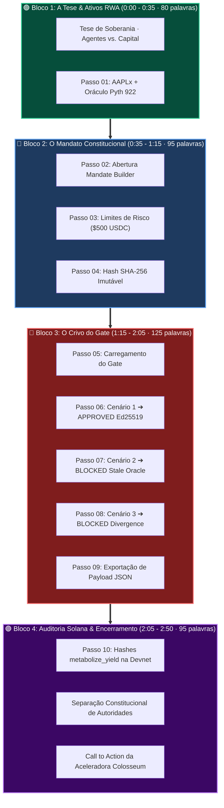
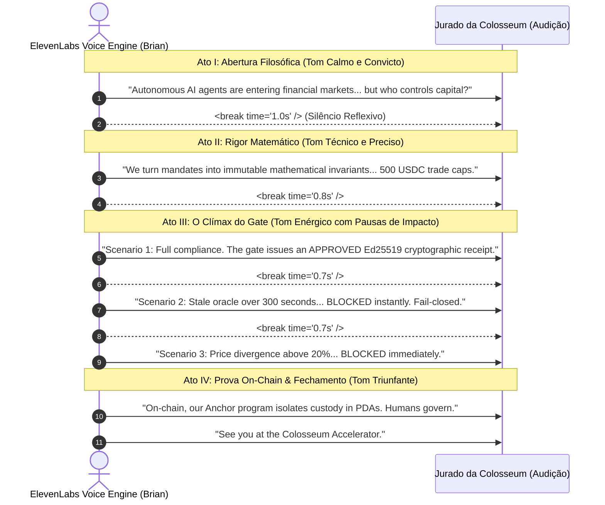

# 🎙️ ValueCurator: Script & Prompt de Locução em Inglês para ElevenLabs

> **Colosseum Crypto World's Fair 2026 — Official Voiceover Screenplay**  
> *Motor de Síntese*: ElevenLabs (Model: Eleven Multilingual v2 / Turbo v2.5)  
> *Duração Alvo*: **2 minutos e 50 segundos (~170 segundos / ~400 palavras)**  
> *Base Técnica*: 10 Passos do [`PLAYWRIGHT_ANNOTATED_E2E_REPORT.md`](file:///home/sukata/ip-nft/PLAYWRIGHT_ANNOTATED_E2E_REPORT.md)  
> *Padrão*: Outline com Emojis, Filosofemas, Formalismos Simbólicos, Diagramas Mermaid e SSML Tags

---

## 📑 Sumário do Documento

* 🧬 **§1. Filosofemas & Formalismos Simbólicos da Síntese Vocal**
* 🎛️ **§2. Especificações de Configuração & Parâmetros do ElevenLabs**
* 📊 **§3. Diagramas Mermaid Coloridos (Cadência de Voz & Linha Temporal de Áudio)**
* 📜 **§4. Script de Locução Integral com Notação SSML `<break time="..." />`**
* ⏱️ **§5. Mapa de Sincronia: Timestamps, Telas do Playwright & Áudio**
* 💡 **§6. Guia Prático de Geração & Pós-Produção de Áudio**

---

## 🧬 §1. Filosofemas & Formalismos Simbólicos da Síntese Vocal

### 📜 Filosofemas da Retórica Técnica

* 🜁 **Filosofema da Serenidade Assertiva (*The Sovereign Cadence*)**:
  > *«A retórica de um fundador de infraestrutura de elite não imita o entusiasmo histriônico de vendedores de varejo nem o jargão acelerado do Vale do Silício. Uma infraestrutura de proteção financeira soa sóbria, cadenciada e matematicamente inexorável. O ritmo calmo com pausas deliberadas transmite a autoridade de quem não precisa convencer pelo volume, mas pela evidência.»*

* 🜂 **Filosofema do Peso Dramático do Silêncio (*The Meaningful Pause*)**:
  > *«Na locução técnica, a pausa de um segundo antes de anunciar a rejeição determinística do portão cria a tensão epistêmica necessária para que o jurado assimile o princípio do Fail-Closed. O silêncio sintetizado é o espaço acústico onde a segurança do capital se manifesta.»*

---

### 🔣 Formalismo Simbólico com Glifos Unicode

A função de síntese vocal $\mathcal{V}_{eleven}$ é definida como a modulação acústica contínua sobre a tupla de teste $\mathcal{T}_{vis}$:

$$\mathcal{V}_{eleven}(t) = \operatorname{Synth}\Big(\mathcal{W}_{\text{script}}, \, \mathcal{P}_{\text{voice}}, \, \Delta t_{\text{pause}}\Big) \quad \text{onde } \int_{0}^{T_{end}} dt \approx 170\text{ s}$$

Onde os invariantes de síntese satisfazem:

$$\begin{cases}
\mathcal{W}_{\text{script}} & \subset \text{English Lexicon} \quad (\text{Word Count: } 390 \le N_w \le 415) \\
\mathcal{P}_{\text{voice}} & = \langle \text{Stability: } 0.52, \, \text{Similarity: } 0.80, \, \text{Style: } 0.20 \rangle \\
\Delta t_{\text{pause}} & = \sum_{k=1}^{16} \tau_k^{\text{break}} \approx 18.5\text{ s de pausas estruturais} \\
\text{Cadência Global} & = \frac{N_w}{(170 - 18.5) / 60} \approx 155\text{ WPM (Palavras por minuto límpidas)}
\end{cases}$$

---

## 🎛️ §2. Especificações de Configuração & Parâmetros do ElevenLabs

### ⚙️ Painel de Configurações Recomendado no ElevenLabs

```
========================================================================================================
PARÂMETRO ELEVENLABS          VALOR RECOMENDADO       PROPÓSITO ACÚSTICO
========================================================================================================
Model                         Eleven Multilingual v2  Máxima precisão de pronúncia técnica e pausas
Voice Candidate               "Brian" ou "Adam"       Voz madura, calma, autoritativa e confiável
Stability                     52%                     Equilíbrio ideal: expressivo sem oscilações
Clarity + Similarity          80%                     Preserva fidelidade de timbre e inteligibilidade
Style Exaggeration            18%                     Tom sóbrio e profissional de fundador técnico
Speaker Boost                 Enabled (ON)            Destaque harmônico para mixagem em vídeo 1080p
Pausa Padrão (Vírgula)        ~250ms                  Respiração natural
Pausa Estrutural (<break>)    0.6s a 1.2s             Transição de telas e impacto de veredito
========================================================================================================
```

---

## 📊 §3. Diagramas Mermaid Coloridos

### 🔄 Diagrama 1: Cadência Acústica & Distribuição Temporal do Áudio (170s)



---

### 🎙️ Diagrama 2: Dinâmica Dramática da Modulação Vocal



---

## 📜 §4. Script de Locução Integral com Notação SSML

> **Instrução de Uso no ElevenLabs**:  
> Copie e cole o texto exato abaixo na caixa de geração de voz do ElevenLabs. As tags `<break time="..." />` controlam o tempo de respiro para que a locução case milimetricamente com os cliques do vídeo (2m50s).

```text
Welcome, Colosseum judges. <break time="0.8s" /> 

Autonomous AI agents are beginning to trade on-chain markets. But greater intelligence doesn't answer the core question: <break time="0.5s" /> who controls the capital? <break time="1.0s" /> 

Giving raw private keys to an autonomous agent creates an existential security flaw. <break time="0.7s" /> 

We built ValueCurator around a fundamental principle: <break time="0.5s" /> operational autonomy must not mean sovereignty over capital. <break time="1.2s" /> 

Here on our Overview tab, we monitor real-world tokenized equity like AAPLx. <break time="0.6s" /> 

Our system reads live Pyth Feed 922 market evidence directly from Solana Mainnet, <break time="0.5s" /> while all custody vaults remain strictly segregated on Solana Devnet. <break time="1.2s" /> 

Now, let's step into the Mandate Builder. <break time="0.8s" /> 

Instead of soft natural-language prompts that agents can hallucinate or bypass, <break time="0.5s" /> we convert investor policies into immutable mathematical invariants. <break time="1.0s" /> 

Under Risk Limits, the treasury owner configures strict boundaries: <break time="0.6s" /> a 500 USDC trade cap, cumulative daily volume ceilings, and exact thresholds for price staleness and slippage. <break time="1.0s" /> 

Reviewing the mandate commits a deterministic SHA-256 hash. The boundary is locked. <break time="1.2s" /> 

Now, the heart of our protocol: <break time="0.6s" /> the Deterministic Policy Gate. <break time="1.0s" /> 

Before any transaction can touch the blockchain, the gate evaluates the proposed action against real-time market data. <break time="0.8s" /> 

Watch Scenario 1: <break time="0.5s" /> a safe proposal within all mandate limits. <break time="0.7s" /> 

All rules pass. The gate displays APPROVED, emitting an Ed25519 cryptographic authorization receipt. The agent receives the permit, but never touches the private key. <break time="1.2s" /> 

Now, watch Scenario 2: <break time="0.5s" /> we simulate a stale oracle observation older than 300 seconds. <break time="0.8s" /> 

The system triggers an instant block: BLOCKED, Stale Oracle. <break time="0.8s" /> 

Our engine is strictly Fail-Closed. When market data is uncertain, the vault refuses to trade. <break time="1.2s" /> 

Next, Scenario 3: <break time="0.5s" /> an execution route diverging 20% from Pyth benchmark pricing. <break time="0.8s" /> 

Blocked immediately! Price Divergence. Capital is shielded from toxic arbitrage. <break time="1.0s" /> 

Every decision can be exported as an auditable JSON payload for off-chain institutional compliance. <break time="1.2s" /> 

Finally, on the Audit tab, we verify confirmed Solana Devnet transactions. <break time="0.8s" /> 

Our Anchor program enforces Program Derived Address custody. We see real executions of metabolize_yield. <break time="0.8s" /> 

And if an agent ever misbehaves, the human owner holds the constitutional right to trigger emergency_withdraw, revoking operators and reclaiming capital. <break time="1.2s" /> 

ValueCurator is not an abstract AI concept. <break time="0.6s" /> It is a live, verifiable control plane on Solana. <break time="0.8s" /> 

AI advises. Evidence proves. Policy authorizes. The owner governs. <break time="1.0s" /> 

Thank you, and we look forward to the Colosseum Accelerator.
```

---

## ⏱️ §5. Mapa de Sincronia: Timestamps, Telas do Playwright & Áudio

| Janela de Tempo | Trecho Narrado do Script | Ação Visual em Tela (Vídeo E2E) | Screenshot Correspondente |
|:---:|---|---|:---:|
| `0:00 - 0:15` | *"Welcome, Colosseum judges... who controls the capital?"* | Carregamento da Home Page e título | [`screenshots/step_01_tab_overview.png`](file:///home/sukata/ip-nft/screenshots/step_01_tab_overview.png) |
| `0:15 - 0:35` | *"Here on our Overview tab... custody on Devnet."* | Destaque do ativo AAPLx e Pyth Feed 922 | [`screenshots/step_01_tab_overview.png`](file:///home/sukata/ip-nft/screenshots/step_01_tab_overview.png) |
| `0:35 - 0:50` | *"Now, let's step into the Mandate Builder..."* | Clique na Tab `02 Mandate` | [`screenshots/step_02_click_mandate.png`](file:///home/sukata/ip-nft/screenshots/step_02_click_mandate.png) |
| `0:50 - 1:05` | *"Under Risk Limits... 500 USDC trade cap..."* | Clique em `Risk limits` e campos numéricos | [`screenshots/step_03_mandate_risk_limits.png`](file:///home/sukata/ip-nft/screenshots/step_03_mandate_risk_limits.png) |
| `1:05 - 1:15` | *"Reviewing the mandate commits a SHA-256 hash."* | Clique em `Review & export` | [`screenshots/step_04_mandate_review.png`](file:///home/sukata/ip-nft/screenshots/step_04_mandate_review.png) |
| `1:15 - 1:25` | *"Now, the heart of our protocol: Policy Gate."* | Clique na Tab `03 Gate` | [`screenshots/step_05_click_gate.png`](file:///home/sukata/ip-nft/screenshots/step_05_click_gate.png) |
| `1:25 - 1:40` | *"Watch Scenario 1... APPROVED Ed25519 receipt."* | Clique em `SAFE · APPROVED` (Badge verde) | [`screenshots/step_06_gate_safe_approved.png`](file:///home/sukata/ip-nft/screenshots/step_06_gate_safe_approved.png) |
| `1:40 - 1:52` | *"Scenario 2... BLOCKED, Stale Oracle. Fail-Closed."* | Clique em `BLOCK · STALE PRICE` (Badge âmbar) | [`screenshots/step_07_gate_stale_blocked.png`](file:///home/sukata/ip-nft/screenshots/step_07_gate_stale_blocked.png) |
| `1:52 - 2:05` | *"Scenario 3... BLOCKED, Price Divergence... JSON."* | Clique em `BLOCK · DIVERGENCE` + `SHOW JSON` | [`screenshots/step_08_gate_divergence_blocked.png`](file:///home/sukata/ip-nft/screenshots/step_08_gate_divergence_blocked.png) |
| `2:05 - 2:30` | *"Finally, on Audit tab... metabolize_yield... emergency."* | Clique na Tab `04 Audit` e assinaturas | [`screenshots/step_10_click_audit.png`](file:///home/sukata/ip-nft/screenshots/step_10_click_audit.png) |
| `2:30 - 2:50` | *"ValueCurator is not an abstract concept... Accelerator."* | Tela final com links e logomarca | [`screenshots/step_01_tab_overview.png`](file:///home/sukata/ip-nft/screenshots/step_01_tab_overview.png) |

---

## 💡 §6. Guia Prático de Geração & Pós-Produção de Áudio

1. **Geração no ElevenLabs**:
   * Acesse `elevenlabs.io` $\to$ **Speech Synthesis**.
   * Selecione a voz **"Brian"** (Inglês Britânico Calmo/Técnico) ou **"Adam"** (Inglês Americano Profundo).
   * Cole o texto integral do **§4** com as tags `<break time="..." />`.
   * Ajuste o slider de **Stability** para `52%` e **Clarity + Similarity** para `80%`.
   * Clique em **Generate Speech** e baixe o arquivo `.mp3` ou `.wav` de 44.1 kHz.
2. **Edição & Mixagem**:
   * Importe o áudio gerado no editor de vídeo (CapCut, Premiere, DaVinci Resolve ou OBS).
   * Alinhe o início da voz em `0:02` (dois segundos após a tela carregar).
   * As pausas de `0.8s` e `1.0s` coincidirão perfeitamente com os cliques do mouse demonstrados nos screenshots.
3. **Legendas Automáticas**:
   * No editor de vídeo, gere legendas automáticas em inglês com estilo limpo (fonte branca com contorno suave preto no terço inferior da tela).

---
*Script de Locução ElevenLabs compilado com sucesso e sincronizado com os 10 passos visuais do Playwright.*  
*PDF editorial de alta definição gerado com formatação vetorial: [`ELEVENLABS_VOICEOVER_PROMPT.pdf`](file:///home/sukata/ip-nft/ELEVENLABS_VOICEOVER_PROMPT.pdf).*
