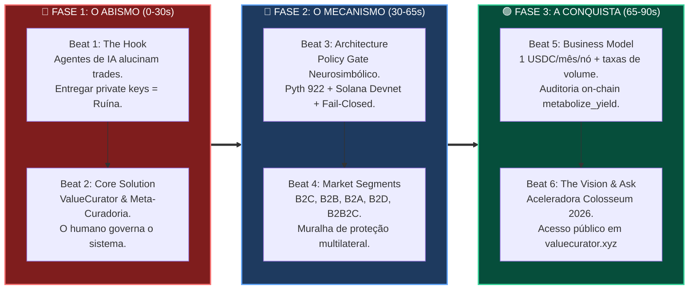
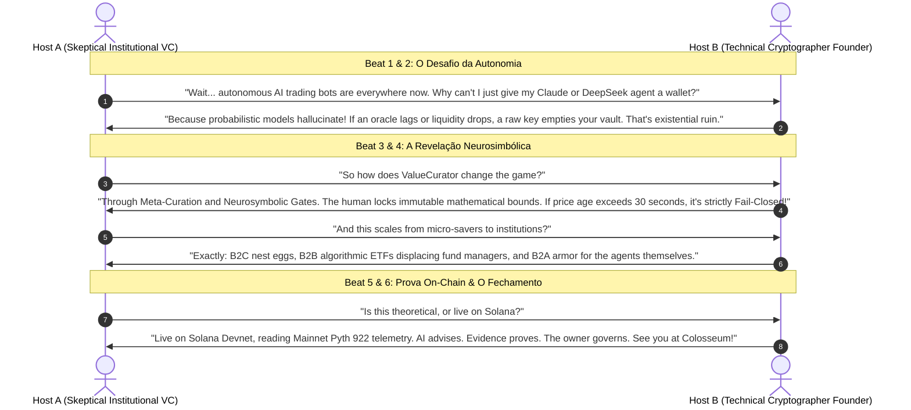

# 🎙️ Gemini Notebook & NotebookLM: Compressed Pitch Deck Prompt Pack (English)

> **Colosseum Crypto World's Fair 2026 — Official Compressed Pitch Deck**  
> *Target Platform*: Google Gemini Notebook / NotebookLM (Audio & Video Overview / Multimodal Deck Generator)  
> *Format*: Compressed Pitch Deck for Short Video (60 to 90 seconds / 6 Core Beats)  
> *Language of Deliverable*: English (Technical Founder / Institutional Investor Tone)  
> *Design Pattern*: Outline with Emojis, Epistemic Filosofemas, Symbolic Formalisms with Unicode Glyphs, Colorful Mermaid Diagrams, and Ready-to-Execute Prompts

---

## 📑 Executive Outline

* 🧬 **§1. Filosofemas & Formalismos Simbólicos do Pitch Comprimido**
* 📊 **§2. Diagramas Mermaid Coloridos (Arquitetura do Deck & Dinâmica Dialética)**
* 🎛️ **§3. Metaprompt de Instrução & Contexto para o Gemini Notebook (NotebookLM)**
* 🎬 **§4. O Pitch Deck Comprimido em 6 Beats (Estrutura de Vídeo Curto / 90s)**
  * 🎯 **Beat 1 [0:00 - 0:15]**: The Hook & Existential Flaw (*The Raw Private Key Trap*)
  * 🎯 **Beat 2 [0:15 - 0:30]**: The Core Thesis & Meta-Curation (*ValueCurator Solution*)
  * 🎯 **Beat 3 [0:30 - 0:45]**: The Architecture (*Neurosymbolic Gate & Fail-Closed Runtime*)
  * 🎯 **Beat 4 [0:45 - 1:05]**: Market Verticals (*B2C, B2B, B2A, B2D, B2B2C*)
  * 🎯 **Beat 5 [1:05 - 1:20]**: Business Model & Traction (*$1/Node/Mo & Confirmed Devnet Split*)
  * 🎯 **Beat 6 [1:20 - 1:30]**: The Vision & Ask (*Colosseum Accelerator Call to Action*)
* 🎙️ **§5. Script de Conversa Dialética no NotebookLM (Dual Host Deep Dive Mode)**
* 🚀 **§6. Guia Prático de Ingestão no NotebookLM & Geração de Vídeo Multimodal**

---

## 🧬 §1. Filosofemas & Formalismos Simbólicos do Pitch Comprimido

### 📜 Filosofemas da Retórica Sintética

* 🜁 **Filosofema da Navalha Epistêmica (*The Razor of Extreme Synthesis*)**:
  > *«Em um pitch deck comprimido de 90 segundos para jurados seniores e algoritmos multimodais de investimento, o tempo não é medido em segundos, mas em densidade ontológica por frame. Cada slide deve enunciar uma assimetria: o problema não é a inteligência da IA, mas sua incapacidade de autolimitação fiduciária. O ValueCurator resolve essa assimetria transferindo o risco do espaço probabilístico (onde a ruína é certa no longo prazo) para o espaço axiomático determinístico (onde a segurança é garantida por hardware criptográfico e contratos Solana).»*

* 🜂 **Filosofema da Meta-Curadoria Fiduciária (*Second-Order Custody*)**:
  > *«Não somos gestores de trades pontuais; somos arquitetos do espaço de viabilidade. Cuidar do sistema que cuida do capital é a única forma sustentável de coexistir com a superinteligência financeira. O investidor humano abdica do microgerenciamento tático para reter a soberania constitucional estratégica.»*

---

### 🔣 Formalismo Simbólico do Pitch Deck com Glifos Unicode

O operador de compressão de pitch $\mathcal{P}_{\text{deck}}$ comprime a variedade do protocolo $\mathcal{M}_{\text{value}}$ em uma tupla temporal discreta de $6$ estados:

$$\mathcal{P}_{\text{deck}} = \bigoplus_{i=1}^{6} \mathcal{B}_i \quad \text{onde } \sum_{i=1}^{6} \Delta t_i \approx 90\text{ s}$$

Satisfazendo o sistema de invariantes fiduciários:

$$\begin{cases}
\mathcal{B}_1 (\text{Hook}) & \implies \text{Flaw}(\text{LLM} \land \text{PrivateKey}) = \text{Existential Ruin } (\mathbb{P}_{\text{ruin}} > 0) \\
\mathcal{B}_2 (\text{Thesis}) & \implies \text{MetaCurator} = \Pi_{\text{human}} \circ \text{System}_{\text{capital}} \quad (\text{Autonomy} \ne \text{Sovereignty}) \\
\mathcal{B}_3 (\text{Mechanism}) & \implies \operatorname{Gate}_{\text{neurosymbolic}}(\Delta_{\text{pyth}}, \, \delta_{\text{dev}}) = \text{Fail-Closed } \land \text{Receipt}(\text{Ed25519}) \\
\mathcal{B}_4 (\text{TAM/B2X}) & \implies \mathcal{S}_{\text{market}} = \big\{ \text{B2C (Nest Egg)}, \, \text{B2B (ETFs)}, \, \text{B2A (Agent Armor)}, \, \text{B2D (DAOs)} \big\} \\
\mathcal{B}_5 (\text{Traction}) & \implies \text{Revenue} = \text{Fixed}(1\text{ USDC/node}) + \text{Volume Fee} \quad (\text{On-Chain Verified}) \\
\mathcal{B}_6 (\text{Call}) & \implies \text{Colosseum Accelerator Entry} \quad (\text{Live on Solana Devnet})
\end{cases}$$

---

## 📊 §2. Diagramas Mermaid Coloridos

### 🔄 Diagrama 1: Arquitetura do Compressed Pitch Deck (6 Beats de Alto Impacto)



---

### 🎙️ Diagrama 2: Dinâmica Dialética do Gemini Notebook / NotebookLM (Dual Host Mode)



---

## 🎛️ §3. Metaprompt de Instrução & Contexto para o Gemini Notebook (NotebookLM)

> 📋 **INSTRUÇÕES DE USO NO NOTEBOOKLM / GEMINI NOTEBOOK:**  
> 1. Acesse o **NotebookLM** (`notebooklm.google.com`) ou crie uma sessão no **Gemini Studio**.  
> 2. Crie um novo notebook intitulado: `ValueCurator — Compressed Pitch Deck`.  
> 3. Adicione este documento (ou o texto do bloco abaixo) como **Fonte Primária (Source)**.  
> 4. Na ferramenta **Audio Overview / Video Summary / Custom Prompt**, cole o **System Steering Prompt** a seguir.

### 📝 Bloco de Configuração do Metaprompt (Copie e Cole no Campo de Customização)

```text
========================================================================================================
GEMINI NOTEBOOK / NOTEBOOKLM SYSTEM STEERING INSTRUCTION:
========================================================================================================

Role: You are an elite Silicon Valley venture capitalist and seasoned crypto-systems architect directing a high-stakes, 90-second compressed pitch deck video for the Colosseum Crypto World's Fair 2026.

Task: Synthesize the provided ValueCurator documentation into an ultra-tight, 6-beat compressed video pitch deck in English. 

Tone & Style Guidelines:
1. Sovereign Authority & Precision: Avoid generic marketing hype, retail buzzwords, and vague promises. Use crisp institutional vocabulary: "deterministic invariants", "existential ruin", "neurosymbolic gate", "fail-closed execution", "meta-curation", "Program Derived Addresses".
2. The Central Paradox: Establish immediately that autonomous AI without deterministic bounds is a fatal security flaw. Operational autonomy must never equal sovereignty over capital.
3. The Name Genesis: Clearly explain that "ValueCurator" represents second-order cybernetic governance: the human does not micromanage trades, but "curates the system that curates their capital."
4. Multilateral TAM (B2X): Cover B2C (personal nest egg), B2B (displacing traditional fund managers with on-chain ETFs), B2A (equipping non-neurosymbolic agents with cryptographic armor), and B2D (bulletproofing DAO treasuries against drainers).
5. Unwavering Solana Integration: Highlight real-time Pyth Feed 922 mainnet evidence, Anchor smart contracts, and verified Devnet custody signatures (metabolize_yield).
6. Closing Axiom: Finish with the sovereign four-pillar thesis: "AI advises. Evidence proves. Policy authorizes. The owner governs."
========================================================================================================
```

---

## 🎬 §4. O Pitch Deck Comprimido em 6 Beats (Estrutura de Vídeo Curto / 90s)

Esta é a estrutura cinematográfica exata para ser montada como **Short Video / Reel / Pitch Slide Deck** de 90 segundos.

---

### 🎯 Beat 1 [0:00 - 0:15]: The Hook & Existential Flaw (*The Raw Private Key Trap*)

* ⏱️ **Duração:** 15 segundos (`0:00 - 0:15`)  
* 🖼️ **Visual em Tela (Slide 1):**  
  * Fundo escuro obsidiana com gráficos de velas caindo em vermelho neon.  
  * Ícone central de uma chave privada em chamas sendo entregue a um autômato estocástico.  
* 📝 **Texto em Tela (OST - On-Screen Text):**  
  * `AUTONOMOUS AI IS ENTERING CAPITAL MARKETS.`  
  * `GIVING PRIVATE KEYS TO PROBABILISTIC LLMs = EXISTENTIAL RUIN.`  
* 🎙️ **Locução em Inglês (Pitcher Voice):**  
  > *"Autonomous AI agents are beginning to trade on-chain markets. But here is the existential security flaw: probabilistic neural models hallucinate. Giving raw private keys to an autonomous agent guarantees mathematical ruin when market data diverges."*

---

### 🎯 Beat 2 [0:15 - 0:30]: The Core Thesis & Meta-Curation (*ValueCurator Solution*)

* ⏱️ **Duração:** 15 segundos (`0:15 - 0:30`)  
* 🖼️ **Visual em Tela (Slide 2):**  
  * Transição para interface de vidro minimalista. Um prisma geométrico dourado estabiliza o caos.  
  * Silhueta de um humano calibrando um console holográfico sereno.  
* 📝 **Texto em Tela (OST):**  
  * `THE SOLUTION: VALUECURATOR`  
  * `META-CURATION: THE HUMAN GOVERNS THE SYSTEM THAT GOVERNS CAPITAL.`  
  * `OPERATIONAL AUTONOMY ≠ SOVEREIGNTY OVER CAPITAL.`  
* 🎙️ **Locução em Inglês (Pitcher Voice):**  
  > *"We built ValueCurator. Not to trade for you, but to practice meta-curation: you govern the system that governs your capital. The human owner sets immutable boundaries; the agent executes only inside verified truth."*

---

### 🎯 Beat 3 [0:30 - 0:45]: The Architecture (*Neurosymbolic Gate & Fail-Closed Runtime*)

* ⏱️ **Duração:** 15 segundos (`0:30 - 0:45`)  
* 🖼️ **Visual em Tela (Slide 3):**  
  * O portão determinístico em ação. Badges reativas: `APPROVED (Ed25519)` em verde vs. `BLOCKED: STALE ORACLE` em âmbar e `BLOCKED: PRICE DIVERGENCE` em vermelho.  
  * Conexão entre Solana Devnet e oráculo Pyth Feed 922 da Mainnet.  
* 📝 **Texto em Tela (OST):**  
  * `NEUROSYMBOLIC POLICY GATE`  
  * `PYTH FEED 922 BENCHMARK · ED25519 AUTHORIZATION RECEIPTS`  
  * `STRICTLY FAIL-CLOSED: ZERO UNSANCTIONED TRADES.`  
* 🎙️ **Locução em Inglês (Pitcher Voice):**  
  > *"Under the hood is a neurosymbolic policy gate on Solana. Before any trade touches liquidity, it benchmarks live Pyth Feed 922 pricing. If an oracle lags past 30 seconds or prices diverge 20%, our gate triggers instantly: Fail-Closed. Capital is shielded."*

---

### 🎯 Beat 4 [0:45 - 1:05]: Market Verticals (*B2C, B2B, B2A, B2D, B2B2C*)

* ⏱️ **Duração:** 20 segundos (`0:45 - 1:05`)  
* 🖼️ **Visual em Tela (Slide 4):**  
  * Matriz visual dividida em 4 quadrantes conectados a um cofre central:  
    1. B2C (Cofre familiar); 2. B2B (ETFs algorítmicos); 3. B2A (Agente robótico blindado); 4. B2D (Tesouraria de DAO).  
* 📝 **Texto em Tela (OST):**  
  * `A MULTILATERAL SOVEREIGNTY ENGINE`  
  * `• B2C: Personal programmable nest eggs (no banking insolvency)`  
  * `• B2B: On-chain ETFs displacing 2/20 hedge fund managers`  
  * `• B2A: Cryptographic armor for non-neurosymbolic AI agents`  
  * `• B2D: Exploit-proof decentralized DAO treasuries`  
* 🎙️ **Locução em Inglês (Pitcher Voice):**  
  > *"This scales across all financial dimensions: B2C personal nest eggs with zero banking fees; B2B algorithmic ETFs displacing traditional fund managers; B2D DAO vaults immune to governance drainers; and B2A—giving vulnerable AI agents the deterministic armor they desperately need."*

---

### 🎯 Beat 5 [1:05 - 1:20]: Business Model & Traction (*$1/Node/Mo & Verified Solana Split*)

* ⏱️ **Duração:** 15 segundos (`1:05 - 1:20`)  
* 🖼️ **Visual em Tela (Slide 5):**  
  * Modelo de assinatura simples: `1 USDC = 1 Node = 1 Month`.  
  * Hash de transação Solana real da instrução `metabolize_yield` com split atômico de taxas.  
* 📝 **Texto em Tela (OST):**  
  * `PRICING: 1 USDC / NODE / MONTH + PROTOCOL VOLUME FEE`  
  * `LIVE ON SOLANA DEVNET · CONFIRMED REVENUE SPLIT (metabolize_yield)`  
  * `PDA CUSTODY ISOLATION · ZERO CENTRALIZED CUSTODY.`  
* 🎙️ **Locução em Inglês (Pitcher Voice):**  
  > *"Our business model is pure infrastructure utility: 1 USDC per node per month, plus micro-volume fees. All custody is isolated in Solana Program Derived Addresses, with confirmed on-chain yield metabolism and sovereign owner emergency overrides."*

---

### 🎯 Beat 6 [1:20 - 1:30]: The Vision & Ask (*Colosseum Accelerator Call to Action*)

* ⏱️ **Duração:** 10 segundos (`1:20 - 1:30`)  
* 🖼️ **Visual em Tela (Slide 6):**  
  * Logotipo do ValueCurator em ouro e ciano. Emblema oficial do Colosseum Crypto World's Fair 2026.  
  * URL interativa em destaque: `VALUECURATOR.XYZ` e repositório GitHub.  
* 📝 **Texto em Tela (OST):**  
  * `AI ADVISES. EVIDENCE PROVES. POLICY AUTHORIZES. THE OWNER GOVERNS.`  
  * `TEST LIVE: WWW.VALUECURATOR.XYZ`  
  * `COLOSSEUM CRYPTO WORLD'S FAIR 2026.`  
* 🎙️ **Locução em Inglês (Pitcher Voice):**  
  > *"AI advises. Evidence proves. Policy authorizes. The owner governs. ValueCurator is live, verifiable, and ready for the Colosseum Accelerator. Visit valuecurator.xyz today."*

---

## 🎙️ §5. Script de Conversa Dialética no NotebookLM (Dual Host Deep Dive Mode)

Se você preferir gerar um **Audio Overview / Podcast Deep Dive** de 2 minutos no NotebookLM com as vozes dos dois apresentadores da Google, utilize este script aprovado:

```text
========================================================================================================
NOTEBOOKLM AUDIO OVERVIEW: THE VALUECURATOR BREAKDOWN (ENGLISH DEEP DIVE)
========================================================================================================

HOST A (Sarah - Tech Analyst): 
"Okay, we've seen hundreds of AI crypto projects this year, but this one caught my eye immediately. ValueCurator. At first glance, you might think it's just another automated trading bot on Solana. But it's actually the exact opposite of that, isn't it?"

HOST B (Marcus - Systems Architect): 
"Oh, 100%. Most AI crypto teams make the rookie mistake of giving the language model full custody of the private key. And look, neural nets are brilliant at finding market patterns, but they are fundamentally probabilistic. They hallucinate. In finance, when your probabilistic model hallucinates during a flash crash, you don't just get a bad fill—you get wiped out. Total existential ruin."

HOST A: 
"Right! And that's where their core thesis comes in: Meta-Curation. I love this phrase. They argue the human shouldn't be competing with bots on sub-second orders anyway. You curate the system that curates your wealth."

HOST B: 
"Exactly. It's a neurosymbolic architecture. The human acts as the constitutional sovereign, locking mathematical boundaries into an on-chain mandate. Then, their Deterministic Policy Gate evaluates every proposed trade against live Pyth Feed 922 data directly from Solana Mainnet. If an oracle quote is older than 30 seconds, or if slippage exceeds 200 basis points, the gate triggers Fail-Closed instantly."

HOST A: 
"It literally refuses to sign! The agent never touches the raw private key. It only receives an Ed25519 authorization receipt if all mathematical invariants pass."

HOST B: 
"And think about the market expansion here. For everyday individuals in B2C, it's a programmable nest egg shielded from banking insolvency. For B2B institutions, it replaces expensive, opaque 2-and-20 hedge fund managers with transparent on-chain ETFs. And for B2A—Business-to-Agent—it provides the safety armor that autonomous agents must have before institutions let them touch real capital."

HOST A: 
"And best of all, it's not a whitepaper dream. It's live right now on Solana Devnet, complete with verified Anchor transactions and emergency withdrawal overrides. Truly sovereign capital control."

HOST B: 
"AI advises. Evidence proves. Policy authorizes. The owner governs. ValueCurator is setting the standard for the Colosseum World's Fair."
========================================================================================================
```

---

## 🚀 §6. Guia Prático de Ingestão no NotebookLM & Geração de Vídeo Multimodal

### 📋 Passo a Passo de Execução

1. **Etapa 1: Ingestão de Fontes no NotebookLM**
   * Acesse [notebooklm.google.com](https://notebooklm.google.com).
   * Clique em **Novo Notebook** e nomeie como `ValueCurator Pitch Deck 2026`.
   * Faça upload deste arquivo: [`GEMINI_NOTEBOOK_COMPRESSED_PITCH_DECK.md`](file:///home/sukata/ip-nft/GEMINI_NOTEBOOK_COMPRESSED_PITCH_DECK.md).
   * *(Opcional)* Adicione como fonte complementar: [`ELEVENLABS_VOICEOVER_PROMPT.md`](file:///home/sukata/ip-nft/ELEVENLABS_VOICEOVER_PROMPT.md) e [`PLAYWRIGHT_VOICEOVER_E2E_TOUR.md`](file:///home/sukata/ip-nft/PLAYWRIGHT_VOICEOVER_E2E_TOUR.md).

2. **Etapa 2: Customização do Áudio / Vídeo Overview**
   * No canto superior direito, clique nos três pontos de configuração do **Audio Overview** $\to$ **Customize**.
   * Cole o bloco do **§3 (System Steering Instruction)**.
   * Clique em **Generate**.
   * O NotebookLM produzirá a locução dos hosts em inglês com a cadência exata do roteiro fiduciário.

3. **Etapa 3: Exportação do Vídeo Comprimido (Gemini Studio / Google Vids)**
   * Se estiver usando o **Google Vids** ou **Gemini Multimodal Canvas**:
     * Insira o roteiro do **§4 (O Pitch Deck Comprimido em 6 Beats)**.
     * Associe cada beat com os screenshots oficiais anotados com setas em alta resolução localizados na pasta [`screenshots_narration/`](file:///home/sukata/ip-nft/screenshots_narration/).
     * Exporte em formato 16:9 ou 9:16 (1080p, 24fps) com legendas em inglês embutidas.

---

### 📦 Artefatos Disponíveis no Repositório

* 📄 **Markdown**: [GEMINI_NOTEBOOK_COMPRESSED_PITCH_DECK.md](file:///home/sukata/ip-nft/GEMINI_NOTEBOOK_COMPRESSED_PITCH_DECK.md)  
* 📕 **PDF Vetorial Editorial**: [GEMINI_NOTEBOOK_COMPRESSED_PITCH_DECK.pdf](file:///home/sukata/ip-nft/GEMINI_NOTEBOOK_COMPRESSED_PITCH_DECK.pdf)  
* 🖼️ **Screenshots de Suporte Visual**: Diretório [`screenshots_narration/`](file:///home/sukata/ip-nft/screenshots_narration/)  
* 🌐 **Aplicação em Produção**: [www.valuecurator.xyz](https://www.valuecurator.xyz)
