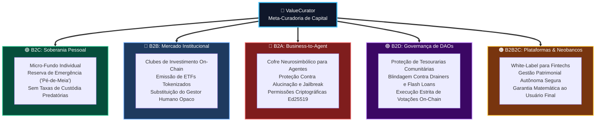

# 🌊 Google Labs Flow: Metaprompt de Steering Prompts & Extensões Sequenciais

> **Projeto:** ValueCurator — Deterministic Capital Control Plane  
> **Plataforma de Vídeo:** Google Labs Flow / Veo 2 / VideoFX  
> **Técnica de Geração:** *Steering Prompts Iterativos via Extensão de Último Frame* (Frame-to-Frame Latent Conditioning)  
> **Tema Central:** A falha existencial da IA puramente probabilística vs. A Meta-Curadoria Humana de Capital e o Paradigma Neurosimbólico (B2C, B2B, B2A, B2D, B2B2C)  
> **Padrão:** Outline com Emojis, Filosofemas, Formalismos Simbólicos, Diagramas Mermaid Coloridos e Prompt Pack Executável

---

## 📑 Sumário do Roteiro de Steering

* 🧬 **§1. Filosofemas & Formalismos Simbólicos da Meta-Curadoria e do Risco de Ruína**
* 🔍 **§2. Análise Crítica, Correções Epistemológicas & Refinamentos do Metaprompt**
* 📊 **§3. Diagramas Mermaid Coloridos (Pipeline de Steering & Arquitetura de Mercado)**
* 🎛️ **§4. Especificações Técnicas de Configuração no Google Labs Flow**
* 🎬 **§5. O Prompt Pack Sequencial: 7 Clipes com Continuidade Estrita de Frames**
  * 📽️ **Clip 01**: O Abismo da IA Desgovernada & O Risco de Ruína (*The Stochastic Abyss*)
  * 📽️ **Clip 02**: A Fronteira Neurosimbólica & O Portão Fail-Closed (*The Axiomatic Shield*)
  * 📽️ **Clip 03**: A Gênese de "ValueCurator" — Meta-Curadoria de 2ª Ordem (*The Sovereign Architect*)
  * 📽️ **Clip 04**: Micro-Soberania B2C & Tesourarias Descentralizadas B2D (*From Nest Egg to DAO Vaults*)
  * 📽️ **Clip 05**: Deslocamento Institucional B2B & Distribuição B2B2C (*The Death of the Fund Manager*)
  * 📽️ **Clip 06**: O Paradigma B2A — O Cérebro Simbólico dos Agentes (*The Agent's Mathematical Armor*)
  * 📽️ **Clip 07**: Epílogo: Eliminação da Barreira Absorvente & Chamada Colosseum (*Zero-Probability Ruin*)
* 🛠️ **§6. Guia Prático de Execução no Flow & Solução de Drift Latente**

---

## 🧬 §1. Filosofemas & Formalismos Simbólicos da Meta-Curadoria e do Risco de Ruína

### 📜 Filosofemas da Soberania de Segunda Ordem

* 🜁 **Filosofema da Meta-Curadoria (*The Cybernetic Governor*)**:
  > *«O erro primitivo da automação financeira foi imaginar que o investidor humano deveria continuar competindo em velocidade com o algoritmo. O ser humano não é um trader de milissegundos; o ser humano é o legislador ontológico. A "Meta-Curadoria" é a arte de cuidar do sistema que cuida do capital: não escolher a cotação de cada segundo, mas esculpir a fronteira geométrica de onde o robô jamais poderá escapar. Curadoria não é gestão de ativos; é a preservação de sentido e soberania sobre os meios de produção algorítmicos.»*

* 🜂 **Filosofema da Barreira Absorvente (*The Existential Absorbent Barrier*)**:
  > *«No mercado financeiro, a morte não é um conceito metafísico: é a insolvência definitiva. O risco existencial não é a volatilidade passageira nem o drawdown temporário de um portfólio; é a probabilidade não-nula de atingir zero. Uma IA desprovida de limites simbólicos e governada por modelos estocásticos inevitavelmente encontrará a cauda longa da ruína. O método determinístico é a única muralha que torna a probabilidade de aniquilação estritamente nula ($\mathbb{P}(\text{Ruin}) \equiv 0$).»*

---

### 🔣 Formalismo Simbólico com Glifos Unicode

Definimos o processo de geração e governança através da álgebra tensorial do controle neurosimbólico:

$$\mathcal{G}_{\text{flow}}(t) = \bigoplus_{k=1}^{7} \operatorname{Extend}\Big(\mathcal{F}_{\text{last}}(k-1), \, \mathcal{P}_{\text{steer}}(k), \, \sigma_{\text{seed}}\Big)$$

Onde a meta-curadoria de capital $\mathcal{M}_{\text{curator}}$ e a segurança contra ruína obedecem ao sistema de invariantes:

$$\begin{cases}
\Omega_{\text{ruin}} & = \left\{ \mathbf{x} \in \mathbb{R}^n \mid \mathcal{V}_{\text{capital}}(\mathbf{x}) \le \text{Threshold}_{\text{min}} \right\} \implies \mathbb{P}\big(\mathbf{x}(t) \in \Omega_{\text{ruin}}\big) = 0 \\
\mathcal{M}_{\text{curator}} & = \langle \text{Human Policy } \Pi_{\text{owner}} \circ \text{Deterministic Gate } \mathcal{D}_{\text{solana}} \circ \text{Stochastic Agent } \mathcal{A}_{\text{AI}} \rangle \\
\mathcal{S}_{\text{B2X}} & = \Big\{ \text{B2C (Reserva)}, \, \text{B2B (ETFs/Fundos)}, \, \text{B2A (Supervisão Simbólica)}, \, \text{B2D (DAOs)}, \, \text{B2B2C (Neobancos)} \Big\} \\
\mathcal{F}_{\text{last}}(k) & \equiv \mathcal{F}_{\text{first}}(k+1) \quad (\text{Preservação Estrita da Continuidade Óptica})
\end{cases}$$

---

## 🔍 §2. Análise Crítica, Correções Epistemológicas & Refinamentos do Metaprompt

Ao construir um metaprompt para geração de vídeo com IA generativa (Google Labs Flow / Veo), certos deslizes conceituais e tentações narrativas precisam ser corrigidos preventivamente:

### ⚠️ 1. A Falácia da "IA Todo-Poderosa" vs. O Papel Real do Neurosimbolismo
* ❌ *Equívoco Comum:* Apresentar a IA como um oráculo místico que prevê o futuro com perfeição se receber mais dados.
* ✅ *Correção:* Modelos conexionistas (redes neurais, LLMs, RL) são calculadores probabilísticos de gradiente. Eles **não compreendem causalidade jurídica nem mandatos fiduciários**. O ValueCurator não afirma ter uma IA "mágica"; ele fornece o **computador simbólico de guarda** (*deterministic runtime guard*) que rejeita propostas alucinadas antes que elas toquem o capital.

### ⚠️ 2. Refinamento do Conceito B2A (Business-to-Agent)
* ❌ *Equívoco Comum:* Achar que B2A significa simplesmente "robôs comprando tokens uns dos outros sem supervisão".
* ✅ *Correção:* A maioria esmagadora dos agentes do mercado (ELIZA, AutoGPT, Virtuals, LangChain bots) é **não-neurosimbólica** — são caixas-pretas conexionistas sujeitas a *jailbreaks*, manipulação de contexto e arbitragem adversária tóxica. O paradigma B2A do ValueCurator é o fornecimento de uma **infraestrutura constitucional de governança para agentes**: ele equipa o agente com uma "carteira inteligente com freio determinístico", permitindo que instituições contratem agentes sem temer a autodestruição do patrimônio.

### ⚠️ 3. O Verdadeiro Sentido do "Risco Existencial" no Mercado
* ❌ *Equívoco Comum:* Tratar risco existencial como medo abstrato de ficção científica (ex.: Skynet financeira).
* ✅ *Correção:* No mercado financeiro, risco existencial é o **Risco de Absorção (Teorema da Ruína do Apostador)**. Quando uma entidade quebra, ela perde o direito de jogar. Não há "respawn" de liquidez. Sem portões determinísticos, um único flash crash ou desvio oracular leva o saldo a zero. Julgamento (*appraisal*) e curadoria são atos de auto-preservação: manter a entidade viva para colher o crescimento composto secular.

### ⚠️ 4. Coerência Visual em Steering Prompts (Prevenção de Mutação Latente)
* ❌ *Equívoco Comum em Vídeo Generativo:* Mudar bruscamente o estilo artístico ou o cenário entre os clipes, gerando "piscadas", rostos mutantes e perda de identidade visual.
* ✅ *Correção de Prompt:* Fixamos uma âncora semântica visual unificada em todos os clipes:
  * **Elemento Invariante:** Um *Prisma Criptográfico Geométrico de Luz Dourada e Azul Cobalto* (a representação visual do Mandato Constitucional).
  * **Estética Cinematográfica:** Cinema anamórfico 35mm, iluminação claroscuro sóbria, hiper-realismo de ficção científica institucional (influência estética de *Severance*, *Ex Machina* e *Blade Runner 2049*).
  * **Transição Estrita:** Todo clipe $k+1$ inicia declarando explicitamente a leitura do último frame do clipe $k$.

---

## 📊 §3. Diagramas Mermaid Coloridos

### 🔄 Diagrama 1: Pipeline de Steering Prompts & Condicionamento de Frames

```mermaid
flowchart LR
    subgraph C1["📽️ Clip 01 (0-6s)"]
        direction TB
        P1["Prompt: O Abismo Estocástico"]
        F1_end["Frame Final: Parede de Luz Geométrica"]
        P1 --> F1_end
    end

    subgraph C2["📽️ Clip 02 (6-12s)"]
        direction TB
        P2["Steering: O Escudo Simbólico"]
        F2_end["Frame Final: Prisma Translúcido Estabilizado"]
        P2 --> F2_end
    end

    subgraph C3["📽️ Clip 03 (12-18s)"]
        direction TB
        P3["Steering: O Humano Meta-Curador"]
        F3_end["Frame Final: O Prisma se Ramifica em 4 Feixes"]
        P3 --> F3_end
    end

    subgraph C4["📽️ Clip 04 (18-24s)"]
        direction TB
        P4["Steering: B2C Pé-de-Meia & B2D DAOs"]
        F4_end["Frame Final: Elevação para Skyline Institucional"]
        P4 --> F4_end
    end

    subgraph C5["📽️ Clip 05 (24-30s)"]
        direction TB
        P5["Steering: B2B ETFs & B2B2C Neobancos"]
        F5_end["Frame Final: Conexão a Frotas de Agentes IA"]
        P5 --> F5_end
    end

    subgraph C6["📽️ Clip 06 (30-36s)"]
        direction TB
        P6["Steering: O Paradigma B2A Neurosimbólico"]
        F6_end["Frame Final: Vista Orbital da Rede Solana"]
        P6 --> F6_end
    end

    subgraph C7["📽️ Clip 07 (36-42s)"]
        direction TB
        P7["Steering: Eliminação do Risco de Ruína"]
        F7_end["Frame Final: Logo ValueCurator & Colosseum"]
        P7 --> F7_end
    end

    F1_end ==>|Input Frame 01| C2
    F2_end ==>|Input Frame 01| C3
    F3_end ==>|Input Frame 01| C4
    F4_end ==>|Input Frame 01| C5
    F5_end ==>|Input Frame 01| C6
    F6_end ==>|Input Frame 01| C7

    style C1 fill:#1f2937,stroke:#ef4444,stroke-width:2px,color:#fff
    style C2 fill:#1e3a5f,stroke:#3b82f6,stroke-width:2px,color:#fff
    style C3 fill:#064e3b,stroke:#10b981,stroke-width:2px,color:#fff
    style C4 fill:#451a03,stroke:#f59e0b,stroke-width:2px,color:#fff
    style C5 fill:#3b0764,stroke:#a855f7,stroke-width:2px,color:#fff
    style C6 fill:#0f766e,stroke:#14b8a6,stroke-width:2px,color:#fff
    style C7 fill:#0f172a,stroke:#38bdf8,stroke-width:2px,color:#fff
```



---

### 🌐 Diagrama 2: A Taxonomia Hexagonal de Mercado do ValueCurator



---

## 🎛️ §4. Especificações Técnicas de Configuração no Google Labs Flow

```
========================================================================================================
PARÂMETRO NO FLOW / VEO 2     VALOR RECOMENDADO       JUSTIFICATIVA TÉCNICA
========================================================================================================
Base Model                    Veo 2 (High-Fidelity)   Melhor aderência semântica e física temporal
Aspect Ratio                  16:9 (1920x1080)        Padrão cinematográfico de vídeo institucional
Frame Rate (FPS)              24 fps                  Cadência cinematográfica natural
Motion Bucket / Strength      45 (Moderado)           Evita aberrações morphing nas transições de frame
Color Space                   Rec.709 Cinematic Log   Tratamento de cor rico, tons profundos e alto contraste
Estilo Visual Constante       Anamorphic Sci-Fi Noir  Iluminação de fenda, reflexos azuis e bronze metálico
Extensão de Frame             Last Frame Conditioning O frame de saída do clipe N é a entrada do clipe N+1
Duração por Clipe             6 segundos (~144 frames)Tamanho ideal para manter coerência sem deformações
Duração Total Montada         42 segundos (7 clipes)  Ritmo impactante de teaser técnico para hackathon
========================================================================================================
```

---

## 🎬 §5. O Prompt Pack Sequencial: 7 Clipes com Continuidade Estrita de Frames

> 💡 **Como Executar no Google Labs Flow / VideoFX:**  
> 1. Gere o **Clip 01** como Text-to-Video usando o prompt abaixo.  
> 2. Salve o **último frame exato** do Clip 01.  
> 3. No **Clip 02**, selecione **Image-to-Video**, carregue esse último frame como imagem inicial e cole o Steering Prompt do Clip 02.  
> 4. Repita esse procedimento rigorosamente até o **Clip 07**.

---

### 📽️ Clip 01: O Abismo da IA Desgovernada & O Risco de Ruína (*The Stochastic Abyss*)

* ⏱️ **Timestamp:** `0:00 - 0:06` (Duração: 6s)  
* 🎯 **Objetivo Epistêmico:** Mostrar visualmente o colapso dos modelos puramente conexionistas sem regras simbólicas — a sensação vertiginosa de perda de capital e ruína existencial.  
* 🖼️ **Frame Inicial:** Geração a partir de texto (Seed Zero).  
* 📝 **Prompt de Geração no Google Labs Flow (Text-to-Video)**:

```text
Cinematic 35mm anamorphic wide shot. Deep dark obsidian digital void. Swarms of glowing red and amber chaotic code streams and erratic neural network synapses pulsing erratically. Holographic candlestick stock charts glitching and cascading downwards into an infinite abyss. Smoke and micro-fractures in the digital space symbolizing financial liquidation and catastrophic capital collapse. Camera slowly pushes forward through the chaotic financial turbulence. Suddenly, in the distance, a colossal, tranquil crystalline geometric barrier made of golden laser filaments and deep blue light manifests, halting the turbulence dead in its tracks. Volumetric god rays, high-end sci-fi realism, 8k, photorealistic textures, moody cinematic lighting, 24fps.
```

* 🏁 **Visual do Frame Final (Handover para o Clip 02)**:
  > A câmera para exatamente a 3 metros da grande parede geométrica translúcida de filamentos dourados e azuis, onde o caos avermelhado se dissipa totalmente ao tocar a barreira.
* 🎙️ **Locução / Narração de Acompanhamento**:
  > *"When probabilistic AI trades on-chain without symbolic boundaries, hallucination doesn't just lose money—it triggers existential ruin. One blind trade, and capital ceases to exist."*

---

### 📽️ Clip 02: A Fronteira Neurosimbólica & O Portão Fail-Closed (*The Axiomatic Shield*)

* ⏱️ **Timestamp:** `0:06 - 0:12` (Duração: 6s)  
* 🎯 **Objetivo Epistêmico:** Demonstrar o poder dos invariantes matemáticos: o código estocástico é detido pelo portão determinístico que nunca falha aberto (*Fail-Closed*).  
* 🖼️ **Frame Inicial:** **ÚLTIMO FRAME DO CLIP 01** (A parede geométrica dourada e azul vista de perto).  
* 📝 **Steering Prompt no Google Labs Flow (Image-to-Video)**:

```text
Continuous camera move extending smoothly from the previous frame. Camera maintains exact position facing the geometric golden and blue laser barrier. The barrier begins to fold inward into an intricate, pristine floating cryptographic polyhedron prism. Glowing mathematical equations, SHA-256 hashes, and Ed25519 cryptographic symbols shimmer across the facet edges of the prism. In the background, waves of red chaotic code surge forward to penetrate the prism, but are instantly deflected and dissolved into cold white sparks with absolute deterministic finality. The camera slowly dollies around the floating prism, revealing a serene, clean glass control sanctum beyond it. Ultra-crisp architectural lines, hyper-realistic reflections, subsurface scattering on glass facets, cinematic teal and gold grade, 24fps.
```

* 🏁 **Visual do Frame Final (Handover para o Clip 03)**:
  > A câmera contorna o prisma poliédrico flutuante e revela o interior de uma sala de comando minimalista de vidro fosco, com uma estação holográfica central.
* 🎙️ **Locução / Narração de Acompanhamento**:
  > *"Enter the neurosymbolic paradigm. Mathematical invariants don't negotiate. When market data is corrupted, the policy gate is fail-closed. Capital remains untouchable."*

---

### 📽️ Clip 03: A Gênese de "ValueCurator" — Meta-Curadoria de 2ª Ordem (*The Sovereign Architect*)

* ⏱️ **Timestamp:** `0:12 - 0:18` (Duração: 6s)  
* 🎯 **Objetivo Epistêmico:** Revelar por que a solução se chama **ValueCurator**: o humano não opera o micro-trade; o humano cura e esculpe as regras do sistema que cuida do seu capital.  
* 🖼️ **Frame Inicial:** **ÚLTIMO FRAME DO CLIP 02** (A visão do santuário minimalista com o console holográfico).  
* 📝 **Steering Prompt no Google Labs Flow (Image-to-Video)**:

```text
Continuing seamlessly from the previous frame in the minimalist glass control sanctum. An elegant human silhouette in an immaculate tailored coat stands before the floating holographic console. The human's hand makes a subtle, calm gesture in mid-air. The glowing golden cryptographic prism expands and calibrates smoothly to the human's command, locking in strict risk boundaries and volume limits. No hectic trading screens—only high-order architectural governance. The human is not micromanaging trades; the human is curating the sovereign operating laws of capital. The word 'ValueCurator' subtly pulses in refined luminescent typography above the console. Camera smoothly pedestals up and pulls back, revealing four distinct harmonic beams of light projecting outwards from the prism. Cinematic lighting, photorealistic human hands and fabric textures, quiet authority, 24fps.
```

* 🏁 **Visual do Frame Final (Handover para o Clip 04)**:
  > O prisma no centro emite quatro feixes de luz direcionados para quatro portais na câmara: um feixe verde esmeralda, um feixe azul safira, um feixe carmesim e um feixe violeta.
* 🎙️ **Locução / Narração de Acompanhamento**:
  > *"This is ValueCurator. You don't fight market noise—you practice meta-curation: governing the autonomous system that protects your wealth."*

---

### 📽️ Clip 04: Micro-Soberania B2C & Tesourarias Descentralizadas B2D (*From Nest Egg to DAO Vaults*)

* ⏱️ **Timestamp:** `0:18 - 0:24` (Duração: 6s)  
* 🎯 **Objetivo Epistêmico:** Demonstrar a aplicação democrática: do cidadão comum guardando sua reserva de vida (*B2C*) até a comunidade protegendo a tesouraria de uma DAO (*B2D*).  
* 🖼️ **Frame Inicial:** **ÚLTIMO FRAME DO CLIP 03** (Os quatro feixes de luz saindo do prisma central).  
* 📝 **Steering Prompt no Google Labs Flow (Image-to-Video)**:

```text
Continuing seamlessly from the previous frame. Camera sweeps along the first two beams of light. The green beam flows into a warm, intimate domestic sanctuary where a personal glowing biometric vault rests on a wooden desk, symbolizing individual financial freedom, family savings, and personal micro-reserves shielded from bank insolvency. Seamless whip-pan along the violet beam into a massive futuristic circular governance chamber: a decentralized DAO assembly where floating cryptographic ballots lock a colossal multi-million treasury vault behind immutable on-chain spending mandates, immune to drainer exploits. Camera tilts smoothly upwards through the glass dome of the chamber toward an expansive urban horizon. Photorealistic architectural contrast, rich atmospheric lighting, cinematic lens flare, 24fps.
```

* 🏁 **Visual do Frame Final (Handover para o Clip 05)**:
  > A câmera atravessa a cúpula transparente da câmara de governança da DAO e emerge contemplando um horizonte de torres financeiras hipermodernas conectadas por vias aéreas de dados luminosos.
* 🎙️ **Locução / Narração de Acompanhamento**:
  > *"From personal nest eggs guarded without banking intermediaries in B2C, to multi-million DAO treasuries bulletproofed against exploit drainers in B2D."*

---

### 📽️ Clip 05: Deslocamento Institucional B2B & Distribuição B2B2C (*The Death of the Fund Manager*)

* ⏱️ **Timestamp:** `0:24 - 0:30` (Duração: 6s)  
* 🎯 **Objetivo Epistêmico:** Expor a substituição de intermediários tradicionais e fundos opacos por ETFs programáveis e neobancos com garantias matemáticas transparentes.  
* 🖼️ **Frame Inicial:** **ÚLTIMO FRAME DO CLIP 04** (A visão aérea dos arranha-céus institucionais conectados por redes de luz).  
* 📝 **Steering Prompt no Google Labs Flow (Image-to-Video)**:

```text
Continuing seamlessly from the previous urban skyline. Camera dives down toward a transparent institutional glass trading floor. Inside, outdated opaque fund manager desks dissolve into thin air, replaced by pristine automated algorithmic nodes rebalancing tokenized equity baskets and on-chain ETFs with sub-second transparency. Golden streams of micro-settlements flow directly to digital banking mobile interfaces held by consumers around the world, representing institutional B2B asset clubs and seamless B2B2C fintech distribution with mathematical integrity. Camera glides past a massive holographic server bank where dozens of autonomous robotic trading agent nodes are docking into place. Sleek corporate futurism, anamorphic bokeh, reflections on polished marble and structural glass, 24fps.
```

* 🏁 **Visual do Frame Final (Handover para o Clip 06)**:
  > A câmera foca em um cluster de agentes robóticos autônomos de alta velocidade cujos núcleos de processamento se conectam diretamente a encaixes dourados com o selo criptográfico do ValueCurator.
* 🎙️ **Locução / Narração de Acompanhamento**:
  > *"In B2B, transparent algorithmic ETFs displace opaque fund managers. In B2B2C, fintechs deliver automated wealth with verifiable mathematical certainty."*

---

### 📽️ Clip 06: O Paradigma B2A — O Cérebro Simbólico dos Agentes (*The Agent's Mathematical Armor*)

* ⏱️ **Timestamp:** `0:30 - 0:36` (Duração: 6s)  
* 🎯 **Objetivo Epistêmico:** O clímax tecnológico do B2A (Business-to-Agent): como o ValueCurator veste agentes de IA existentes com uma "armadura matemática", impedindo desvios estocásticos.  
* 🖼️ **Frame Inicial:** **ÚLTIMO FRAME DO CLIP 05** (O cluster de agentes robóticos autônomos se acoplando aos encaixes dourados).  
* 📝 **Steering Prompt no Google Labs Flow (Image-to-Video)**:

```text
Continuing seamlessly from the previous frame. Extreme close-up on the chest and neural core of an autonomous AI trading agent. The agent's chest plate snaps shut, locking an armored golden Ed25519 cryptographic gate over its neural processor. As the agent's eyes glow with rapid computation, mathematical equations orbit its silhouette like a celestial shield. The agent trades at the speed of light across decentralized books, but every proposed transaction is verified in under two milliseconds by the invariant policy runtime. It can never overspend; it can never drift. The camera performs a rapid, exhilarating backward zoom, lifting out of the facility, over the skyline, and ascending high into the stratosphere overlooking Earth. Cosmic scale, photorealistic cybernetic textures, dramatic lighting, 24fps.
```

* 🏁 **Visual do Frame Final (Handover para o Clip 07)**:
  > A câmera está na órbita da Terra, vendo continentes iluminados por redes de dados azuis e douradas da blockchain Solana.
* 🎙️ **Locução / Narração de Acompanhamento**:
  > *"In B2A, we equip probabilistic AI agents with neurosymbolic armor. Agents explore the market at lightning speed, but our gate holds the keys."*

---

### 📽️ Clip 07: Epílogo: Eliminação da Barreira Absorvente & Chamada Colosseum (*Zero-Probability Ruin*)

* ⏱️ **Timestamp:** `0:36 - 0:42` (Duração: 6s)  
* 🎯 **Objetivo Epistêmico:** Conclusão triunfante: a erradicação da probabilidade de falência, a soberania eterna do proprietário e a convocação para a Aceleradora Colosseum.  
* 🖼️ **Frame Inicial:** **ÚLTIMO FRAME DO CLIP 06** (A vista orbital da Terra com as rotas de dados da Solana conectadas).  
* 📝 **Steering Prompt no Google Labs Flow (Image-to-Video)**:

```text
Continuing seamlessly from the orbital view. The glowing data routes across the planet converge into a stunning, majestic geometric constellation forming the official insignia of ValueCurator. Below the insignia, three crystalline orbital monoliths align in perfect harmony, inscribed with: 'AI Advises. Evidence Proves. Policy Authorizes. The Owner Governs.' Deep space backdrop with nebulae and gentle starlight. The text 'COLOSSEUM 2026 · VALUECURATOR.XYZ' reveals itself in pristine, luminescent gold and cyan typography. Camera gently settles into a majestic, stable composition. Epic cinematic lighting, inspiring technological triumph, 8k resolution, immaculate color depth, 24fps.
```

* 🏁 **Visual do Frame Final (Encerramento do Teaser)**:
  > Enquadramento final estático e imponente com o logotipo do ValueCurator, o lema constitucional de 4 pilares e os links de acesso da submissão do Colosseum.
* 🎙️ **Locução / Narração de Acompanhamento**:
  > *"Zero-probability ruin. True economic appraisal. AI advises. Evidence proves. Policy authorizes. The owner governs. ValueCurator at the Colosseum World's Fair."*

---

## 🛠️ §6. Guia Prático de Execução no Flow & Solução de Drift Latente

### 📋 Checklist Passo a Passo de Operação

```
[ ] 1. ACESSO: Abra o Google Labs (Flow / VideoFX / Veo 2).
[ ] 2. SEED CLIP: Cole o prompt do Clip 01 em Text-to-Video com Aspect Ratio 16:9.
[ ] 3. EXPORTAÇÃO DE FRAME: Pause no frame 144 (último frame) e salve como PNG de alta resolução.
[ ] 4. MODALIDADE EXTENSÃO: Mude a ferramenta para Image-to-Video e insira a imagem salva.
[ ] 5. STEERING PROMPT: Cole o prompt do Clip 02. Garanta que o Motion Bucket esteja entre 40 e 50.
[ ] 6. REPETIÇÃO EM CADEIA: Repita o processo sequencialmente do Clip 02 até o Clip 07.
[ ] 7. MONTAGEM FINAL: Importe os 7 clipes no seu editor (Premiere, DaVinci ou CapCut).
[ ] 8. ÁUDIO ELEVENLABS: Sincronize a faixa de locução com as transições de corte exatas de 6 segundos.
```

### 🛡️ Tratamento de Possíveis Anomalias de Latência (Drift)

* **Problema:** O modelo distorce o rosto humano ou o prisma entre clipes.
  * *Solução:* Mantenha no prompt de extensão as mesmas palavras-chave descritoras de materialidade: `"floating cryptographic polyhedron prism"`, `"golden laser filaments"`, `"cinematic 35mm anamorphic"`.
* **Problema:** Movimento de câmera excessivamente rápido ou oscilante.
  * *Solução:* Use termos direcionais explícitos: `"camera slowly dollies"`, `"continuous camera move extending smoothly"`, `"camera gently settles"`.
* **Problema:** Cores saturadas demais em relação ao clipe anterior.
  * *Solução:* Insira no final de cada prompt o descritor de colorimetria: `"cinematic teal and gold grade, moody lighting, Rec.709 log"`.

---

*Metaprompt de Steering Prompts do Google Labs Flow compilado com sucesso para a arquitetura soberana do ValueCurator.*
