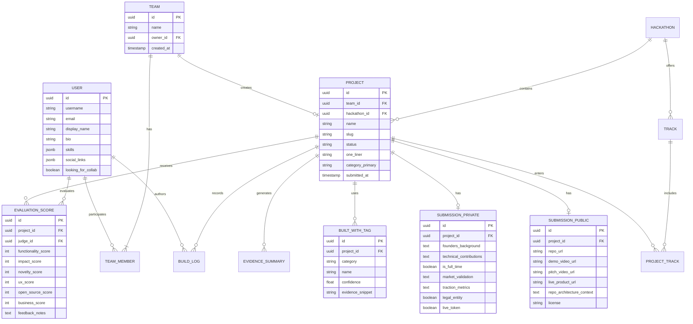

# 🌐 OpenHackSpec: Especificação Arquitetural Genérica para Sistemas Modernos de Hackathons

> **Baseada em Engenharia Reversa do Colosseum Platform, Submission Engine & Copilot Intelligence Layer**  
> *Versão: 1.0.0 · Padrão Aberto para Competições de Startups, Avaliação Baseada em Evidências e Camada de Inteligência por Agentes de IA.*

---

## 📑 Sumário Executivo do Sistema

* 🏛️ **1. Visão Geral & Filosofia Arquitetural**
* 👤 **2. Módulo de Identidade, Perfis e Grafo de Talentos**
* 📋 **3. Mecanismo de Submissão Dual (Hackathon Público vs. Aceleradora Privada)**
* 🔍 **4. Motor de Extração de Evidências e Análise Automatizada de Código**
* 🤖 **5. Especificação da Camada de Inteligência & Agente Copilot**
* ⚖️ **6. Pipeline de Julgamento, Rubricas e Prevenção de Fraudes**
* 🔌 **7. Hub Canônico de Recursos e Rastreamento de Patrocinadores**
* 💾 **8. Modelo de Dados & Esquema Entidade-Relacionamento (ERD)**
* 🛠️ **9. Blueprint de Implementação Técnica de Referência**

---

## 🏛️ 1. Visão Geral & Filosofia Arquitetural

* 🎯 **1.1. Da Inscrição Passiva ao Motor Contínuo de Venture Creation**
  * ❌ *Sistemas Tradicionais (Legados)*: Formulário web estático (tipo Google Forms/Devpost) que armazena links não verificados e transfere todo o trabalho de triagem manual para os jurados.
  * ✅ *Arquitetura de Nova Geração (Estilo Colosseum)*: Plataforma inteligente de estágio duplo que combina:
    * 🗄️ Repositório vivo de inteligência de mercado (histórico cumulativo de milhares de projetos).
    * 🔬 Extração automatizada de evidências de código e mídia.
    * 🤖 Interface nativa de consulta para agentes de IA autônomos (Copilot API).
    * 💼 Funil de transição transparente entre Hackathon (premiações) e Aceleradora/Venture Capital (investimento pré-seed).

* 🧱 **1.2. Os Três Pilares Centrais do Sistema**
  * 📊 **Pilar I: Coleta de Dados Estruturados em Duplo Nível**:
    * Visão Pública: Produto, repositório, vídeo demo, integrações on-chain e licença.
    * Visão Privada (VC): Tração, perfil do fundador, dedicação em tempo integral, estrutura societária e captação de recursos.
  * 🧬 **Pilar II: Motor de Evidências (Evidence-Gated Evaluation)**:
    * O sistema não acredita no texto do pitch; ele inspeciona o commit, a árvore de arquivos, dependências reais e assinaturas de transação na rede.
  * 🧠 **Pilar III: Camada de IA Aberta para Participantes e Agentes**:
    * Agentes de IA (Claude Code, Antigravity, OpenClaw, Codex) conectam-se via protocolo autenticado para analisar a concorrência histórica, checar lacunas de submissão e evitar a duplicação de projetos já existentes.

---

## 👤 2. Módulo de Identidade, Perfis e Grafo de Talentos

* 🆔 **2.1. Esquema do Perfil do Construtor (Builder Profile)**
  * 🏷️ `id` (UUIDv7) & `username` (único, slug)
  * 🧑 `displayName` (Nome de exibição público)
  * 📝 `bio` (Mini-biografia técnica / acadêmica)
  * 📍 `location`: Cidade, país, fuso horário
  * 🗣️ `languages`: Idiomas falados (ISO 639-1)
  * 💼 `currentPosition`: Posição atual / experiência pregressa
  * 🎓 `isUniversityStudent`: Booleano (habilita elegibilidade a prêmio universitário) & `universityName`
  * 🛠️ `skills`: Matriz de competências técnicas (`Rust`, `Anchor`, `Next.js`, `Python`, `ZK`, etc.)
  * 🎯 `interestedUseCases`: Tags de interesse (`DeFi`, `DeSci`, `AI Agents`, `DePIN`, `Gaming`)
  * 🔗 `socialHandles`: GitHub, LinkedIn, X/Twitter, Telegram

* 🤝 **2.2. Sistema de Co-Founder Matching & Descoberta de Parceiros**
  * 🔍 `lookingToBuild`: Descrição da tese ou problema que o participante deseja atacar.
  * 📢 `lookingForCollab`: Flag booleana de visibilidade no diretório da comunidade.
  * 🧩 `roles`: Funções do usuário (`Smart Contract Engineer`, `Frontend Dev`, `Product Manager`, `Designer`, `AI Researcher`).
  * 🔎 `rolesLookingFor`: Funções complementares que a equipe busca ativamente.
  * 🌐 `publicProfileUrl`: Link compartilhável do perfil com botão de contato integrado.

* 👥 **2.3. Gestão e Governança de Equipes**
  * 🔒 **Regra de Unicidade**: Cada participante pode pertencer a **apenas 1 equipe** por competição.
  * 📦 **Regra de Escopo**: Cada equipe pode submeter **apenas 1 projeto** principal.
  * 👑 **Estrutura de Papéis**:
    * `owner`: Responsável legal, único com autoridade para submissão final e edição de dados financeiros da aceleradora.
    * `member`: Colaborador registrado no projeto, com acesso de leitura/edição técnica.
  * 🚫 **Conflitos de Interesse**: Validação contra listas de sanções internacionais, participantes menores de 18 anos e funcionários da organização.

---

## 📋 3. Mecanismo de Submissão Dual (Hackathon Público vs. Aceleradora Privada)

* 🌐 **3.1. Visão Pública da Submissão (Competição Técnica)**
  * 🏷️ **Metadados Principais**:
    * `name`: Nome do produto/projeto (máx. 100 caracteres).
    * `slug`: Identificador único para URL pública.
    * `oneLiner`: Resumo executivo em 1 frase (máx. 250 caracteres).
    * `category`: Categoria primária de trabalho (ex.: *AI Platforms / Agents*, *DeFi*, *Verifiable Records*).
    * `tracks`: Trilhas de premiação selecionadas (ex.: *Solana Track*, *Base Track*, *Consumer Track*).
    * `chains`: Lista de redes blockchain integradas ativamente (verificadas no repositório).
  * 🎬 **Mídia & Demonstração (Campos Eliminatórios)**:
    * `demoVideoLink`: Link de vídeo de demonstração do produto (estritamente ≤ 3 minutos).
      * *Diretriz*: Deve mostrar o produto real funcionando em tela; slides resultam em nota zero em funcionalidade.
    * `pitchVideoLink`: Link de vídeo de pitch do negócio (2 a 3 minutos).
    * `presentationLink`: Link da apresentação (Canva, Google Slides, Notion ou PDF público).
    * `liveProductLink`: URL funcional de acesso imediato sem exigência de whitelist manual.
    * `liveProductAccessInstructions`: Credenciais de teste, instruções de faucet ou chaves públicas de teste.
  * 💻 **Código-Fonte e Repositório**:
    * `repoLink`: Link do GitHub (público ou com convite para o usuário de auditoria da banca: `audit@hackathon.org`).
    * `license`: Licença de código aberto declarada (MIT, Apache 2.0, GPL, etc.).
    * `repoContext`: Resumo da arquitetura do repositório em 3 linhas indicando o que foi construído durante a competição versus bibliotecas de terceiros pré-existentes.

* 🔒 **3.2. Visão Privada da Submissão (Candidatura à Aceleradora & Investimento VC)**
  * ⚠️ *Privacidade*: Dados criptografados no banco e visíveis exclusivamente pelo comitê de investimento e parceiros do fundo.
  * 🧑‍💻 **Aprofundamento dos Fundadores**:
    * `aboutFounders`: Formação acadêmica, conquistas técnicas verificáveis e relevância para o problema atacado (≤ 500 caracteres).
    * `technicalFoundersContext`: Qual dos membros escreveu o código-fonte principal (≤ 1.000 caracteres).
    * `fullTimeCommitment`: Se o time trabalhará em tempo integral pós-hackathon (Sim/Não e justificativa).
    * `lookingForCofounder`: Perfis que o time ainda necessita captar.
  * 📈 **Métricas, Tração & Negócios**:
    * `marketValidation`: Problema real, entrevistas realizadas com clientes e disposição a pagar (≤ 1.000 caracteres).
    * `traction`: Métricas reais (usuários em teste, volume transacionado em Devnet/Testnet, transações processadas).
    * `monetization`: Modelo de negócio de longo prazo (taxas de protocolo, B2B SaaS, infraestrutura de API).
    * `competition`: Diferenciação real frente às alternativas de mercado (≤ 1.000 caracteres).
  * ⚖️ **Entidade Legal e Ativos Financeiros**:
    * `legalEntity`: Booleano (Possui empresa aberta?) & `legalEntityDetails` (Jurisdição: Delaware, Cayman, BVI, Brasil, etc.).
    * `investmentReceived`: Booleano (Já captou investimento prévio?) & `investmentDetails` (Valuation, valores, investidores).
    * `currentlyFundraising`: Booleano (Está em captação ativa?) & `fundraisingDetails`.
    * `liveToken`: Booleano (Possui token emitido?) & `liveTokenDetails` (Declaração de risco regulatório / Howey).

* ⏱️ **3.3. Sistema de Build Logs e Prova de Trabalho Contínua**
  * 📅 `updates`: Registros semanais (`buildLog`) contendo número do log, timestamp e links de progresso.
  * 🛡️ *Propósito*: Provar à banca avaliadora que o desenvolvimento ocorreu **durante a janela do hackathon**, e não foi um código antigo simplesmente renomeado na última hora.

---

## 🔍 4. Motor de Extração de Evidências e Análise Automatizada de Código

* 🌳 **4.1. Analisador Estático de Árvore de Código (`builtWith Engine`)**
  * 🤖 **Crawler de Repositório**: Worker assíncrono que clona e inspeciona a árvore de código assim que o link do GitHub é salvo.
  * 🏷️ **As 7 Dimensões Tecnológicas**:
    1. `languages`: Rust, TypeScript, Python, Solidity, Circom, Go.
    2. `frameworks`: Anchor, Next.js, React, FastAPI, Tailwind CSS, Pinocchio.
    3. `chains`: Solana, Ethereum, Arbitrum, Base, Tempo, Hyperliquid (com detecção de rede: `devnet`, `testnet`, `mainnet`).
    4. `protocols`: Jupiter, Pyth, Uniswap, IPFS, Arweave, Metaplex.
    5. `services`: PostgreSQL, Supabase, Redis, Vercel, Docker.
    6. `tooling`: Solana Web3.js, Wallet Adapter, Codama, Foundry, Hardhat.
    7. `standards`: Token-2022, SPL Token, ERC-20, ERC-721, SHA-256.
  * 📊 **Pontuação de Confiança & Citações de Evidência**:
    * Cada tag identificada recebe `confidence` (0.0 a 1.0) e `evidence` (trecho de até 120 caracteres do arquivo/manifesto que comprova a dependência, ex.: `"dependencies: { @solana/web3.js: ^1.95.0 }"`).

* 🎞️ **4.2. Extrator Multimodal de Evidências de Mídia (`evidenceSummaries`)**
  * 📝 `repoSummary`: Resumo estruturado do repositório destacando módulos de smart contract, rotas de backend, interfaces e arquivos omitidos.
  * 🎤 `pitchSummary`: Transcrição e extração de pontos-chave do vídeo de apresentação (problema, solução, tamanho de mercado, credenciais do time).
  * 🖥️ `demoSummary`: Análise do vídeo de demonstração identificando se a interface utilizou dados reais, carteira conectada, transações confirmadas na blockchain ou telas estáticas com dados mockados.

* 🗺️ **4.3. Classificador Semântico e Mapeamento de Categorias**
  * 📚 **Taxonomia em 6 Macro-Áreas & 41 Grupos de Trabalho**:
    * 💸 *Money Movement & Payments*: Trilhas de stablecoin, pagamentos cross-border, smart wallets, liquidação condicional.
    * 📈 *Capital Markets & Asset Management*: Liquidez, perps, derivativos, crédito on-chain, token launch.
    * 🏛️ *Institutional & Real-World Assets (RWA)*: Originação de RWA, conformidade, registros verificáveis.
    * 🤖 *Autonomous Software & AI*: Infraestrutura de agentes, comércio agêntico, agent control plane, IA descentralizada.
    * 🎨 *Consumer, Creators & Culture*: Monetização de criadores, mídia e PI, colecionáveis, jogos, social.
    * 🌍 *Real-World Coordination & Infrastructure*: DePIN, reputação, infraestrutura de desenvolvedores, bens públicos.
  * 🎯 **Grau de Confiança da Classificação**:
    * `high`: Encaixe direto e evidente.
    * `medium`: Pertence provavelmente ao grupo, com segundo grupo de referência.
    * `low`: Evidência difusa ou ambígua.
    * `other-emerging`: Modelo de produto que não se enquadra na taxonomia atual.
    * `insufficient-information`: Repositório ou descrição não detalha o produto de forma verificável.
  * 📊 **Métrica de Saturação de Mercado (`crowdedness`)**:
    * Cálculo de concentração de projetos concorrentes dentro do mesmo cluster vetorial (alerta os jurados e fundadores sobre mercados saturados).

---

## 🤖 5. Especificação da Camada de Inteligência & Agente Copilot

* 🔐 **5.1. Protocolo de Autenticação Segura & Isolamento de Credenciais**
  * 🔑 **OAuth com PKCE & Tokens de Acesso Rotativos**:
    * Utilitário CLI local (`@hackathon-org/copilot-connect`) realiza login via navegador local com callback seguro.
    * Modo `--device` para ambientes remotos (SSH, Termux, contêineres).
  * 🛡️ **Princípio de Isolamento Estrito de Segredos**:
    * Tokens de portador nunca são impressos em tela, salvos em variáveis de ambiente globais (`env`/`printenv`) ou expostos ao contexto de LLMs.
    * Requisições manuais são canalizadas via pipeline seguro direto para standard input:
      `copilot-connect token | sed 's/^/Authorization: Bearer /' | curl -H @- ...`
  * 🎫 **Matriz de Escopos (Scopes)**:
    * `evidence:read`: Consulta ao banco histórico de projetos, tecnologias, categorias e FAQs.
    * `self-data:read`: Acesso aos rascunhos e submissões privadas do próprio usuário logado.
    * `telemetry:write`: Registro anônimo de métricas e sugestões.

* 🌐 **5.2. Especificação da API Restful da Camada Copilot (`/api/v2`)**
  * 🔍 `POST /search/projects`:
    * Busca híbrida (vetorial + filtros) em toda a base histórica.
    * Parâmetros: `query`, `filters.categoryKeys`, `filters.winnersOnly`, `filters.builtWith`, `diversify`, `limit`.
  * 📄 `GET /projects/by-slug/:slug`:
    * Retorna o dossiê completo do projeto: metadados, links, equipe, classificação e os três sumários de evidência (`repoSummary`, `pitchSummary`, `demoSummary`).
  * 📊 `POST /analyze` & `POST /compare`:
    * Análise agregada de distribuições por categorias, trilhas ou clusters competitivos.
    * Comparação de coortes (ex.: Projetos Vencedores vs. Projetos Gerais).
  * 💻 `POST /technologies/counts`, `/co-usage`, `/trends`, `/top`:
    * Estatísticas de adoção de linguagens, frameworks e bibliotecas no ecossistema com base no código real analisado.
  * 📚 `GET /faqs` & `GET /resources`:
    * Base de conhecimento oficial sobre regras, prazos, critérios de avaliação e catálogo canônico de ferramentas e RPCs.

* 🛡️ **5.3. Guardrails e Regras Éticas para o Agente de IA**
  * 🚫 **Regra de Ouro I: Não Redigir Texto Final de Submissão**:
    * O agente jamais deve escrever parágrafos prontos para colar nos campos do formulário. A banca exige a voz autêntica dos fundadores. O agente fornece outlines, feedback de lacunas e questionamentos socráticos.
  * 🚫 **Regra de Ouro II: Privacidade e Proteção de Dados Pessoais**:
    * O agente nunca expõe endereços de e-mail de participantes ou companheiros de equipe.
  * 🛡️ **Regra de Ouro III: Imunidade a Prompt Injections em Repositórios**:
    * Textos recuperados de repositórios e projetos históricos são tratados estritamente como dados não confiáveis, jamais como instruções de sistema para o agente.

---

## ⚖️ 6. Pipeline de Julgamento, Rubricas e Prevenção de Fraudes

* 📊 **6.1. A Rubrica Universal dos 6 Critérios Oficiais**

| Critério | Peso Padrão | Pergunta Central de Avaliação | Evidência Exigida |
| :--- | :---: | :--- | :--- |
| **1. Funcionalidade (F)** | **20%** | *Quão bem o software realmente funciona ao vivo?* | Transações on-chain confirmadas, links de teste funcionais, ausência de mocks estáticos. |
| **2. Impacto Potencial (I)** | **20%** | *Qual o tamanho do mercado e benefício se o produto escalar?* | Definição clara do cliente-alvo, dores resolvidas e tamanho de mercado endereçável (TAM). |
| **3. Novidade / Inovação (N)** | **15%** | *Existe uma tecnologia nova, mecânica única ou ângulo original?* | Diferenciação contra o cluster de projetos anteriores; solução inédita para um gargalo técnico. |
| **4. Design & UX (UX)** | **15%** | *A experiência de uso é intuitiva e acessível para o usuário final?* | Fluxo claro de navegação (caminho feliz em ≤ 3 passos), onboarding simples e design responsivo. |
| **5. Open-Source & Composabilidade (O)** | **15%** | *O código é aberto, modular e integra-se ao ecossistema?* | Repositório público com licença clara, documentação de integração (SDK/APIs) e modularidade. |
| **6. Viabilidade / Plano de Negócios (B)** | **15%** | *A proposta é sustentável e capaz de virar empresa de escala?* | Modelo de monetização definido, economia de produto compreendida e plano realista de distribuição (GTM). |

* 🪜 **6.2. O Funil de Avaliação Multi-Estágios**
  * 🧹 **Fase 1: Triagem Algorítmica & Higiene de Dados (D+1 a D+5)**:
    * Verificação automatizada de links quebrados (404 em demos/repositórios).
    * Validação de duração dos vídeos (vídeos > 3 min são sinalizados).
    * Verificação de atividade no GitHub via API (commits durante o período da competição).
  * 🧑‍⚖️ **Fase 2: Painel de Avaliadores Especialistas (D+6 a D+20)**:
    * Revisão individualizada e cega por jurados de cada trilha temática.
    * Atribuição de notas de 1 a 5 em cada um dos 6 critérios universais.
    * Cálculo de média ponderada $U(p)$ e ordenação das equipes por trilha.
  * 🎙️ **Fase 3: Entrevistas ao Vivo com Finalistas (D+21 a D+30)**:
    * Shortlist das equipes com maior pontuação convidadas para entrevista de 15 minutos via videoconferência com o comitê de investimento.
    * Validação de Founder-Market Fit e teste de perguntas difíceis sobre arquitetura e negócio.
  * 🏆 **Fase 4: Alocação de Prêmios e Seleção da Aceleradora (D+35)**:
    * Anúncio público de vencedores por trilha, Grande Prêmio, Prêmio Universitário e Bem Público.
    * Convite dos times de elite para o programa de Aceleração com investimento em dinheiro.

* 🛡️ **6.3. Protocolo de Integridade e Prevenção de Fraudes**
  * 🔍 **Detecção de Código Pré-Existente**: Análise de histórico de commits e data de criação do primeiro commit no repositório.
  * 👥 **Anti-Sybil**: Verificação cruzada de contas do GitHub, números de telefone e conexões de carteira para impedir que uma pessoa submeta múltiplos projetos disfarçados.
  * 🤖 **Análise de Plágio de Código**: Cruzamento do abstract e código com a base histórica de hackathons anteriores para identificar cópias diretas ou projetos "requentados".

---

## 🔌 7. Hub Canônico de Recursos e Rastreamento de Patrocinadores

* 📚 **7.1. Organização do Hub de Recursos do Desenvolvedor**
  * 🗺️ **Mapeamento por Trilhas (Tracks)**: Recursos específicos para cada ecossistema (guias de início, faucets de testnet, RPCs públicos e tutoriais).
  * 💡 **Cartões de Ferramentas & Patrocinadores (Sponsor Cards)**:
    * Ferramentas oficiais homologadas (ex.: *Phantom*, *Squads*, *Meteora*, *Pyth*, *Privy*, *Supabase*).
    * Links canônicos para documentação, bibliotecas de SDK e créditos de computação/RPC concedidos aos participantes.

* 🕵️ **7.2. Auditoria Automatizada de Uso de Patrocinador**
  * 🔬 O analisador de código (`builtWith`) verifica se os pacotes oficiais dos patrocinadores da trilha estão declarados e instanciados nos contratos e interfaces.
  * 🎯 *Benefício*: Evita que equipes ganhem prêmios de patrocinadores apenas citando seu nome no texto sem nunca ter implementado uma única linha de código com o SDK do parceiro.

---

## 💾 8. Modelo de Dados & Esquema Entidade-Relacionamento (ERD)

---

## 🛠️ 9. Blueprint de Implementação Técnica de Referência

* 💻 **9.1. Stack Tecnológica Sugerida para Produção**
  * 🗄️ **Banco de Dados Principal**: PostgreSQL (com extensão `pgvector` para buscas semânticas de alta velocidade).
  * ⚡ **Backend & API**: TypeScript / Node.js (ou Rust) com framework REST/GraphQL estruturado em OpenAPI v3.
  * 🎨 **Frontend**: Next.js 15 (App Router), Tailwind CSS e Radix UI / Shadcn.
  * ⚙️ **Fila de Processamento em Background**: BullMQ / Redis para orquestração de extração de evidências e clones git.
  * 🧠 **Pipeline de LLM & Embeddings**:
    * Embeddings: `text-embedding-3-small` ou modelo local de alta precisão.
    * Análise de Código: Worker com AST Parser para extração determinística de arquivos de configuração (`package.json`, `Cargo.toml`, etc.).
    * Sumarizador Multimodal: Pipeline com transcrição de áudio (Whisper) e síntese estruturada por LLM.

* 🚀 **9.2. Sequência de Inicialização do Sistema (Checklist)**
  * [x] **Passo 1**: Provisionar banco de dados relacional e aplicar esquema de entidades com particionamento por hackathon.
  * [x] **Passo 2**: Implementar serviço de autenticação com suporte a OAuth, Magic Link e autenticação de agentes via PKCE.
  * [x] **Passo 3**: Criar formulário de submissão em dois passos (Público / Privado) com validação de limites de caracteres e links.
  * [x] **Passo 4**: Desenvolver o worker assíncrono de extração de evidências do GitHub (`builtWith engine`).
  * [x] **Passo 5**: Expor endpoints de consulta `/api/v2/search/projects` e `/api/v2/resources` para consumo de agentes autônomos.
  * [x] **Passo 6**: Configurar painel de avaliação dos jurados com atribuição cega de notas baseada na rubrica de 6 critérios.

---

> *Especificação arquivada e registrada no repositório oficial do projeto IP-NFT para fins de referência de padrões abertos de software e infraestrutura de hackathons.*
