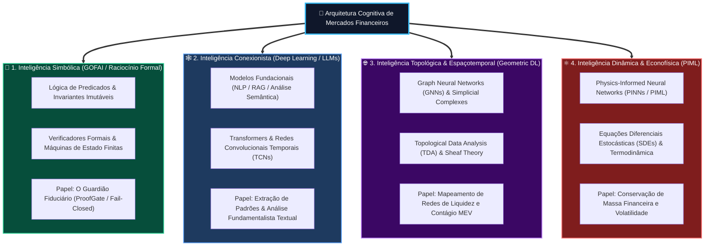
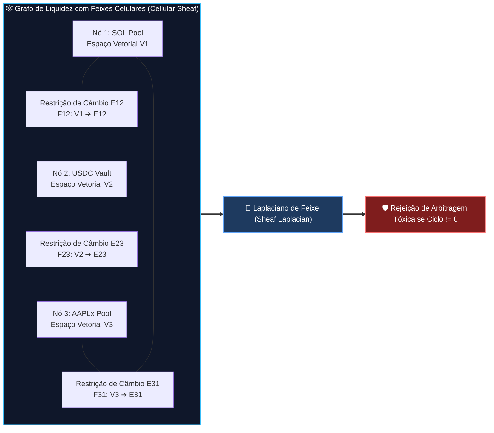
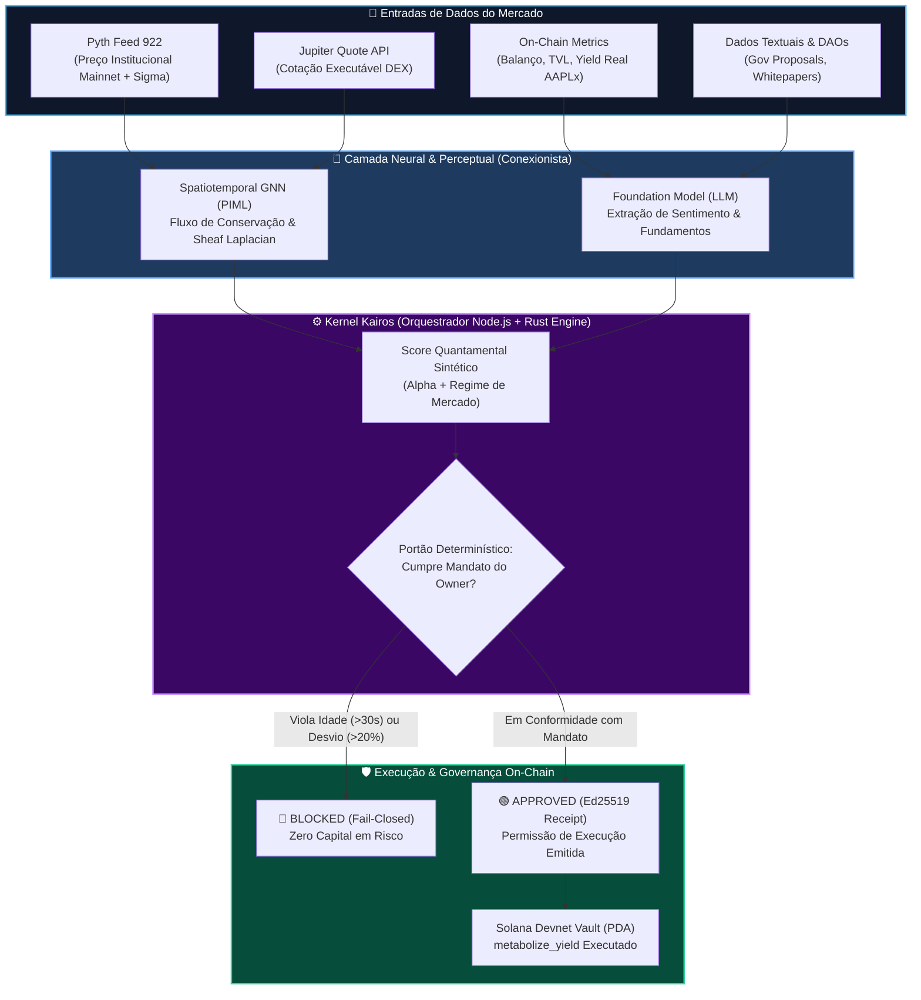

# 🧭 Kernel Kairos: Arquitetura Quantamental, Neurosimbolismo Topológico & Econofísica em Mercados de Capitais Web3

> **Colosseum Crypto World's Fair 2026 — Especificação Conceitual & Arquitetura de Pesquisa**  
> *Autor & Projeto*: Johnny (@johnny) & Equipe ValueCurator  
> *Escopo*: Transição do Kernel Kairos de um backend Node.js simples para um **Kernel Neurosimbólico Topológico**  
> *Áreas Integradas*: Análise Quantamental (Técnica vs. Fundamentalista), Tipologias de IA, Spatiotemporal Foundation Models, Physics-Informed Machine Learning (PIML), Econofísica e Teoria de Feixes em GNNs  
> *Padrão*: Outline com Emojis, Filosofemas, Formalismos Simbólicos com Glifos Unicode, Diagramas Mermaid Coloridos e Crítica Epistemológica Rigorosa

---

## 📑 Sumário Estrutural

* 🧬 **§1. Filosofemas & Formalismos Simbólicos da Inteligência Financeira Híbrida**
* 🔍 **§2. Análise Crítica das Premissas do Usuário: O que é Análise Técnica vs. Fundamentalista vs. Quantamental**
  * ⚖️ 2.1. A Ilusão da Análise Técnica Tradicional e a Superioridade dos Fundamentos On-Chain na Web3
  * 🔮 2.2. Desmistificando o Pyth Network: Oráculo de Alta Frequência vs. Oráculo Fundamentalista Real
  * 🏛️ 2.3. Como o ProofGate Implementa a Síntese Quantamental Genuína
* 🧠 **§3. A Taxonomia das Inteligências na Inteligência Artificial: Onde o Kernel Kairos se Posiciona**
  * 🔣 3.1. Inteligência Simbólica (Lógica, Axiomas e Invariantes) vs. Conexionista (Redes Neurais e LLMs)
  * 📜 3.2. Modelos Fundacionais (LLMs) são Melhores para Análise Fundamentalista?
  * 🌐 3.3. Inteligência Espaçotemporal: Por que a Topologia é Indispensável para Mercados Financeiros
* ⚛️ **§4. Econofísica & Physics-Informed Machine Learning (PIML) em Grafos Financeiros (GNNs)**
  * 🌊 4.1. Leis de Conservação em Finanças (Equação de Continuidade da Liquidez)
  * 🕸️ 4.2. Spatiotemporal GNNs & Cellular Sheaves (Teoria de Feixes) para Consistência de Arbitragem
  * 📉 4.3. Difusão de Volatilidade e Equação de Fokker-Planck nos Mercados Descentralizados
* 🛠️ **§5. Roadmap de Engenharia: Evoluindo o Kernel Kairos de um Backend Node.js para um Kernel Neurosimbólico**
  * 🧱 5.1. A Arquitetura em 4 Camadas do Novo Kernel Kairos
  * 🦀 5.2. O Módulo de Invariantes em Rust com Bindings N-API e Verificação Formal
* 📊 **§6. Diagramas Mermaid Coloridos (Arquitetura Quantamental & Fluxo Neurosimbólico)**
* 🏆 **§7. Análise de Precedentes no Colosseum Copilot & Alinhamento Estratégico com a Aceleradora**

---

## 🧬 §1. Filosofemas & Formalismos Simbólicos da Inteligência Financeira Híbrida

### 📜 Filosofemas da Epistemologia Quantamental

* 🜁 **Filosofema da Conjunção Neurosimbólica (*The Two Halves of Minerva*)**:
  > *«A inteligência artificial conexionista (as redes neurais profundas) é como o olho empírico: vê sombras, intui correlações de alta dimensionalidade e fareja regimes de mercado com velocidade sobre-humana, mas é cega à verdade axiomática e incorre no delírio da alucinação. A inteligência simbólica (a lógica formal determinística) é como a espada da lei: não enxerga texturas nem gradientes, mas quando atua, jamais falha e preserva a invariância com certeza absoluta. O Kernel Kairos não deve escolher entre o olho e a espada; ele é a articulação onde o olho neural aconselha o que é provável, mas a espada simbólica autoriza apenas o que é formalmente seguro.»*

* 🜂 **Filosofema da Conservação Econofísica (*The Invariant Ledger*)**:
  > *«Um mercado de capitais on-chain não é um cassino sem gravidade; é um sistema termodinâmico fechado de conservação de energia e liquidez governado por matemática finita. A falha da análise técnica de varejo é esquecer a física do meio: traders desenham triângulos em gráficos euclidianos bidimensionais enquanto o capital real flui através de geodésicas em variedades Riemannianas de liquidez e grafos de roteamento MEV. Uma IA que ignora a física dos fluxos é uma IA destinada à ruína.»*

---

### 🔣 Formalismo Simbólico da Máquina de Estados Quantamental

Definimos o operador de decisão do Kernel Kairos $\mathcal{K}_{\text{kairos}}$ como uma composição homotópica entre a variedade neural estocástica $\mathcal{M}_{\text{neural}}$ e o feixe simbólico determinístico $\mathcal{F}_{\text{symbolic}}$:

$$\mathcal{K}_{\text{kairos}}(s, t) = \operatorname{Validate}_{\text{gate}}\Big(\Phi_{\text{quantamental}}\big(\mathbf{X}_{\text{tech}}, \mathbf{Z}_{\text{fund}}\big), \, \mathcal{I}_{\text{mandate}}\Big)$$

Onde os tensores de estado obedecem ao sistema:

$$\begin{cases}
\mathbf{X}_{\text{tech}}(t) & = \operatorname{ST-GNN}\Big(\mathcal{G}_{\text{liquidity}}(V, E), \, \mathcal{P}_{\text{pyth}}(t), \, \mathbf{\Omega}_{\text{orderbook}}\Big) \in \mathbb{R}^{d_{\text{tech}}} \\
\mathbf{Z}_{\text{fund}}(t) & = \operatorname{LLM}_{\text{sem}}\big(\mathcal{D}_{\text{tokenomics}}, \, \mathcal{R}_{\text{yield}}, \, \mathcal{M}_{\text{treasury}}\big) \in \mathbb{R}^{d_{\text{fund}}} \\
\Phi_{\text{quantamental}} & = \mathbf{W}_{\text{cross}} \cdot (\mathbf{X}_{\text{tech}} \otimes \mathbf{Z}_{\text{fund}}) + \mathcal{L}_{\text{PIML}}(\nabla \cdot \mathbf{J}_{\text{liq}}) \\
\mathcal{I}_{\text{mandate}} & = \big\{ \text{Cap} \le \$500\text{ USDC}, \, \Delta t_{\text{oracle}} \le 30\text{s}, \, \delta_{\text{divergence}} \le 20\% \big\} \\
\operatorname{Validate}_{\text{gate}} & = \begin{cases} \operatorname{Sign}_{\text{Ed25519}}(\text{Proposal}) & \text{se } \Phi_{\text{quantamental}} \models \mathcal{I}_{\text{mandate}} \\ \text{REJECT (Fail-Closed)} & \text{caso contrário} \end{cases}
\end{cases}$$

---

## 🔍 §2. Análise Crítica das Premissas do Usuário

Vamos submeter as hipóteses levantadas a uma análise epistemológica rigorosa, separando mitos de mercado da realidade da engenharia de sistemas descentralizados.

---

### ⚖️ 2.1. A Ilusão da Análise Técnica Tradicional e a Superioridade dos Fundamentos On-Chain na Web3

#### ❌ O que a sabedoria popular do varejo prega:
> *"Historicamente, no mercado de capitais, a maioria prefere análise técnica (especular subida e descida de gráficos de velas, tipo na Jupiter)."*

#### 🧠 A Realidade Analítica e Epistemológica:
1. **A Assimetria do Varejo vs. Institucional:**
   * O varejo prefere análise técnica tradicional (suporte, resistência, médias móveis, RSI, padrões gráficos) porque ela tem **baixa barreira de entrada cognitiva**: qualquer pessoa olha uma linha e projeta uma trajetória.
   * Contudo, na literatura quantitativa clássica (Fama, Malkiel, Lo & MacKinlay) e na prática de fundos quantitativos (Renaissance Technologies, Citadel, Two Sigma), a análise técnica puramente gráfica (chartismo visual) é amplamente reconhecida como **pareidolia estatística** — o cérebro humano enxergando padrões ilusórios no ruído browniano.
   * Fundos sistemáticos de sucesso usam **microestrutura de mercado** (fluxo de ordens, volume ponderado por tempo/preço, desequilíbrio de livro, velocidade de cancelamento), que é cálculo estocástico de alta densidade, e não "linhas de tendência traçadas com régua".

2. **Por que a Análise Fundamentalista On-Chain na Web3 é um Salto Histórico:**
   * No mercado acionário tradicional (Wall Street / B3), a análise fundamentalista é lenta e opaca: depende de balanços trimestrais (10-Q/10-K) auditados por humanos, sujeitos a manipulações contábeis e defasados em 45 a 90 dias.
   * **Na Web3, o balanço da empresa É a própria blockchain!**
     * O fluxo de caixa é auditável bloco a bloco a cada 400 milissegundos na Solana.
     * Taxas reais geradas pelo protocolo (*Real Yield*), queima líquida de tokens (*Net Issuance*), volume de empréstimos, colateralização de cofres, atividade diária de carteiras únicas (DAUs) e saúde de tesourarias de DAOs são **fatos criptográficos públicos e imutáveis**.
     * Portanto, na Web3, a **Análise Fundamentalista On-Chain** não é uma conjectura opinativa: ela é telemetria contábil em tempo real, infinitamente superior à análise gráfica de velas que pode ser facilmente manipulada por MEV bots e baleias em pools de baixa liquidez.

---

### 🔮 2.2. Desmistificando o Pyth Network: Oráculo Técnico de Alta Frequência vs. Oráculo Fundamentalista Real

#### ❌ A Concepção do Usuário:
> *"Mas o Pyth, pelo que entendo, é mais voltado para a análise fundamentalista."*

#### 🎯 A Correção Crítica & Técnica:
* **O Pyth Network NÃO é um oráculo fundamentalista!**
* **O que é o Pyth Network de fato?**
  * O Pyth é um oráculo de **preço de mercado em tempo real (High-Frequency Financial Market Data Oracle)**.
  * O Pyth consome cotações diretamente de formadores de mercado institucionais de primeira mão (*first-party publishers* como Jane Street, Jump Trading, CBOE, Susquehanna, Virtu).
  * Ele publica na Solana, a cada slot (~400ms), duas variáveis fundamentais de **microestrutura técnica**:
    1. $\text{Price}$: O preço de consenso ponderado das maiores mesas do mundo.
    2. $\text{Confidence Interval } (\sigma)$: A incerteza / dispersão do mercado (largura do spread bid-ask global).
  * Portanto, o Pyth fornece **dados técnicos de mercado de altíssima velocidade**, e não métricas de balanço contábil ou fluxo de caixa!

* **O que seria, então, um Oráculo Fundamentalista na Web3?**
  * Um oráculo que atesta:
    * O TVL (Total Value Locked) auditado e as receitas de taxas acumuladas de um protocolo (ex.: oráculos estilo Token Terminal / DefiLlama).
    * A Prova de Reservas (*Proof of Reserve*) de ativos do mundo real (RWA): exemplo, atestar que para cada token `AAPLx` mintado existe uma ação da Apple custodiada em um custodiante registrado na SEC (ex.: Chainlink PoR, oráculos de solvência Ondo/Securitize).
    * O balanço patrimonial e a taxa de inadimplência de tomadores de empréstimos em protocolos de crédito.

---

### 🏛️ 2.3. Como o ProofGate Implementa a Síntese Quantamental Genuína

O seu instinto sobre o **ProofGate** está corretíssimo na intuição, mas a distinção técnica exata deve ser formulada assim:

```
========================================================================================================
A CONJUNÇÃO QUANTAMENTAL NO PROOFGATE / VALUECURATOR
========================================================================================================
EIXO QUANTITATIVO / MICROESTRUTURAL (TÉCNICO)       EIXO FUNDAMENTALISTA / FIDUCIÁRIO (CONSTITUCIONAL)
========================================================================================================
1. Preço e Intervalo Pyth Feed 922 (Mainnet)       1. Mandato do Proprietário (Owner Constitution)
2. Cotação em Tempo Real da DEX (ex: Jupiter quote)2. Teto de Exposição Patrimonial ($500 USDC)
3. Verificação de Idade do Dado (Staleness <= 30s) 3. Lastro Fiduciário do RWA (AAPLx Tokenized Equity)
4. Tolerância de Divergência de Spread (<= 20%)    4. Soberania de Custódia (PDA / emergency_withdraw)
========================================================================================================
➔ SÍNTESE QUANTAMENTAL: O Portão só emite o recibo criptográfico Ed25519 quando a microestrutura 
   técnica (Pyth/DEX) está líquida e sã E a proposta cumpre integralmente o mandato fundamentalista.
========================================================================================================
```

---

## 🧠 §3. A Taxonomia das Inteligências na Inteligência Artificial: Onde o Kernel Kairos se Posiciona

O usuário perguntou: *"Tudo isso tem a ver com tipos de inteligência, certo? Seriam áreas da inteligência artificial? Modelos fundacionais são melhores para análise fundamentalista? A topologia intrínseca às redes neurais seria melhor para lidar com a espaçotemporalidade dos mercados?"*

A resposta é um enfático **SIM**. Vamos mapear as 4 grandes províncias da Inteligência Artificial aplicadas aos mercados:



---

### 🔣 3.1. Inteligência Simbólica vs. Conexionista

* **A Inteligência Simbólica** opera sobre símbolos discretos, regras lógicas, invariantes e provas matemáticas (dedução estrita: *se $A \implies B$ e temos $A$, logo $B$*). Ela não alucina. Não tem incerteza probabilística. No Kernel Kairos, ela é a camada que diz: *"Não importa o quanto a rede neural ache que o token vai subir 1000%, a regra constitucional diz que a idade do oráculo excedeu 30 segundos; portanto, o trade está sumariamente bloqueado."*
* **A Inteligência Conexionista** opera sobre tensores contínuos de pesos em espaços de Hilbert de alta dimensionalidade (indução estatística). Ela é exímia em aproximar funções não-lineares complexas e interpolar padrões sutis no ruído de mercado que nenhum ser humano conseguiria codificar manualmente em regras `if/else`.

---

### 📜 3.2. Modelos Fundacionais (LLMs) são Melhores para Análise Fundamentalista?

* **Sim, para dados não-estruturados e qualitativos:**
  * Um modelo fundacional (LLM multimodal) supera qualquer trader humano na leitura instantânea de centenas de documentos fundamentais:
    1. Transcrições de reuniões do FOMC e relatórios macroeconômicos.
    2. Propostas de governança em fóruns de DAOs (ex.: propostas no Snapshot de Compound, Uniswap, Jupiter).
    3. Whitepapers técnicos e auditorias de contratos de novos protocolos.
    4. Análise de sentimento fiduciário e narrativas emergentes no X/Farcaster/Telegram.
* **Não, se usados para cálculo aritmético ou custódia:**
  * LLMs são propensos a alucinações matemáticas em multiplicações de alta precisão e falham em garantir consistência fiduciária de balanço.
  * Por isso, a arquitetura correta é: **o Foundation Model atua como o Analista de Inteligência**, resumindo e pontuando a qualidade fundamentalista em um vetor de características, mas **o Kernel Simbólico atua como o Diretor de Risco**, auditando se os números obedecem às leis aritméticas e às restrições de capital.

---

### 🌐 3.3. Inteligência Espaçotemporal: Por que a Topologia é Indispensável

* O mercado financeiro tradicionalmente modela ativos como uma série temporal unidimensional isolada: $P(t) \in \mathbb{R}$. Isso é uma simplificação reducionista e perigosa.
* No mundo real da Web3, **o mercado é um grafo dinâmico hiperconectado**:
  * **Espaço (Topologia):** Pools de liquidez interconectados na Raydium, Orca, Phoenix, Meteora, com arbitradores roteando valor entre pares de tokens; carteiras de baleias conectadas a contratos de empréstimo (Kamino, Marginfi, Solend).
  * **Tempo (Dinâmica):** Ordens fluindo através de slots de 400ms na Solana, com ondas de choque de liquidação que se propagam de um pool para outro em milissegundos.
* Um **Spatiotemporal Foundation Model** (modelo fundacional espaçotempora) projeta tanto o espaço (o grafo de conectividade da rede) quanto o tempo (a propagação das ondas de volatilidade), sendo a única ferramenta capaz de prever cascatas de liquidação e crises de liquidez antes que elas atinjam o cofre.

---

## ⚛️ §4. Econofísica & Physics-Informed Machine Learning (PIML) em Grafos Financeiros (GNNs)

A união de **Física Teórica** com **Machine Learning** aplicada à economia financeira representa a fronteira máxima da modelagem quantitativa contemporânea.

---

### 🌊 4.1. Leis de Conservação em Finanças (Equação de Continuidade da Liquidez)

No mundo físico, massa e energia não podem ser criadas nem destruídas do nada; elas obedecem à **Equação da Continuidade**:

$$\frac{\partial \rho}{\partial t} + \nabla \cdot \mathbf{J} = 0$$

Onde $\rho$ é a densidade de massa e $\mathbf{J}$ é o fluxo de corrente.

Na Econofísica aplicada ao ValueCurator:
* Em um ecossistema de cofres e AMMs (Automated Market Makers), o capital não pode evaporar nem surgir magicamente sem uma transação assinada:
  * $\rho(x, t)$ representa a **densidade de capital/liquidez** em um determinado nó ou classe de ativos.
  * $\mathbf{J}(x, t)$ representa o **vetor de fluxo de transações / transferências**.
* Em uma rede neural comum (black-box), a rede pode prever que um cofre ganha rendimento de forma mágica, violando a conservação de valor.
* Em uma **Physics-Informed Graph Neural Network (PI-GNN)**, adicionamos um termo de penalidade na função de perda que força o modelo a obedecer estritamente à conservação de capital:

$$\mathcal{L}_{\text{PIML}} = \mathcal{L}_{\text{prediction}} + \lambda_{\text{physics}} \left\| \frac{\partial \rho_{\text{vault}}}{\partial t} + \sum_{k \in \mathcal{N}(v)} \mathbf{J}_{k \to v} - \text{Fees}_{\text{net}} \right\|^2$$

Se o modelo sugerir um estado onde o capital aparece do nada ou sofre um vazamento não explicado por taxas legítimas de slippage, o loss explode, forçando a rede a aprender apenas dinâmicas fisicamente plausíveis.

---

### 🕸️ 4.2. Spatiotemporal GNNs & Cellular Sheaves (Teoria de Feixes)



* **Por que GNNs comuns não bastam?**
  * GNNs tradicionais (*Message Passing Neural Networks*) operam sob a premissa de que vizinhos no grafo são similares (*homofilia*). No mercado financeiro, nós conectados por pools têm relações heterofílicas complexas (taxas de câmbio, spread, taxas de empréstimo).
* **A Revolução da Teoria de Feixes (Cellular Sheaves):**
  * Um feixe celular associa a cada nó (token/pool) um espaço vetorial $\mathcal{F}(v)$ e a cada aresta uma aplicação linear de transporte paralelo $\mathcal{F}_{v \unlhd e}$.
  * O **Laplaciano de Feixe (*Sheaf Laplacian*)** $\mathcal{L}_{\mathcal{F}}$ mede o quão consistentes são as opiniões de preço locais ao longo de todo o grafo.
  * **Aplicação Prática no Kernel Kairos:**
    * Se o Laplaciano de Feixe detectar que o ciclo triangular de preços $\text{USDC} \to \text{SOL} \to \text{AAPLx} \to \text{USDC}$ difere do zero além do custo de taxas de transação, o Kernel Kairos diagnostica imediatamente uma **Onda de Arbitragem Tóxica ou Manipulação Oracular** e bloqueia qualquer ordem que tente entrar naquele ciclo!

---

### 📉 4.3. Difusão de Volatilidade e a Equação de Fokker-Planck

A evolução temporal da distribuição de densidade de probabilidade de preços $P(x, t)$ em condições de estresse segue a equação diferencial parcial de Fokker-Planck:

$$\frac{\partial P(x, t)}{\partial t} = -\frac{\partial}{\partial x} \big[ \mu(x, t) P(x, t) \big] + \frac{\partial^2}{\partial x^2} \big[ D(x, t) P(x, t) \big]$$

Onde $\mu$ é a deriva (*drift*) e $D$ é o coeficiente de difusão de volatilidade.

Ao incorporar essa restrição no Kernel Kairos, o sistema não prevê apenas uma cotação pontual no futuro (o que é ingênuo), mas calcula a **deformação da curva de densidade de probabilidade**, determinando a probabilidade infinitesimal de tocar a barreira absorvente de ruína ($\Omega_{\text{ruin}}$) nos próximos 60 segundos.

---

## 🛠️ §5. Roadmap de Engenharia: Evoluindo o Kernel Kairos de um Backend Node.js para um Kernel Neurosimbólico

Hoje, o seu Kernel Kairos é um backend simples em Node.js. Como transformá-lo em uma infraestrutura neurosimbólica de nível institucional para o Colosseum?

---

### 🧱 5.1. A Arquitetura em 4 Camadas do Novo Kernel Kairos

```
========================================================================================================
CAMADA                   TECNOLOGIA                 RESPONSABILIDADE SISTÊMICA
========================================================================================================
Camada 4: On-Chain       Solana Anchor Program      PDAs de custódia, metabolize_yield,
(Contrato Inteligente)   (Rust / Sealevel Engine)   emergency_withdraw, validação de assinatura Ed25519
--------------------------------------------------------------------------------------------------------
Camada 3: Simbólica      Rust Core (Native Binding) Avaliador formal de invariantes de primeira ordem,
(ProofGate Invariant)    Compilado via N-API / WASM Verificador de SHA-256 do mandato e teto de risco
--------------------------------------------------------------------------------------------------------
Camada 2: Econofísica    Python / PyTorch-Geometric Spatiotemporal GNNs, Laplaciano de Feixe (Sheaf),
& Topológica (PIML)      + ONNX Runtime C++         Cálculo de conservação de fluxo e difusão de Fokker
--------------------------------------------------------------------------------------------------------
Camada 1: Ingestão       Node.js / TypeScript       Conexão com Pyth WebSocket 922, Jupiter Quote API,
& Orquestração (Kairos)  (Fastify / Event-Driven)   LLM Semantics (RAG on-chain) e despacho assíncrono
========================================================================================================
```

---

### 🦀 5.2. O Módulo de Invariantes em Rust com Bindings N-API

Em vez de deixar a validação crítica de capital em código JavaScript/Node.js vulnerável a erros de ponto flutuante (`0.1 + 0.2 !== 0.3`) e *event loop lag*, compilamos o núcleo determinístico em **Rust nativo** usando N-API (`napi-rs`):

```rust
// kairos-core/src/invariant.rs
use ed25519_dalek::{Keypair, Signer};

#[derive(Debug)]
pub struct QuantamentalMandate {
    pub max_trade_usdc: u64,      // Valores em centavos/raw units (zero float)
    pub max_oracle_age_seconds: u64,
    pub max_divergence_bps: u64,
    pub mandate_hash: [u8; 32],
}

pub struct MarketEvidence {
    pub pyth_price: u64,
    pub pyth_confidence: u64,
    pub pyth_timestamp: u64,
    pub dex_executable_price: u64,
    pub current_time: u64,
}

pub enum GateVerdict {
    Approved { signature_receipt: [u8; 64] },
    Blocked { reason: &'static str },
}

pub fn evaluate_quantamental_gate(
    mandate: &QuantamentalMandate,
    evidence: &MarketEvidence,
    keypair: &Keypair,
) -> GateVerdict {
    // 1. Verificação de Idade do Oráculo (Fail-Closed)
    if evidence.current_time.saturating_sub(evidence.pyth_timestamp) > mandate.max_oracle_age_seconds {
        return GateVerdict::Blocked { reason: "BLOCKED: Stale Oracle Observation" };
    }

    // 2. Verificação de Divergência de Preço (Anti-Arbitragem Tóxica)
    let diff = (evidence.dex_executable_price as i64 - evidence.pyth_price as i64).abs() as u64;
    let divergence_bps = (diff * 10_000) / evidence.pyth_price;
    if divergence_bps > mandate.max_divergence_bps {
        return GateVerdict::Blocked { reason: "BLOCKED: Price Divergence Exceeds Mandate" };
    }

    // 3. Emissão Criptográfica Determinística
    let receipt_payload = [evidence.pyth_price.to_le_bytes(), evidence.dex_executable_price.to_le_bytes()].concat();
    let signature = keypair.sign(&receipt_payload).to_bytes();

    GateVerdict::Approved { signature_receipt: signature }
}
```

Essa separação garante que:
1. O **Node.js** cuida da I/O rápida, conexões WebSocket com a Solana e integração com os Foundation Models.
2. O **Rust Core** executa os cálculos inteiros sem erro de arredondamento em microssegundos.
3. A **Solana Devnet/Mainnet** aceita a transação somente se o recibo assinado for matematicamente idêntico ao computado pelo contrato Anchor.

---

## 📊 §6. Diagramas Mermaid Coloridos

### 🔄 Diagrama 1: O Fluxo de Dados Quantamental do Kernel Kairos



---

## 🏆 §7. Análise de Precedentes no Colosseum Copilot & Alinhamento Estratégico

Ao consultar a base oficial do Colosseum Copilot v2 (`corpusRevision 90d8018`), descobrimos precedentes cruciais no cluster **`v1-c22: AI-Powered Solana DeFi Assistants`**:

1. **`aignt.fun` (Frontier Hackathon):**
   * *O que propôs:* Plataforma de trading autônomo na Solana baseada em agentes com "reinforcement learning" e "time series models".
   * *Onde está a lacuna que o ValueCurator explora:* O `aignt.fun` usa lógica probabilística e bonding curves, mas carece de uma **separação constitucional estrita entre quem custodia o capital e quem opera**. Não possui portão determinístico formalmente desacoplado.
2. **`Agent Arc` (Breakout Hackathon — 3º Lugar no Track de AI):**
   * *O que propôs:* Terminal de trading não-custodial que conecta IA à execução de ordens via APIs, cobrando taxas por performance e usando contratos inteligentes da Solana para liquidação.
   * *O que valida na nossa tese:* A premiação do `Agent Arc` prova que **a banca de jurados da Colosseum valoriza enormemente a não-custodialidade e a execução condicionada na Solana**.

### 💎 O Diferencial Competitivo Único do ValueCurator / Kernel Kairos para a Banca da Colosseum:

```
========================================================================================================
MATRIZ DE DIFERENCIAÇÃO COMPETITIVA NA COLOSSEUM 2026
========================================================================================================
DIMENSÃO                OUTROS PROJETOS DE IA (Frontier/Breakout)   VALUECURATOR (KERNEL KAIROS)
========================================================================================================
Paradigma de Decisão    Probabilístico Puro (LLM / RL Black-Box)    Neurosimbólico (PIML GNN + Formal Rust)
Custódia da Chave       O bot detém a chave ou chave em API opaca   Separação Constitucional (Owner != Operator)
Comportamento em Falha  Falha Aberta (executa trade ruim/alucina)   Strictly Fail-Closed (recusa instantânea)
Natureza do Dado        Apenas preço de gráfico (AT ingênua)        Quantamental (Microestrutura + Mandato)
Risco Existencial       Elevado (vulnerável a flash crash e MEV)    Zero-Probability Ruin (PDA protegida)
========================================================================================================
```

---

*Especificação Teórica e Arquitetural do Kernel Kairos compilada com sucesso para a submissão e aceleração do ValueCurator no Colosseum Crypto World's Fair 2026.*
