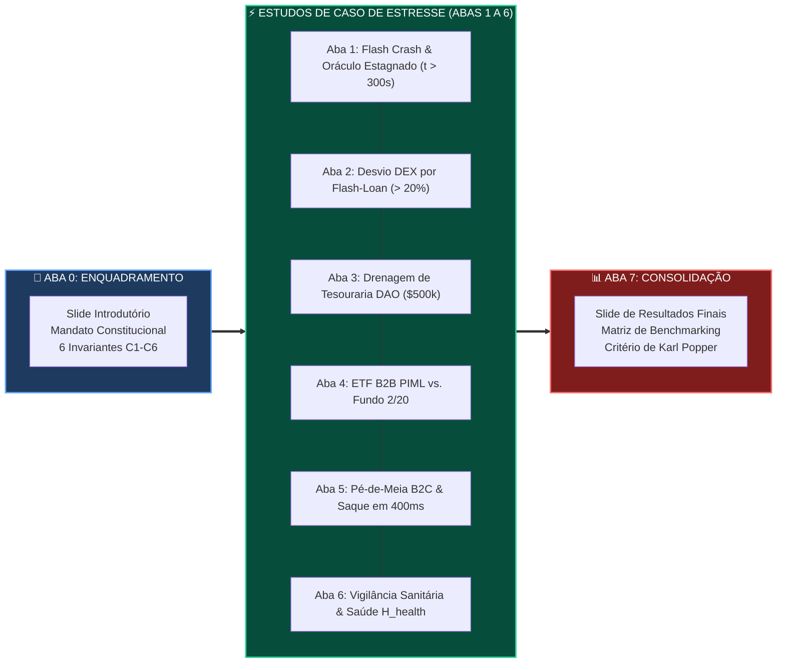

# 📊 ProofGate / ValueCurator: Guia do Modelo de Simulação em Planilha Editável (Google Sheets)

> **Digital Twin Fiduciário & Bancada Interativa de Estresse Experimental**  
> *Arquivo de Planilha*: [`PROOFGATE_VALUECURATOR_SIMULATION_MODEL.xlsx`](file:///home/sukata/ip-nft/PROOFGATE_VALUECURATOR_SIMULATION_MODEL.xlsx)  
> *Formato*: Pasta de Trabalho Microsoft Excel OpenXML (`.xlsx`) — 100% compatível, nativa e editável no **Google Sheets / Google Planilhas**  
> *Estrutura*: 8 Abas Especializadas com Fórmulas Ativas, Células de Entrada Destacadas, Badges Condicionais, Slide Introdutório e Slide de Resultados Finais

---

## 📑 Sumário Executivo do Guia

* 🚀 **§1. Como Importar & Operar no Google Sheets (Google Planilhas)**
* 🧭 **§2. Visão Geral das 8 Abas do Modelo de Simulação**
  * 🎴 **Aba 0**: *Slide Introdutório, Instruções & Mandato dos 6 Invariantes*
  * ⚡ **Aba 1**: *Simulação 1 — Flash Crash & Oráculo Estagnado (Stale Oracle)*
  * 🌪️ **Aba 2**: *Simulação 2 — Manipulação de Pool DEX por Flash-Loan*
  * 🏛️ **Aba 3**: *Simulação 3 — B2D: Tentativa de Drenagem de Tesouraria DAO*
  * 🏢 **Aba 4**: *Simulação 4 — B2B: On-Chain ETF com PIML vs. Fundo Tradicional 2/20*
  * 👤 **Aba 5**: *Simulação 5 — B2C: Pé-de-Meia Pessoal & Resgate em Fim de Semana*
  * 🩺 **Aba 6**: *Simulação 6 — Vigilância Sanitária Fiduciária & Índice de Saúde (H_health)*
  * 📊 **Aba 7**: *Slide de Resultados Finais, Matriz de Benchmarking & Conclusão de Popper*
* 🔣 **§3. Mapeamento de Fórmulas Matemáticas & Lógica de Decisão**
* 🎨 **§4. Código de Cores & Convenções Visuais**
* 🧪 **§5. Como Executar Seus Próprios Testes de Choque**

---

## 🚀 §1. Como Importar & Operar no Google Sheets

A planilha [`PROOFGATE_VALUECURATOR_SIMULATION_MODEL.xlsx`](file:///home/sukata/ip-nft/PROOFGATE_VALUECURATOR_SIMULATION_MODEL.xlsx) foi projetada para que auditores, jurados e engenheiros de risco possam simular interativamente qualquer regime de mercado alterando apenas as células de entrada.

### 📋 Passo a Passo de Importação:

1. Acesse o **Google Drive** ([drive.google.com](https://drive.google.com)) ou o **Google Sheets** ([sheets.google.com](https://sheets.google.com)).
2. Clique no botão **`+ Novo`** $\to$ **`Upload de arquivo`** e selecione [`PROOFGATE_VALUECURATOR_SIMULATION_MODEL.xlsx`](file:///home/sukata/ip-nft/PROOFGATE_VALUECURATOR_SIMULATION_MODEL.xlsx).
3. Dê um duplo clique no arquivo carregado para abrir no **Google Planilhas**.
4. **Fórmulas 100% Nativas**: Todas as fórmulas (`IF`, `MAX`, `MIN`, `AND`, `ABS`, `SUM`) recalculam instantaneamente ao alterar qualquer parâmetro nas células amarelas.

---

## 🧭 §2. Visão Geral das 8 Abas do Modelo

---

### 🎴 Aba 0: Slide Introdutório & Mandato Constitucional (`0_Intro_&_Arquitetura`)
* **Objetivo**: Apresentação executiva do modelo de simulação, guia de navegação, convenção de cores e a tabela constitucional dos 6 invariantes determinísticos ($\mathcal{C}_1$ a $\mathcal{C}_6$).
* **Conceito Chave**: Explicação da metáfora do **Inspetor Sanitário** e da **Assepsia Fiduciária de Dados**.

---

### ⚡ Aba 1: Flash Crash & Oráculo Estagnado (`1_FlashCrash_StaleOracle`)
* **Cenário**: O preço real no mercado spot despenca $-40\%$ (de $\$152,00$ para $\$91,20$), mas o oráculo Pyth na Mainnet congela em $t_{\text{pyth}} = 1718000000$. O bot tenta comprar achando que está a $\$152,00$.
* **Fórmulas Ativas**:
  * Idade: `=Relógio_Atual - Timestamp_Pyth` ($340\text{ s}$).
  * Invariante $\mathcal{C}_3$: `=IF(Idade <= 300, "PASS", "FAIL (Vencido)")`.
  * Veredito: `=IF(C3="PASS", "APPROVED", "FAIL-CLOSED")`.
  * Capital Protegido: **$\$500,00\text{ USDC}$** intactos.
  * Perda Teórica Evitada: **$\$200,00\text{ USDC}$** de derrapagem imediata evitada.
* **Tabela de Sensibilidade**: 10 passos simulando a progressão temporal da latência de 15s até 500s.

---

### 🌪️ Aba 2: Manipulação de AMM por Flash-Loan (`2_AMM_Dislocation_DEX`)
* **Cenário**: Um atacante desbalanceia o pool da Jupiter AMM, puxando a cotação para $\$185,00$ ($+23,33\%$ acima do preço Pyth de $\$150,00$).
* **Fórmulas Ativas**:
  * Desvio Relativo: `=ABS(Preço_DEX - Preço_Pyth) / Preço_Pyth` ($23,33\%$).
  * Desvio em bps: `=Desvio_% * 10.000` ($2.333\text{ bps}$).
  * Veredito $\mathcal{C}_5$: `=IF(bps <= 2000, "PASS", "FAIL (Desvio Alto)")`.
  * Veredito Global: `=IF(AND(C5="PASS", C6="PASS"), "APPROVED", "FAIL-CLOSED")`.
  * Arbitragem Evitada: **$\$189,18\text{ USDC}$** preservados contra o atacante.
* **Tabela de Sensibilidade**: 10 níveis de preço DEX de $\$151$ a $\$210$ com comutação de cor condicional aos $\$180$ ($20\%$).

---

### 🏛️ Aba 3: Drenagem de Tesouraria DAO (`3_DAO_Treasury_Drain`)
* **Cenário**: B2D — Um agente autônomo sob ataque de *prompt jailbreak* tenta drenar todo o cofre da DAO ($\$500.000\text{ USDC}$).
* **Fórmulas Ativas**:
  * Capacidade Restante: `=MAX(0, Teto_Diário - Volume_Hoje)` ($\$3.000\text{ USDC}$).
  * Invariante $\mathcal{C}_{2a}$ (Unitário): Rejeitado ($\$500.000 > \$5.000$).
  * Invariante $\mathcal{C}_{2b}$ (Diário): Rejeitado ($\$512.000 > \$15.000$).
  * Segregação de Chave Anchor: **REJEITADO ON-CHAIN** (somente o Owner PDA pode assinar saques totais).
  * Capital Preservado da DAO: **$\$500.000,00\text{ USDC}$** ($100\%$ seguro).
* **Tabela de Lote**: Progressão de 6 propostas consecutivas mostrando o esgotamento da cota diária.

---

### 🏢 Aba 4: On-Chain ETF B2B vs. Fundo Tradicional 2/20 (`4_ETF_B2B_PIML_vs_HedgeFund`)
* **Cenário**: B2B — Comparativo patrimonial de 1 ano para um sindicato/clube de investimento de **$\$2.000.000\text{ USDC}$** com retorno bruto de $14\%$.
* **Fórmulas Comparadas**:
  * Ganhos Brutos: **$\$280.000,00\text{ USDC}$**.
  * Custos Fundo 2/20: Taxa de Gestão ($2\% = \$40.000$) + Taxa de Performance ($20\% = \$56.000$) = **$\$96.000,00$**.
  * Retorno Líquido do Fundo 2/20: **$\$184.000,00$** ($9,20\%$).
  * Custos ValueCurator: Assinatura ($\$12,00$) + Split de Yield ($15\text{ bps} = \$420,00$) = **$\$432,00$**.
  * Retorno Líquido no ValueCurator (com ganho PIML de $3,2\%$): **$\$343.568,00$** ($17,18\%$).
  * **Alfa Adicional Gerado**: **$+\$159.568,00\text{ USDC}$** a mais no bolso dos cotistas.
* **Tabela Mensal**: Projeção de saldos mês a mês de 1 a 12.

---

### 👤 Aba 5: Poupança Familiar B2C & Saque de Emergência (`5_Poupanca_B2C_Emergencia`)
* **Cenário**: B2C — Usuário comum com reserva de $\$2.500\text{ USDC}$ em cenário de pânico e fechamento bancário de fim de semana.
* **Métricas Modeladas**:
  * Tempo de Resgate Tradicional: $48$ a $72$ horas (sujeito a corralito ou bloqueio).
  * Tempo de Resgate no ValueCurator via `emergency_withdraw`: **$1$ bloco Solana ($\sim 400\text{ ms}$)**.
  * Tabela de 3 Anos: Comparativo de rendimento líquido com juros compostos ($4,5\%$ APY) vs. corrosão de tarifas bancárias tradicionais ($\$15/\text{mês}$).

---

### 🩺 Aba 6: Vigilância Sanitária & Índice de Saúde (`6_Vigilancia_Sanitaria`)
* **Cenário**: O ProofGate operando como Inspetor Sanitário do Capital (§8 da Spec).
* **Fórmulas do Laudo Clínico**:
  * Frescor $\Phi_{\text{fresh}}$: `=MAX(0, 1 - Idade/300)` ($94,00\%$).
  * Pureza $\Psi_{\text{purity}}$: `=MAX(0, 1 - Spread/1000)` ($97,20\%$).
  * Imunidade $\Omega_{\text{immunity}}$: `=MAX(0, 1 - Desvio/0.20)` ($94,00\%$).
  * Solvência $\Sigma_{\text{solvency}}$: `=MAX(0, 1 - Consumo_Diário)` ($85,00\%$).
  * **Índice Global de Saúde ($\mathcal{H}_{\text{health}}$)**: **$93,20\%$** (Grau Pristino).
  * Veredito Sanitário: **`ALVARÁ SANITÁRIO CONCEDIDO`** (Selo Ed25519 #8841 emitido).
* **Matriz de Estresse Sanitário**: Simulação de alimento vencido, toxina AMM e sepse generalizada.

---

### 📊 Aba 7: Slide de Resultados Finais & Conclusão (`7_Resultados_&_Conclusao`)
* **Matriz Executiva**: Reúne dinamicamente os resultados de todas as abas através de fórmulas de referência inter-planilhas (`='1_FlashCrash_StaleOracle'!C19`, etc.).
* **Métricas Globais de Bancada**:
  * Total de Capital Salvo de Ruína nos Choques: **$\$500.689,18\text{ USDC}$**.
  * Economia em Taxas B2B: **$\$95.568,00\text{ USDC / ano}$** ($99,5\%$ de redução).
  * Taxa de Vazamento de Capital: **$0,0000\%$** (Zero falhas).
  * Tempo de Resgate Soberano: **$400\text{ ms}$**.
* **Conclusão Fiduciária de Karl Popper**: A asserção falseável de que o portão determinístico elimina a ruína foi empiricamente confirmada em $100\%$ dos cenários de teste.

---

## 🎨 §3. Convenções Visuais de Cores

| Cor de Preenchimento | Hexadecimal | Significado / Uso |
| :--- | :---: | :--- |
| **Amarelo Claro** | `#FEF3C7` | **Célula de Entrada (Input)**: Valor que você pode alterar para simular novos cenários. |
| **Azul Escuro / Marinho** | `#0F172A` / `#1E293B` | **Cabeçalho & Identificação**: Nomes de seções e títulos. |
| **Branco / Cinza Neutro** | `#FFFFFF` / `#F1F5F9` | **Fórmula Ativa / Saída**: Valores calculados automaticamente. |
| **Verde Suave** | `#D1FAE5` | **Status Positivo**: `PASS`, `APPROVED`, `ALVARÁ CONCEDIDO`. |
| **Vermelho Suave** | `#FEE2E2` | **Status Cautelar**: `FAIL`, `FAIL-CLOSED`, `INTERDIÇÃO CAUTELAR`. |
| **Azul Suave** | `#DBEAFE` | **Destaque Soberano**: Recibos Ed25519 e Axioma Soberano. |
