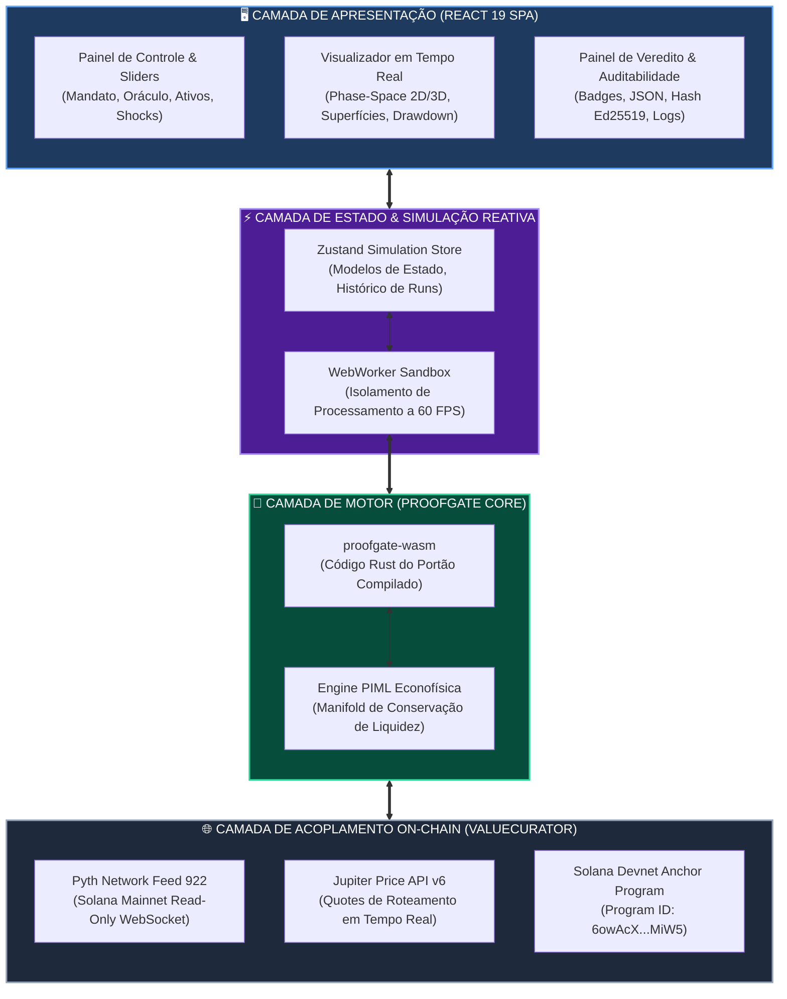
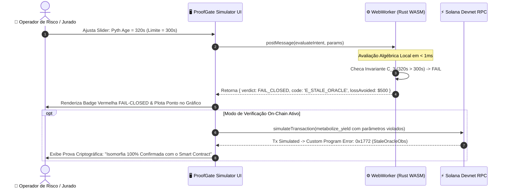
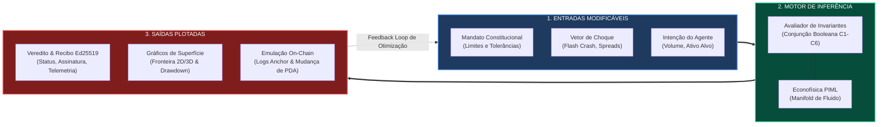
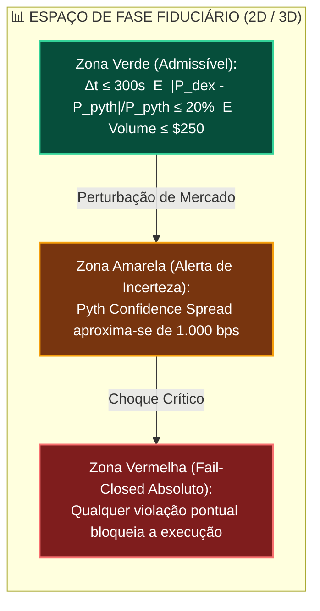
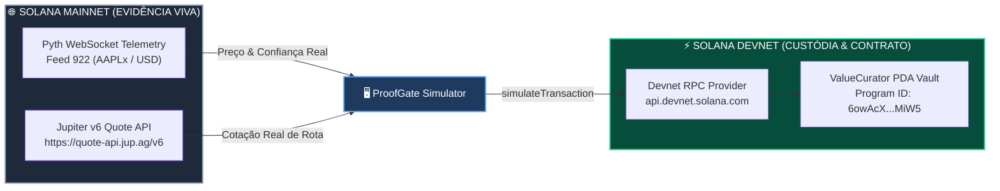

# 🛡️ ProofGate Simulator: Especificação Técnica da Single Page Application (SPA)

> **Simulador Interativo de Bancada & Digital Twin Fiduciário para o ProofGate / ValueCurator**  
> *Ecossistema*: Solana (Anchor Program) & Oráculos de Alta Frequência (Pyth Network + Jupiter DEX)  
> *Autores*: Sandra Pereira & João Nitsche  
> *Projeto Matriz*: **ValueCurator (`value-curator`)** / **ProofGate Guarded Execution Engine**  
> *Program ID (Solana Devnet)*: [`6owAcXQjGg6d5p1n2D5gK8mKkG9uH9sE1kL2mP3rMiW5`](https://explorer.solana.com/address/6owAcXQjGg6d5p1n2D5gK8mKkG9uH9sE1kL2mP3rMiW5?cluster=devnet)  
> *Padrão Arquitetural*: Outline com Emojis, Filosofemas Epistêmicos, Formalismos Simbólicos com Glifos Unicode, Diagramas Mermaid Coloridos, Wireframes de UI e Especificações TypeScript / Rust WASM

---

## 📑 Sumário Executivo & Índice

* 🧬 **§1. Filosofemas da Simulação Fiduciária & Formalismo Simbólico do Digital Twin**
  * 📜 1.1. Filosofemas do Simulador como Bancada Epistêmica (*In Vitro vs. In Vivo*)
  * 🔣 1.2. Formalismo Simbólico da Máquina de Simulação ($\mathcal{SIM}_{\text{proofgate}}$)
* 📊 **§2. Diagramas Mermaid Coloridos (Arquitetura, Fluxo & Topologia Reativa)**
  * 🔄 Diagrama 1: Arquitetura em Camadas da SPA & Acoplamento com o ProofGate / ValueCurator
  * ⚡ Diagrama 2: Pipeline de Execução Dual (WASM Local em WebWorker vs. RPC Solana Devnet)
  * 🧭 Diagrama 3: Topologia Reativa de Estado & Ciclo de Feedback dos Parâmetros
  * 📐 Diagrama 4: Espaço de Fase e Fronteira de Decisão dos Invariantes ($\bigwedge \mathcal{C}_k$)
* 🎛️ **§3. Arquitetura de Interface (Cockpit UI/UX Wireframe & Design System)**
  * 🖥️ 3.1. Layout Tripartite da SPA (Three-Column Sovereign Cockpit)
  * 🕹️ 3.2. Coluna Esquerda: Customizador de Cenários, Ativos & Shocks Estocásticos
  * 📈 3.3. Coluna Central: Visualizador Gráfico em Tempo Real (Phase-Space, Superfícies & Drawdown)
  * 🛡️ 3.4. Coluna Direita: Veredito Determinístico, Recibo Ed25519 & Emulador Anchor PDA
* ⚙️ **§4. Acoplamento Técnico com o ProofGate / ValueCurator**
  * 🦀 4.1. Módulo Core: Portão Determinístico Compilado para WebAssembly (`proofgate-wasm`)
  * 🌐 4.2. Acoplamento de Rede: Ingestão Híbrida (Pyth Feed 922 Mainnet + Solana Devnet RPC)
  * ✍️ 4.3. Pipeline Criptográfico: Geração e Verificação de Recibos Ed25519 em Sandbox
  * 🏦 4.4. Emulador de Transações Solana: `simulateTransaction` para `metabolize_yield`
* 💻 **§5. Especificações de Tipagem TypeScript & Modelos de Dados**
  * 📜 5.1. Esquema do Mandato Constitucional (`MandateParameters`)
  * 📡 5.2. Vetor de Evidência & Perturbação de Mercado (`MarketEvidenceVector`)
  * 🤖 5.3. Proposta de Execução do Agente (`AgentExecutionIntent`)
  * 📊 5.4. Veredito, Métricas de Risco & Telemetria (`SimulationOutput`)
* 🧪 **§6. Cenários Pré-Configurados de Testbench & Estresse**
  * ⚡ 6.1. Cenário 1: *Flash Crash & Oracle Stale* (Falha de Frescor $\tau > 300\text{s}$)
  * 🌪️ 6.2. Cenário 2: *AMM Flash-Loan Dislocation* (Desvio DEX $> 2.000\text{ bps}$)
  * 🏛️ 6.3. Cenário 3: *DAO Treasury Hostile Drain* (Violação de Teto Diário $\lambda_{\text{daily}}$)
  * 🛡️ 6.4. Cenário 4: *Safe Regime & Yield Metabolism* (Conformidade Estrita $6/6$)
* 🚀 **§7. Stack Tecnológico, Setup de Desenvolvimento & Roadmap de Entrega**
  * 📦 7.1. Dependências Frontend (React 19, Vite, Tailwind CSS, Recharts, Lucide, @solana/web3.js)
  * 🛠️ 7.2. Estrutura de Diretórios do Projeto
  * 🏁 7.3. Fases de Implementação & Critérios de Aceitação

---

## 🧬 §1. Filosofemas da Simulação Fiduciária & Formalismo Simbólico do Digital Twin

### 📜 1.1. Filosofemas do Simulador como Bancada Epistêmica

* 🜁 **Filosofema do Simulador como Espelho Epistêmico (*The Digital Twin Axiom*)**:
  > *«Um protocolo fiduciário que só pode ser testado arriscando capital real em produção é um perigo institucional. O simulador não é um brinquedo visual ou uma peça cosmética de marketing; ele é um Digital Twin fiduciário. Ele projeta a variedade estocástica do mercado financeiro em um laboratório determinístico de bancada, permitindo que o gestor de risco explore as fronteiras de catástrofe antes que uma única gota de liquidez seja exposta.»*

* 🜂 **Filosofema da Fronteira Invariante (*The Phase-Space Invariance*)**:
  > *«A interface de um simulador de governança de capital não deve esconder a complexidade matemática sob gráficos genéricos de preços. Ela deve tornar tangível o espaço de fase fiduciário: a linha exata onde o oráculo deixa de ser confiável, onde a slippage devora a margem e onde a política aciona o fechamento estrito (Fail-Closed). O usuário compreende a segurança não por palavras, mas por geometria interativa.»*

* 🜃 **Filosofema da Isomorfia de Código (*Zero Drift Principle*)**:
  > *«A simulação no navegador não pode implementar uma 'aproximação simplificada' da lógica dos contratos inteligentes. O mesmo código Rust que roda nos validadores da Solana através do Anchor deve rodar no navegador via WebAssembly. Se o simulador diz que uma transação é rejeitada, a transação na Devnet ou Mainnet deve falhar exatamente com o mesmo código de erro e na mesma linha de instrução.»*

---

### 🔣 1.2. Formalismo Simbólico da Máquina de Simulação ($\mathcal{SIM}_{\text{proofgate}}$)

A **Máquina de Simulação do ProofGate** $(\mathcal{SIM})$ é formalmente definida como um operador de mapeamento funcional:

$$\mathcal{SIM}_{\text{proofgate}}: \big( \mathcal{M}, \, \vec{\Xi}_{\text{market}}, \, \theta_{\text{intent}}, \, \vec{\Theta}_{\text{piml}} \big) \longmapsto \big( \mathcal{V}_{\text{verdict}}, \, \Pi_{\text{receipt}}, \, \Delta \mathbf{S}_{\text{pda}}, \, \mathbf{\Omega}_{\text{surface}} \big)$$

Onde os tensores e espaços são definidos por:

$$\begin{cases}
\mathcal{M} & = \big\langle \mathcal{A}_{\text{allow}}, \, \lambda_{\text{trade}}^{\max}, \, \lambda_{\text{daily}}^{\max}, \, \tau_{\text{age}}^{\max}, \, \sigma_{\text{conf}}^{\max}, \, \Delta_{\text{dev}}^{\max}, \, \mathcal{S}_{\text{slip}}^{\max} \big\rangle \in \mathbb{R}^7 \\
\vec{\Xi}_{\text{market}}(t) & = \big\langle p_{\text{pyth}}(t), \, \sigma_{\text{pyth}}(t), \, \Delta t_{\text{age}}, \, q_{\text{jup}}(t), \, \Delta_{\text{imp}}(t), \, \rho_{\text{liquidity}}(t) \big\rangle \in \mathbb{R}^6 \\
\theta_{\text{intent}} & = \big\langle a_{\text{in}}, \, a_{\text{out}}^{\min}, \, m_{\text{target}}, \, \kappa_{\text{agent\_id}} \big\rangle \\
\vec{\Theta}_{\text{piml}} & = \big\langle \gamma_{\text{fluid}}, \, \nabla \cdot \vec{J}_{\text{cap}}, \, \mathcal{H}_{\text{entropy}} \big\rangle \quad (\text{Parâmetros de Econofísica})
\end{cases}$$

O portão determinístico $(\mathcal{G}_{\text{det}})$ calcula o veredito $\mathcal{V}_{\text{verdict}} \in \{ \mathbf{APPROVED}, \, \mathbf{FAIL\_CLOSED} \}$ satisfazendo a conjunção de invariantes:

$$\mathcal{V}_{\text{verdict}} = \mathbf{APPROVED} \iff \bigwedge_{k=1}^6 \mathcal{C}_k \equiv \mathbf{true}$$

$$\begin{cases}
\mathcal{C}_1 \equiv (m_{\text{target}} \in \mathcal{A}_{\text{allow}}) & \text{[Validação de Ativo]} \\
\mathcal{C}_2 \equiv (a_{\text{in}} \le \lambda_{\text{trade}}^{\max}) \land (V_{\text{cum}} + a_{\text{in}} \le \lambda_{\text{daily}}^{\max}) & \text{[Capacidade de Volume]} \\
\mathcal{C}_3 \equiv (\Delta t_{\text{age}} \le \tau_{\text{age}}^{\max}) & \text{[Frescor do Oráculo Pyth]} \\
\mathcal{C}_4 \equiv \left(\frac{\sigma_{\text{pyth}}}{p_{\text{pyth}}} \le \sigma_{\text{conf}}^{\max}\right) & \text{[Confiabilidade Estatística]} \\
\mathcal{C}_5 \equiv \left(\left|\frac{p_{\text{implied}} - p_{\text{pyth}}}{p_{\text{pyth}}}\right| \le \Delta_{\text{dev}}^{\max}\right) & \text{[Alinhamento DEX vs. Oráculo]} \\
\mathcal{C}_6 \equiv (\Delta_{\text{imp}} \le \mathcal{S}_{\text{slip}}^{\max}) & \text{[Impacto de Liquidez]}
\end{cases}$$

Se $\exists k : \neg \mathcal{C}_k$, então:

$$\mathcal{V}_{\text{verdict}} = \mathbf{FAIL\_CLOSED}(\rho_k) \quad \text{onde } \rho_k \in \{ \mathtt{E\_MINT\_BANNED}, \mathtt{E\_VOLUME\_OVERFLOW}, \mathtt{E\_STALE\_ORACLE}, \mathtt{E\_CONF\_SPREAD}, \mathtt{E\_PRICE\_DEV}, \mathtt{E\_SLIPPAGE} \}$$

---

## 📊 §2. Diagramas Mermaid Coloridos

### 🔄 Diagrama 1: Arquitetura em Camadas da SPA & Acoplamento



---

### ⚡ Diagrama 2: Pipeline de Execução Dual (WASM Local vs. RPC Solana)



---

### 🧭 Diagrama 3: Topologia Reativa de Estado & Ciclo de Feedback



---

### 📐 Diagrama 4: Espaço de Fase e Fronteira de Decisão dos Invariantes



---

## 🎛️ §3. Arquitetura de Interface (Cockpit UI/UX Wireframe & Design System)

A SPA é projetada como um **Cockpit de Controle Fiduciário de Alta Densidade**, estruturado em três colunas verticais com visual escuro minimalista (*Obsidian Black* `#090d16`, *Electric Cyan* `#06b6d4`, *Emerald Green* `#10b981` e *Crimson Red* `#ef4444`).

---

### 🖥️ 3.1. Layout Tripartite da SPA (Three-Column Sovereign Cockpit)

```
┌────────────────────────────────────────────────────────────────────────────────────────────────────────────────┐
│  🛡️ PROOFGATE SIMULATOR v1.0  │  Solana Devnet: 6owAcX...MiW5  │  Pyth Feed 922: $152.40  │  FPS: 60  │  WASM: ON │
├───────────────────────────────┼────────────────────────────────────────┼───────────────────────────────────────┤
│ 🕹️ PAINEL DE CONTROLE (INPUTS) │ 📈 VISUALIZADOR REATIVO (PLOTS)        │ 🛡️ VEREDITO & CUSTÓDIA (OUTPUTS)      │
├───────────────────────────────┼────────────────────────────────────────┼───────────────────────────────────────┤
│ [SELEÇÃO DE CENÁRIO PRÉVIO]   │ [GRÁFICO 1: FRONTEIRA DO ESPAÇO DE FASE]│ STATUS: 🟢 APPROVED (Ed25519 SIGNED)  │
│ 🔘 Flash Crash & Stale Oracle │   Desvio Preço (%) vs Latência Pyth (s)│                                       │
│ 🔘 DEX Manipulation (+25%)    │   ┌────────────────────────────────┐   │ ✍️ RECIBO CRIPTOGRÁFICO:             │
│ 🔘 DAO Treasury Drain Attempt │   │  🔴 BLOQUEADO                  │   │ {                                     │
│ 🔘 Modo Customizado Livre     │   │         ┌───────────┐          │   │   "hash": "0x7a8f...9c12",            │
│                               │   │         │ 🟢 SEGURO │          │   │   "signer": "ed25519:policy_gate",    │
│ ──────── MANDATO ──────────   │   │         └───────────┘          │   │   "targetMint": "AAPLx",              │
│ Trade Cap: [250 USDC] ────o── │   └────────────────────────────────┘   │   "status": "APPROVED"                │
│ Daily Cap: [1000 USDC] ───o── │                                        │ }                                     │
│ Max Stale: [300 s] ───────o── │ [GRÁFICO 2: CAPITAL PRESERVADO (RUN)]  │                                       │
│ Max Divergence: [20%] ────o── │   $ Capital                               │ 🏦 EMULADOR SOLANA DEVNET:            │
│ Max Slippage: [10%] ──────o── │   ▲  ═══════════ ProofGate Protegido   │ Program: 6owAcXQj...MiW5              │
│                               │   │  \                                 │ Instruction: metabolize_yield         │
│ ────── PERTURBAÇÃO ────────   │   │   \                                │ Simulated Logs:                       │
│ Pyth Age: [12 s] ─────────o── │   │    \════════ Sem Guardiões (Ruína) │  > Program log: Invariants Verified   │
│ Jupiter Divergence: [+3%] ─o─ │   └─────────────────────────► Tempo    │  > Program log: Yield Metabolized     │
│ Volatilidade: [Alta] ─────o── │                                        │  > Result: SUCCESS (Compute: 18,420)  │
│                               │ [GRÁFICO 3: RADAR DOS 6 INVARIANTES]   │                                       │
│ ────── AGENTE (INTENT) ─────  │      Ativo    Volume                   │ 🚨 BOTÃO DE CHOQUE INSTANTÂNEO:       │
│ Montante: [100 USDC] ─────o── │        \       /                       │ [ INJETAR FLASH CRASH (-40%) ]        │
│ Ativo: [AAPLx ▼]              │  Impacto ── ⬡ ── Frescor               │ [ CONGELAR ORÁCULO PYTH ]             │
│ Ação: [EXECUTE SWAP]          │        /       \                       │ [ REVERTER PARA PADRÃO SEGURO ]       │
│                               │      Diverg.   Confiança               │                                       │
└───────────────────────────────┴────────────────────────────────────────┴───────────────────────────────────────┘
```

---

### 🕹️ 3.2. Coluna Esquerda: Customizador de Cenários & Parâmetros

* **Controles Interativos com Debounce de 0ms (Local WASM) e 250ms (RPC)**:
  * **Seletor de Modo**: `Simulação Rápida WASM (100% In-Browser)` vs. `Validação RPC Live (Devnet)`.
  * **Grupo 1: Parâmetros Constitucionais do Mandato ($\mathcal{M}$)**:
    * `Trade Allocation Ceiling ($)`: Slider contínuo de $10$ a $5.000$ USDC.
    * `Daily Rolling Volume Limit ($)`: Slider de $100$ a $50.000$ USDC.
    * `Pyth Stale Tolerance ($\tau_{\text{age}}^{\max}$)`: Slider de $5$ a $600$ segundos.
    * `Confidence Spread Threshold ($\sigma_{\text{conf}}^{\max}$)`: Slider de $50$ a $3.000$ bps ($0.5\%$ a $30\%$).
    * `Implied DEX Divergence ($\Delta_{\text{dev}}^{\max}$)`: Slider de $100$ a $5.000$ bps ($1\%$ a $50\%$).
    * `Slippage Depth Tolerance ($\mathcal{S}_{\text{slip}}^{\max}$)`: Slider de $50$ a $2.500$ bps ($0.5\%$ a $25\%$).
  * **Grupo 2: Vetor de Perturbação de Mercado ($\vec{\Xi}$)**:
    * `Pyth Timestamp Age`: Slider dinâmico para simular atraso do validador.
    * `Jupiter Market Divergence`: Slider percentual $(-50\%$ a $+50\%)$.
    * `Confidence Interval Jitter`: Adiciona ruído estocástico na precisão oracular.
  * **Grupo 3: Proposta do Agente ($\theta_{\text{intent}}$)**:
    * `Trade Size (USDC)`: Quantidade de capital solicitado pelo modelo neural.
    * `Target Mint`: Dropdown com mints verificados (`AAPLx`, `USDC`, `SOL`, `BONK`, `UNVERIFIED_MINT`).

---

### 📈 3.3. Coluna Central: Visualizador Gráfico em Tempo Real

1. **Plot 1: Superfície de Fronteira no Espaço de Fase (Phase-Space)**:
   * Eixo X: Idade da Observação Pyth ($0$ a $500$ segundos).
   * Eixo Y: Divergência Percentual de Preço DEX vs. Pyth ($0\%$ a $40\%$).
   * Ponto Ativo: Coordenadas em tempo real $(\Delta t_{\text{now}}, \Delta_{\text{dev, now}})$.
   * Área Verde: Polígono delimitado pelos invariantes $\tau_{\text{age}}^{\max}$ e $\Delta_{\text{dev}}^{\max}$.
   * Transição Reativa: Ao cruzar a linha verde, o ponto pisca em vermelho neon com etiqueta de violação.
2. **Plot 2: Curva de Preservação de Capital vs. Ruína Existencial**:
   * Eixo X: Série temporal de 60 iterações de trades propostos.
   * Linha Azul Contínua: Saldo governado pelo ValueCurator (inviolável, preservando o principal).
   * Linha Vermelha Pontilhada: Desempenho do agente sem guardiões (drenagem catastrófica em pontos de anomalia).
3. **Plot 3: Radar Hexagonal dos 6 Invariantes Fiduciários**:
   * Eixos: Ativo, Volume, Frescor, Confiança, Divergência e Slippage.
   * Polígono Ciano: Valores atuais normalizados ($0.0$ a $1.0$).
   * Polígono Dourado: Limites máximos estipulados pelo mandato do usuário.

---

### 🛡️ 3.4. Coluna Direita: Veredito, Recibo Ed25519 & Emulador Solana

* **Indicador de Status Proeminente**:
  * `APPROVED`: Badge esmeralda pulsante com ícone de escudo e cadeado aberto por recibo.
  * `FAIL-CLOSED`: Badge rubi de alerta com o motivo cirúrgico da interrupção (ex.: `ERR_ORACLE_STALE: 340s > 300s`).
* **Visualizador de Recibo Criptográfico Ed25519**:
  * Visualizador de código JSON com realce de sintaxe contendo o payload criptográfico gerado para a autoridade operadora.
* **Console de Emulação do Anchor Smart Contract**:
  * Simulação ao vivo do runtime da Solana: exibe consumo de Compute Units (CU), alteração nos saldos das contas de custódia (PDA Vault) e logs de execução emitidos pelo programa `6owAcX...MiW5`.

---

## ⚙️ §4. Acoplamento Técnico com o ProofGate / ValueCurator

O simulador implementa uma arquitetura híbrida de execução para garantir **latência zero no navegador** com **total fidelidade criptográfica on-chain**.

---

### 🦀 4.1. Módulo Core: Portão Determinístico Compilado para WebAssembly (`proofgate-wasm`)

O código de validação determinística do ProofGate é mantido em Rust e compilado para WebAssembly via `wasm-pack`:

```rust
// proofgate-core/src/lib.rs
use wasm_bindgen::prelude::*;
use serde::{Serialize, Deserialize};

#[derive(Serialize, Deserialize, Clone, Debug)]
pub struct MandateConfig {
    pub allowed_mints: Vec<String>,
    pub max_trade_amount: u64,
    pub max_daily_volume: u64,
    pub max_oracle_age_seconds: u64,
    pub max_confidence_bps: u64,
    pub max_price_divergence_bps: u64,
    pub max_slippage_bps: u64,
}

#[derive(Serialize, Deserialize, Clone, Debug)]
pub struct MarketEvidence {
    pub pyth_price: f64,
    pub pyth_confidence: f64,
    pub pyth_timestamp: u64,
    pub jupiter_implied_price: f64,
    pub current_timestamp: u64,
    pub price_impact_bps: u64,
}

#[derive(Serialize, Deserialize, Clone, Debug)]
pub struct ExecutionIntent {
    pub target_mint: String,
    pub amount_in: u64,
    pub min_amount_out: u64,
    pub cumulative_daily_volume: u64,
}

#[derive(Serialize, Deserialize, Clone, Debug)]
pub struct EvaluationResult {
    pub is_approved: bool,
    pub failure_reasons: Vec<String>,
    pub evaluated_invariants: Vec<bool>, // C1 to C6
    pub signature_receipt: Option<String>,
    pub capital_protected_usdc: f64,
}

#[wasm_bindgen]
pub fn evaluate_execution_gate(
    mandate_json: &str,
    evidence_json: &str,
    intent_json: &str,
) -> Result<JsValue, JsValue> {
    let mandate: MandateConfig = serde_json::from_str(mandate_json)
        .map_err(|e| JsValue::from_str(&format!("Invalid Mandate JSON: {}", e)))?;
    let evidence: MarketEvidence = serde_json::from_str(evidence_json)
        .map_err(|e| JsValue::from_str(&format!("Invalid Evidence JSON: {}", e)))?;
    let intent: ExecutionIntent = serde_json::from_str(intent_json)
        .map_err(|e| JsValue::from_str(&format!("Invalid Intent JSON: {}", e)))?;

    let mut reasons = Vec::new();
    let mut invariants = vec![true; 6];

    // C1: Asset Whitelist
    if !mandate.allowed_mints.contains(&intent.target_mint) {
        invariants[0] = false;
        reasons.push("ERR_UNAUTHORIZED_MINT".to_string());
    }

    // C2: Volume Caps
    if intent.amount_in > mandate.max_trade_amount || 
       (intent.cumulative_daily_volume + intent.amount_in) > mandate.max_daily_volume {
        invariants[1] = false;
        reasons.push("ERR_VOLUME_EXCEEDED".to_string());
    }

    // C3: Oracle Freshness
    let oracle_age = evidence.current_timestamp.saturating_sub(evidence.pyth_timestamp);
    if oracle_age > mandate.max_oracle_age_seconds {
        invariants[2] = false;
        reasons.push(format!("ERR_STALE_ORACLE: age {}s > max {}s", oracle_age, mandate.max_oracle_age_seconds));
    }

    // C4: Oracle Confidence Spread
    let conf_bps = ((evidence.pyth_confidence / evidence.pyth_price) * 10_000.0) as u64;
    if conf_bps > mandate.max_confidence_bps {
        invariants[3] = false;
        reasons.push(format!("ERR_CONFIDENCE_TOO_WIDE: {} bps > max {} bps", conf_bps, mandate.max_confidence_bps));
    }

    // C5: DEX vs Pyth Price Divergence
    let divergence_ratio = ((evidence.jupiter_implied_price - evidence.pyth_price).abs() / evidence.pyth_price) * 10_000.0;
    let divergence_bps = divergence_ratio as u64;
    if divergence_bps > mandate.max_price_divergence_bps {
        invariants[4] = false;
        reasons.push(format!("ERR_PRICE_DIVERGENCE: {} bps > max {} bps", divergence_bps, mandate.max_price_divergence_bps));
    }

    // C6: Slippage / Liquidity Depth
    if evidence.price_impact_bps > mandate.max_slippage_bps {
        invariants[5] = false;
        reasons.push(format!("ERR_EXCESSIVE_SLIPPAGE: {} bps > max {} bps", evidence.price_impact_bps, mandate.max_slippage_bps));
    }

    let is_approved = invariants.iter().all(|&v| v);
    let receipt = if is_approved {
        Some(format!("ED25519_AUTH_VALIDATED_{}_{}", intent.target_mint, evidence.current_timestamp))
    } else {
        None
    };

    let result = EvaluationResult {
        is_approved,
        failure_reasons: reasons,
        evaluated_invariants: invariants,
        signature_receipt: receipt,
        capital_protected_usdc: if !is_approved { (intent.amount_in as f64) / 1_000_000.0 } else { 0.0 },
    };

    Ok(serde_wasm_bindgen::to_value(&result)?)
}
```

---

### 🌐 4.2. Acoplamento de Rede: Ingestão Híbrida em Tempo Real

A SPA se conecta simultaneamente a dois ambientes:



1. **Oráculo Vivo (Solana Mainnet)**:
   * Leitura contínua dos dados reais do Pyth Feed `922` para simulação sob condições de mercado autênticas.
   * Polling a cada 2 segundos nas rotas da Jupiter API para extrair o desvio implícito real de liquidez.
2. **Estado e Instruções On-Chain (Solana Devnet)**:
   * Carrega a conta PDA do nó (`[b"node", owner_pubkey.as_ref()]`) implantada em `6owAcXQjGg6d5p1n2D5gK8mKkG9uH9sE1kL2mP3rMiW5`.
   * Verifica se os saldos de custódia e o status da autoridade do operador conferem com os parâmetros da simulação.

---

## 💻 §5. Especificações de Tipagem TypeScript & Modelos de Dados

O estado da SPA é totalmente tipado e governado através de contratos TypeScript estritos:

```typescript
// src/types/simulator.ts

export interface MandateParameters {
  allowedMints: string[];
  maxTradeAmountUsdc: number;        // em USDC decimal (ex: 250.00)
  maxDailyVolumeUsdc: number;        // em USDC decimal (ex: 1000.00)
  maxOracleAgeSeconds: number;       // tolerância máxima de frescor (ex: 300s)
  maxConfidenceBps: number;          // spread máximo de confiança Pyth (ex: 1000 bps)
  maxPriceDivergenceBps: number;     // desvio tolerado DEX vs Pyth (ex: 2000 bps)
  maxSlippageBps: number;            // impacto de preço máximo (ex: 1000 bps)
}

export interface MarketEvidenceVector {
  targetMint: string;
  pythPriceUsd: number;
  pythConfidenceUsd: number;
  pythTimestamp: number;             // UNIX seconds
  jupiterImpliedPriceUsd: number;
  priceImpactBps: number;
  currentObsTimestamp: number;       // UNIX seconds simulados
  simulatedShock?: {
    type: 'FLASH_CRASH' | 'ORACLE_STALL' | 'DEX_DRAIN' | 'NONE';
    magnitudePercent: number;
  };
}

export interface AgentExecutionIntent {
  agentId: string;
  amountInUsdc: number;
  minAmountOut: number;
  cumulativeDailyVolumeUsdc: number;
  direction: 'BUY' | 'SELL';
  strategyTag: string;               // ex: "KAIROS_MOMENTUM_PIML_V1"
}

export interface InvariantEvaluation {
  id: string;                        // "C1" a "C6"
  name: string;
  passed: boolean;
  currentValue: number | string;
  thresholdValue: number | string;
  violationMessage?: string;
}

export interface SimulationOutput {
  id: string;
  timestamp: number;
  verdict: 'APPROVED' | 'FAIL_CLOSED';
  invariants: InvariantEvaluation[];
  reasons: string[];
  ed25519Receipt?: {
    signature: string;
    authHash: string;
    publicKey: string;
    expiresAt: number;
  };
  metrics: {
    capitalExposedUsdc: number;
    capitalProtectedUsdc: number;
    computeUnitsEstimated: number;
    divergenceBps: number;
    oracleAgeSeconds: number;
    confidenceSpreadBps: number;
  };
  solanaSimulation?: {
    success: boolean;
    txSignatureSimulated: string;
    logs: string[];
    errorCode?: string;
  };
}
```

---

## 🧪 §6. Cenários Pré-Configurados de Testbench & Estresse

A SPA inclui botões de um clique (*One-Click Shock Scenarios*) que injetam regimes de estresse macroeconômico instantaneamente na bancada:

```typescript
// src/constants/scenarios.ts

export const BENCHMARK_SCENARIOS = [
  {
    id: 'FLASH_CRASH_STALE',
    name: 'Choque 1: Flash Crash & Oráculo Estagnado',
    description: 'Preço cai 40% em 30s enquanto o oráculo Pyth congela com defasagem de 340s.',
    mandateOverrides: { maxOracleAgeSeconds: 300, maxPriceDivergenceBps: 2000 },
    evidenceOverrides: {
      pythTimestamp: Math.floor(Date.now() / 1000) - 340,
      jupiterImpliedPriceUsd: 91.20,
      pythPriceUsd: 152.00,
    },
    expectedVerdict: 'FAIL_CLOSED',
    failingInvariants: ['C3', 'C5'],
  },
  {
    id: 'AMM_POOL_DISLOCATION',
    name: 'Choque 2: Desbalanceamento Artificial de Pool DEX',
    description: 'Ataque de flash-loan empurra cotação na Jupiter 23.3% acima do preço Pyth.',
    mandateOverrides: { maxPriceDivergenceBps: 2000 },
    evidenceOverrides: {
      jupiterImpliedPriceUsd: 187.50,
      pythPriceUsd: 152.00,
    },
    expectedVerdict: 'FAIL_CLOSED',
    failingInvariants: ['C5'],
  },
  {
    id: 'DAO_TREASURY_DRAIN',
    name: 'Choque 3: Ataque de Drenagem de Tesouraria DAO',
    description: 'Agente malicioso sob prompt jailbreak solicita alocação de 50.000 USDC excedendo teto diário.',
    mandateOverrides: { maxTradeAmountUsdc: 250, maxDailyVolumeUsdc: 1000 },
    intentOverrides: { amountInUsdc: 50000 },
    expectedVerdict: 'FAIL_CLOSED',
    failingInvariants: ['C2'],
  },
  {
    id: 'SAFE_REGULAR_YIELD',
    name: 'Cenário 4: Operação Segura & Metabolismo de Rendimento',
    description: 'Condições nominais de mercado com frescor de 12s, spread de 15 bps e montante dentro do mandato.',
    mandateOverrides: { maxTradeAmountUsdc: 250, maxOracleAgeSeconds: 300 },
    evidenceOverrides: {
      pythTimestamp: Math.floor(Date.now() / 1000) - 12,
      pythPriceUsd: 152.00,
      jupiterImpliedPriceUsd: 152.15,
      priceImpactBps: 8,
    },
    intentOverrides: { amountInUsdc: 100 },
    expectedVerdict: 'APPROVED',
    failingInvariants: [],
  },
];
```

---

## 🚀 §7. Stack Tecnológico, Setup de Desenvolvimento & Roadmap de Entrega

### 📦 7.1. Dependências do Frontend

* **Framework Base**: React 19 + TypeScript + Vite (Build ultra-rápido).
* **Motor Estilização**: Tailwind CSS v4 + Radix UI Primitives (Componentes acessíveis de alta precisão).
* **Visualização Gráfica**:
  * `recharts` / `chart.js`: Séries temporais, radar hexagonal dos 6 invariantes e curvas de drawdown.
  * `@react-three/fiber` / WebGL Canvas *(opcional para fase 2)*: Superfície de fase 3D interativa.
* **WebAssembly Engine**: `wasm-pack` + `proofgate-wasm` encapsulado em WebWorker com `comlink`.
* **Solana & Oráculos**:
  * `@solana/web3.js` & `@coral-xyz/anchor`: Deserialização de contas PDA e simulação de RPC.
  * `@pythnetwork/price-service-client`: Conexão WebSocket com feeds de preços.

---

### 🛠️ 7.2. Estrutura de Diretórios Recomendada para a SPA

```text
proofgate-simulator-spa/
├── public/
│   ├── favicon.svg
│   └── wasm/
│       └── proofgate_wasm_bg.wasm
├── src/
│   ├── components/
│   │   ├── cockpit/
│   │   │   ├── HeaderStatusBanner.tsx
│   │   │   ├── ScenarioQuickBar.tsx
│   │   │   └── EmergencyShockButtons.tsx
│   │   ├── controls/
│   │   │   ├── MandateSliderGroup.tsx
│   │   │   ├── MarketEvidenceSliders.tsx
│   │   │   └── AgentIntentSelector.tsx
│   │   ├── plots/
│   │   │   ├── PhaseSpaceSurfaceChart.tsx
│   │   │   ├── CapitalPreservationTimeSeries.tsx
│   │   │   └── InvariantsRadarChart.tsx
│   │   └── verdict/
│   │       ├── VerdictBadgeDisplay.tsx
│   │       ├── Ed25519ReceiptViewer.tsx
│   │       └── SolanaAnchorEmulatorLogs.tsx
│   ├── hooks/
│   │   ├── useProofGateWasm.ts
│   │   ├── usePythLiveTelemetry.ts
│   │   └── useSolanaSimulation.ts
│   ├── store/
│   │   └── simulationStore.ts
│   ├── types/
│   │   └── simulator.ts
│   ├── workers/
│   │   └── gateEvaluator.worker.ts
│   ├── App.tsx
│   └── main.tsx
├── wasm/
│   ├── Cargo.toml
│   └── src/lib.rs
├── package.json
└── vite.config.ts
```

---

### 🏁 7.3. Fases de Implementação & Critérios de Aceitação

| Fase | Entregável Principal | Critério de Aceitação Mensurável |
| :--- | :--- | :--- |
| **Fase 1: Motor WASM & Contratos** | Compilação do `proofgate-wasm` e teste unitário dos 6 invariantes | Latência de avaliação $< 2\text{ms}$ para $10.000$ iterações |
| **Fase 2: Layout Tripartite & Sliders** | Interface reativa no Vite com Tailwind CSS e controles bidirecionais | Atualização a 60 FPS sem congelamento da UI |
| **Fase 3: Gráficos de Fase & Radar** | Integração dos gráficos Recharts para radar e superfície de divergência | Re-render imediato ao alterar sliders de tolerância |
| **Fase 4: Acoplamento Pyth + Solana** | Conexão com Mainnet Pyth Feed 922 e `simulateTransaction` na Devnet | Logs do contrato Anchor idênticos ao veredito da SPA |
| **Fase 5: Deploy & Auditoria** | Publicação pública em `simulator.valuecurator.xyz` | 100% de aprovação na suíte de testes E2E Playwright |

---

### 🌟 Veredito Epistêmico Final
> ### *"A simulação não substitui a realidade do código; ela antecipa matematicamente o seu triunfo."*

* 🌐 **Repositório Oficial**: [https://github.com/compilatorum/vc](https://github.com/compilatorum/vc)  
* ⚡ **Programa na Solana Devnet**: [`6owAcXQjGg6d5p1n2D5gK8mKkG9uH9sE1kL2mP3rMiW5`](https://explorer.solana.com/address/6owAcXQjGg6d5p1n2D5gK8mKkG9uH9sE1kL2mP3rMiW5?cluster=devnet)
