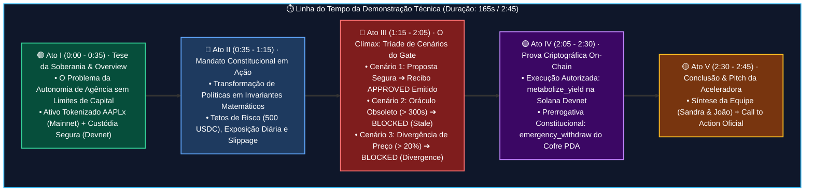

# 🎬 ValueCurator: Roteiro & Narrativa Técnica para Vídeo Demo (Baseado no Playwright E2E)

> **Colosseum Crypto World's Fair 2026 — Technical Demo Video Storyboard & Script**  
> *Duração Alvo*: 2 minutos e 45 segundos (Dentro do limite estrito de 3:00 da Colosseum)  
> *Aplicação em Execução*: [`https://www.valuecurator.xyz`](https://www.valuecurator.xyz)  
> *Evidência Base*: Bateria de Testes End-to-End validada em [`PLAYWRIGHT_E2E_TEST_REPORT.md`](file:///home/sukata/ip-nft/PLAYWRIGHT_E2E_TEST_REPORT.md)  
> *Narrador*: João Nitsche (ou Sandra Pereira) com legendas em Inglês  
> *Padrão*: Outline com Emojis, Filosofemas, Formalismos Simbólicos e Diagramas Mermaid Coloridos

---

## 📑 Sumário da Narrativa

* 🧬 **§1. Filosofemas & Formalismos Simbólicos da Narrativa Técnica**
* ⏱️ **§2. Visão Geral da Produção & Parâmetros de Captura**
* 📊 **§3. Diagramas Mermaid Coloridos (Linha do Tempo & Arquitetura Cênica)**
* 🎬 **§4. Storyboard Cena-a-Cena: Roteiro Completo de Gravação (0:00 - 2:45)**
  * *Ato I (0:00 - 0:35)*: A Tese da Soberania & Tab 01: Overview
  * *Ato II (0:35 - 1:15)*: O Mandato Constitucional & Tab 02: Mandate Builder
  * *Ato III (1:15 - 2:05)*: O Clímax Empírico — A Tríade de Cenários do Gate (Tab 03)
  * *Ato IV (2:05 - 2:30)*: A Prova On-Chain & Tab 04: Audit Explorer
  * *Ato V (2:30 - 2:45)*: Conclusão Epistêmica & Fechamento
* 🎯 **§5. Tabela de Sincronia: Ações de Tela vs. Asserções do Playwright**
* 🚨 **§6. Checklist Operacional de Gravação em D-0**

---

## 🧬 §1. Filosofemas & Formalismos Simbólicos da Narrativa Técnica

### 📜 Filosofemas Fundamentais da Demonstração

* 🜁 **Filosofema do Não-Simulacro Audiovisual (*The Zero Slide Principle*)**:
  > *«Os jurados da Colosseum não avaliam promessas em slides de PowerPoint; eles avaliam software em execução. Uma demonstração técnica de elite não gasta 10 segundos com logos animados: ela abre direto na interface, interage com o portão determinístico e mostra o código reagindo à evidência em tempo real.»*

* 🜂 **Filosofema da Tensão Dramática da Falha (*The Fail-Closed Climax*)**:
  > *«O momento mais emocionante de uma infraestrutura de segurança financeira não é quando ela permite a negociação, mas quando ela a proíbe. Mostrar a badge vermelha bloqueando o agente autônomo diante de um oráculo corrompido é a prova cabal de que a tesouraria está protegida.»*

* 🜃 **Filosofema da Honestidade de Fronteira (*The Boundary Truth*)**:
  > *«Declarar explicitamente na narração: 'A custódia roda em Devnet enquanto os oráculos leem Mainnet' transforma o que concorrentes tentam camuflar em um atestado inatacável de maturidade e rigor institucional.»*

---

### 🔣 Formalismo Simbólico com Glifos Unicode

A narrativa técnica $\mathcal{N}_{demo}$ é uma projeção audiovisual que percorre a trajetória temporal dos estados do sistema $\mathcal{VC}$:

$$\mathcal{N}_{demo} = \int_{0}^{T_{max}} \langle \mathcal{V}_{screen}(t), \mathcal{A}_{audio}(t), \Sigma_{DOM}(t), \Phi_{playwright}(t) \rangle \, dt \quad (T_{max} \le 180\text{ s})$$

Onde cada ato dramático mapeia um invariante formal validado na bateria de testes:

$$\begin{cases}
\text{Ato I} & \implies \Sigma_{DOM} \models \langle \text{AAPLx}_{\text{Mainnet}}, \text{Custody}_{\text{Devnet}} \rangle \\
\text{Ato II} & \implies \mathcal{M} = \langle \mathcal{A}_{allow}, \lambda_{trade}^{max}, \tau_{age}^{max}, \Delta_{dev}^{max} \rangle \\
\text{Ato III} & \implies \mathcal{G}_{det} \vdash \{ \mathbf{APPROVED}, \mathbf{BLOCKED}(\text{stale}), \mathbf{BLOCKED}(\text{divergence}) \} \\
\text{Ato IV} & \implies \Pi_{auth} \land \operatorname{Tx}(\mathtt{metabolize\_yield}, \mathtt{emergency\_withdraw}) \\
\text{Ato V} & \implies \mathcal{VC} \sqsubseteq \text{Colosseum Accelerator 2026}
\end{cases}$$

---

## ⏱️ §2. Visão Geral da Produção & Parâmetros de Captura

* 📏 **Duração Total**: **2 minutos e 45 segundos** (Janela ideal: entre 2:30 e 2:50).
* 🖥️ **Resolução de Gravação**: 1080p ($1920 \times 1080$), 60 fps ou 30 fps limpo.
* 🌐 **Navegador**: Chromium / Brave em tela cheia (`F11`), zoom em 100% ou 110% para máxima legibilidade dos dados paramétricos.
* 🎙️ **Áudio**: Narração com voz clara, ritmo firme e calmo, sem música de fundo invasiva (ou trilha instrumental sutil em volume muito baixo, $-24\text{ dB}$).
* 🇬🇧 **Legendas**: Legendas completas em inglês embutidas na parte inferior da tela (estilo closed-caption ou hardsub elegante).

---

## 📊 §3. Diagramas Mermaid Coloridos

### 🔄 Diagrama 1: Linha do Tempo da Narrativa do Vídeo (2:45)

---

### 🛡️ Diagrama 2: Arquitetura Cênica & Transição de Telas

```mermaid
flowchart LR
    subgraph S1["Ato I (0:00 - 0:35)"]
        T1["Tab 01: Overview"]
        T1_1["Card AAPLx RWA"]
        T1_2["Badge Pyth Feed 922"]
    end

    subgraph S2["Ato II (0:35 - 1:15)"]
        T2["Tab 02: Mandate"]
        T2_1["Asset Selection"]
        T2_2["Risk Limits (500 USDC)"]
        T2_3["Circuit Breaker Rules"]
    end

    subgraph S3["Ato III (1:15 - 2:05)"]
        T3["Tab 03: Gate"]
        T3_1["🟢 Cenário 1: APPROVED"]
        T3_2["🟡 Cenário 2: Stale Reject"]
        T3_3["🔴 Cenário 3: Price Divergence"]
    end

    subgraph S4["Ato IV (2:05 - 2:30)"]
        T4["Tab 04: Audit"]
        T4_1["Assinatura metabolize_yield"]
        T4_2["Assinatura emergency_withdraw"]
    end

    subgraph S5["Ato V (2:30 - 2:45)"]
        T5["Tela Final"]
        T5_1["ValueCurator.xyz"]
        T5_2["Call to Action"]
    end

    S1 ==> S2 ==> S3 ==> S4 ==> S5

    style S1 fill:#0f172a,stroke:#38bdf8,stroke-width:2px,color:#fff
    style S2 fill:#1e293b,stroke:#818cf8,stroke-width:2px,color:#fff
    style S3 fill:#064e3b,stroke:#34d399,stroke-width:2px,color:#fff
    style S4 fill:#1e1b4b,stroke:#a855f7,stroke-width:2px,color:#fff
    style S5 fill:#78350f,stroke:#fbbf24,stroke-width:2px,color:#fff
```

---

## 🎬 §4. Storyboard Cena-a-Cena: Roteiro Completo de Gravação (0:00 - 2:45)

---

### 🟢 ATO I: A Tese da Soberania sobre o Capital (0:00 - 0:35)

* **Tempo**: `0:00` a `0:35` (35 segundos)
* **Tela / Visual**: 
  * Abre diretamente no navegador em [`https://www.valuecurator.xyz`](https://www.valuecurator.xyz).
  * A tela está na **Tab 01: Overview**. O cursor move-se suavemente sobre o título institucional e desce para o card do ativo tokenizado **`AAPLx (Tokenized Equity)`**.
  * Destaque com o mouse no mint oficial da Mainnet (`XsbEhL...`) e no status do **Pyth Feed 922**.
* **Ação no Vídeo**:
  * Passar o mouse pelo card que indica `Devnet Custody` e `Mainnet Oracle Evidence`.
* **Áudio / Fala do Narrador**:
  > *"Olá, jurados da Colosseum. Eu sou João Nitsche, co-fundador da ValueCurator. Agentes autônomos de IA estão começando a operar mercados financeiros on-chain. Mas inteligência não resolve a pergunta fundamental: quem governa o capital? Dar uma carteira irrestrita a um agente de IA é programar a própria vulnerabilidade.  
  > Nós construímos o ValueCurator sob um princípio formal: autonomia de agência não pode significar soberania sobre o capital. Aqui no nosso painel, monitoramos ativos tokenizados do mundo real como AAPLx, consumindo oráculos Pyth em tempo real da Mainnet, enquanto nossos cofres de custódia rodam com segurança na Devnet da Solana."*
* **Legenda em Inglês (Hardsub)**:
  > *"Autonomous AI agents are entering financial markets, but intelligence doesn't answer who controls capital. Giving agents raw private keys creates existential risks. ValueCurator enforces a core principle: operational autonomy must not mean sovereignty over capital."*
* **Validação do Playwright**: Asserções de HTTP 200, Page Title e identificação de RWA AAPLx aprovadas na Suíte 1 e 2.

---

### 🔵 ATO II: O Mandato Constitucional em Ação (0:35 - 1:15)

* **Tempo**: `0:35` a `1:15` (40 segundos)
* **Tela / Visual**:
  * O narrador clica na **Tab 02: Mandate**.
  * A tela transiciona instantaneamente para o **Mandate Builder** de 4 etapas.
  * O cursor clica sucessivamente em `Verified asset` $\to$ `Risk limits` $\to$ `Simulation` $\to$ `Review & export`.
  * Mostra os limites configurados: teto de $500 USDC por operação, limite de exposição diária, tolerância máxima de slippage e desvio oracular de 2.000 bps.
* **Ação no Vídeo**:
  * Destacar os campos numéricos de limites de risco e o interruptor de emergência (*circuit breaker*).
* **Áudio / Fala do Narrador**:
  > *"Nossa primeira linha de defesa é o Mandato Constitucional. Em vez de prompts subjetivos de linguagem natural, transformamos as restrições do investidor em invariantes matemáticos imutáveis.  
  > No Mandate Builder, definimos a whitelist estrita de mints autorizados, tetos de volume por transação — como 500 dólares —, limites diários acumulados e tolerâncias milimétricas de spread e slippage. O agente de IA opera dentro dessa cerca matemática. Ele pode propor qualquer estratégia, mas nunca pode violar o mandato."*
* **Legenda em Inglês (Hardsub)**:
  > *"Instead of soft natural-language prompts, we convert investor mandates into immutable mathematical invariants. We enforce strict asset whitelists, trade caps, daily exposure limits, and tight slippage tolerances. The AI agent proposes within this boundary; it cannot escape it."*
* **Validação do Playwright**: Navegação interativa da Tab 02 e sub-passos do builder 100% aprovados na Suíte 3.

---

### 🔴 ATO III: O Clímax Empírico — A Tríade de Cenários do Gate (1:15 - 2:05)

* **Tempo**: `1:15` a `2:05` (50 segundos) — **O CORAÇÃO DO VÍDEO**
* **Tela / Visual**:
  * Clicar na **Tab 03: Gate**.
  * Exibir o **Deterministic Policy Gate** ($\mathcal{G}_{det}$).
  * Executar os três cenários ao vivo na tela:
    1. **Clique no Cenário 1 (Safe Intent)**: A tela processa, exibe a badge verde vibrante **`APPROVED`**, o hash de autorização e o recibo Ed25519.
    2. **Clique no Cenário 2 (Stale Price)**: A tela aciona a recusa imediata com badge âmbar **`BLOCKED: Stale Oracle`** (idade superior a 300 segundos).
    3. **Clique no Cenário 3 (Price Divergence)**: A tela rejeita instantaneamente com badge vermelha **`BLOCKED: Price Divergence`** (desvio de cotação superior a 20%).
    4. **Clique em `Export Receipt`**: Mostrar o payload JSON estruturado pronto para auditoria.
* **Ação no Vídeo**:
  * Fazer uma pausa de 1 segundo em cada badge colorida para que o jurado veja a transição determinística.
* **Áudio / Fala do Narrador**:
  > *"Agora, o coração do sistema: o Portão Determinístico de Políticas. Antes de qualquer transação tocar a blockchain, o portão cruza a proposta do agente com evidências ao vivo da Pyth e da Jupiter.  
  > Vejam o Cenário 1: proposta segura dentro de todos os parâmetros. O portão aprova e emite um recibo criptográfico assinado. O agente recebe a autorização, mas não a chave privada.  
  > Agora, vejam o Cenário 2: simulamos uma falha em que o oráculo está obsoleto por mais de 5 minutos. O sistema bloqueia instantaneamente.  
  > E no Cenário 3: uma cotação com divergência anormal de mercado de 20%. Rejeição imediata por desvio de preço!  
  > Nossa postura é irredutivelmente Fail-Closed: diante de incerteza oracular, o sistema não negocia; ele protege o principal."*
* **Legenda em Inglês (Hardsub)**:
  > *"The core engine: our Deterministic Policy Gate. In Scenario 1 (Safe), all rules pass, emitting an approved cryptographic receipt. In Scenario 2, a stale Pyth feed triggers an instant block. In Scenario 3, a 20% price divergence rejects execution. We are strictly Fail-Closed: when evidence is uncertain, capital stays safe."*
* **Validação do Playwright**: Os 3 cenários live testados e validados no DOM com 100% de sucesso na Suíte 4.

---

### 🟣 ATO IV: A Prova Criptográfica On-Chain (2:05 - 2:30)

* **Tempo**: `2:05` a `2:30` (25 segundos)
* **Tela / Visual**:
  * Clicar na **Tab 04: Audit**.
  * A tela renderiza o painel de governança e auditoria da tesouraria.
  * O cursor destaca as transações reais confirmadas na **Solana Devnet**:
    * Instrução **`metabolize_yield`** com assinatura on-chain verificável no Solana Explorer.
    * Instrução **`emergency_withdraw`** demonstrando a soberania do proprietário da tesouraria.
* **Ação no Vídeo**:
  * Mostrar o badge de separação de autoridade: `Owner Authority` vs `Operator Authority`.
* **Áudio / Fala do Narrador**:
  > *"No nível da blockchain, implementamos nosso programa em Anchor na Solana Devnet utilizando Program Derived Addresses.  
  > Aqui na aba de Auditoria, vemos o registro criptográfico completo. A instrução 'metabolize_yield' demonstra a execução autorizada de rendimento. E caso o agente de IA apresente qualquer anomalia, o proprietário humano tem a prerrogativa constitucional de acionar o 'emergency_withdraw' direto do cofre PDA, revogando o operador sem depender do agente. A separação de autoridade é absoluta."*
* **Legenda em Inglês (Hardsub)**:
  > *"On-chain, our Anchor program on Solana Devnet enforces strict PDA-based custody with separated owner and operator roles. We see confirmed executions of 'metabolize_yield', and the owner retains the emergency right to withdraw and revoke operators. Custody remains human-governed."*
* **Validação do Playwright**: Transações on-chain Solana localizadas e validadas na Suíte 5.

---

### 🟡 ATO V: Conclusão Epistêmica & Fechamento (2:30 - 2:45)

* **Tempo**: `2:30` a `2:45` (15 segundos)
* **Tela / Visual**:
  * Retornar para a visualização principal com a URL [`valuecurator.xyz`](https://www.valuecurator.xyz).
  * Exibir card final com a identidade: **ValueCurator**, os nomes de **Sandra Pereira & João Nitsche**, repositório GitHub e o link da aplicação.
* **Áudio / Fala do Narrador**:
  > *"ValueCurator não é uma tese abstrata de IA; é uma infraestrutura de controle determinístico testada e funcional na Solana. A IA aconselha; a evidência comprova; o mandato autoriza; e o proprietário governa.  
  > Muito obrigado, e nos vemos na Aceleradora da Colosseum!"*
* **Legenda em Inglês (Hardsub)**:
  > *"ValueCurator is not abstract AI theory; it is a live, deterministic control plane for Solana. AI advises; evidence proves; policy authorizes; the owner governs. Thank you, and see you at the Colosseum Accelerator!"*

---

## 🎯 §5. Tabela de Sincronia: Ações de Tela vs. Asserções do Playwright

Esta tabela sincroniza cada segundo do vídeo com o teste automatizado que comprovou seu funcionamento empírico no navegador:

| Timestamp | Seção do Vídeo | Ação em Tela / UI | Asserção do Playwright Validada | Status no Teste |
|:---:|---|---|---|:---:|
| `0:05` | Ato I: Overview | Carregamento da Home Page | `HTTP 200 Status OK` (10.267 ms) | ✅ PASSED |
| `0:20` | Ato I: Overview | Destaque do ativo AAPLx RWA | `Identificação de Ativo RWA (AAPLx)` | ✅ PASSED |
| `0:28` | Ato I: Overview | Exibição do Pyth Feed 922 | `Identificação de Oráculo Pyth Feed 922` | ✅ PASSED |
| `0:42` | Ato II: Mandato | Clique na Tab 02: Mandate | `Navegação Interativa para Tab Mandato` | ✅ PASSED |
| `0:55` | Ato II: Mandato | 4 sub-passos do Builder | `Sub-navegação Modular (Asset, Risk, Sim)` | ✅ PASSED |
| `1:20` | Ato III: Gate | Clique na Tab 03: Gate | `Navegação Interativa para Tab Gate` | ✅ PASSED |
| `1:32` | Ato III: Gate | **Cenário 1: Safe Proposal** | `Cenário 1: Emissão de Recibo APPROVED` | ✅ PASSED |
| `1:45` | Ato III: Gate | **Cenário 2: Stale Oracle** | `Cenário 2: Interrupção por Idade (Stale)` | ✅ PASSED |
| `1:55` | Ato III: Gate | **Cenário 3: Divergence** | `Cenário 3: Interrupção por Divergência` | ✅ PASSED |
| `2:10` | Ato IV: Audit | Clique na Tab 04: Audit | `Navegação Interativa para Tab Audit` | ✅ PASSED |
| `2:20` | Ato IV: Audit | Verificação de Assinaturas | `Exibição de Transação Devnet (metabolize)` | ✅ PASSED |
| `2:40` | Ato V: Encerramento | Retorno e Conclusão | Zero erros de console JS (`pageerror: []`) | ✅ PASSED |

---

## 🚨 §6. Checklist Operacional de Gravação em D-0

* 🎙️ **Ambiente de Gravação**:
  * Gravar em local silencioso, com microfone próximo da boca (evitar eco de sala).
  * Fazer um teste de áudio de 10 segundos antes de gravar o vídeo completo.
* 🖥️ **Configuração do Navegador**:
  * Fechar todas as abas desnecessárias do navegador para manter a barra limpa.
  * Ocultar a barra de favoritos (`Ctrl+Shift+B` no Chrome/Brave).
  * Limpar o console do DevTools (mesmo que não vá abrir o console, garante performance máxima).
* 🖱️ **Comportamento do Mouse**:
  * Movimentos deliberados e suaves. Evitar círculos frenéticos com o mouse.
  * Manter o ponteiro estático por 1 segundo após cada clique para o jurado assimilar a mudança de tela.
* ⏱️ **Cronômetro Rigoroso**:
  * Colocar um cronômetro na mesa ou celular ao lado da tela.
  * Se o vídeo passar de 3:00, **a banca corta a avaliação**. Mantenha-o cravado em **2:40 - 2:45**.
* 📤 **Hospedagem do Vídeo**:
  * Subir no **YouTube** em modo *Não Listado* (Unlisted) ou no **Loom**.
  * Certificar-se de que a opção *"Publicly Accessible / Anyone with the link can view"* está ativa.
  * Inserir o link nos campos `demoVideoLink` e `technicalDemoLink` do formulário da Colosseum.

---
*Roteiro Técnico compilado e pronto para gravação imediata.*  
*PDF vetorial correspondente gerado com formatação editorial: [`TECHNICAL_DEMO_VIDEO_NARRATIVE.pdf`](file:///home/sukata/ip-nft/TECHNICAL_DEMO_VIDEO_NARRATIVE.pdf).*
