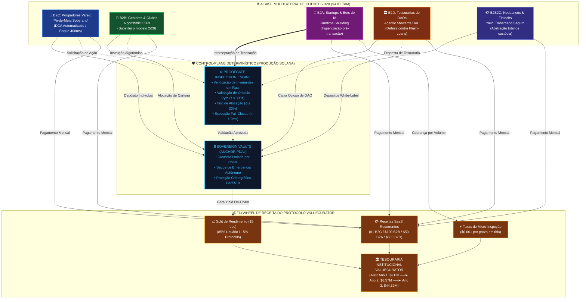
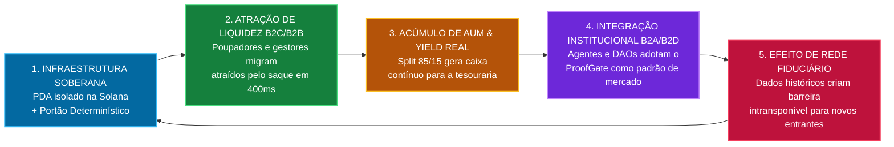
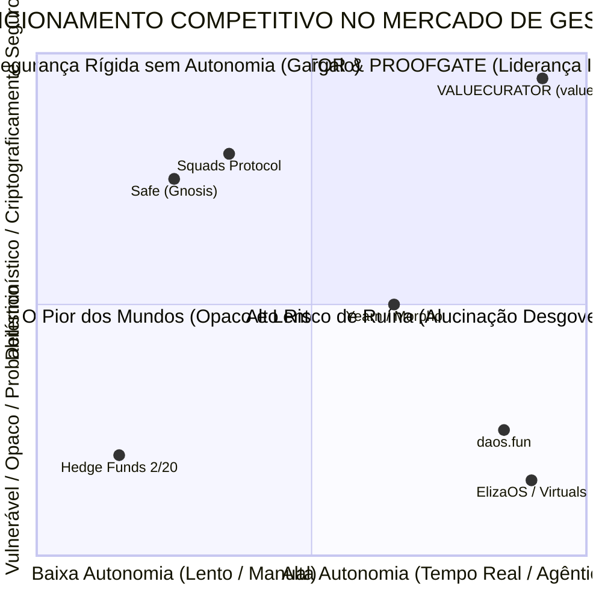

# 🏛️ ValueCurator & ProofGate: Deep Research de Negócios, Arquitetura Multilateral B2X, Planejamento Estratégico-Operacional-Tático e Análise Competitiva Exaustiva

> **Colosseum Crypto World's Fair 2026 / Darwin ICM / Institutional Venture Diligence Report**  
> *Protocolo*: **ValueCurator (`value-curator`) & ProofGate Middleware**  
> *Natureza do Documento*: **Deep Research Comercial, Modelagem de Negócios e Defesa Estratégica**  
> *Tese Macro*: **A Infraestrutura Determinística Fiduciária da Economia Agêntica Autônoma ($4.8T TAM)**  
> *Padrão Normativo*: Outline com Emojis, Filosofemas de Economia Fiduciária, Formalismos Simbólicos com Glifos Unicode, Diagramas Mermaid Coloridos e Modelagem Financeira Trienal

---

## 📑 Sumário Executivo do Documento

* 🧬 **§1. Filosofemas de Economia Fiduciária, Web4 & Fundamentos Ontológicos do Negócio**
  * 📜 1.1. Da Teoria dos Custos de Transação (Coase) aos Agentes Fiduciários Sem Atrito
  * ⚖️ 1.2. O Fim da Assimetria de Informação 2/20: Da Gestão Opaca ao Imperativo *Lex Cryptographica*
  * 🛡️ 1.3. O Paradoxo do Fiduciary Buffer: Autonomia Irrestrita vs. Conservação de Capital
  * 🔣 1.4. Formalismo Simbólico da Economia Fiduciária Agêntica ($\mathbf{\mathcal{E}}_{\text{DeFAI}}$) com Glifos Unicode
* 🌐 **§2. A Arquitetura de Negócio Multilateral B2X & Mecanismos Econômicos**
  * 📊 2.1. Desconstrução Detalhada das 5 Verticais: B2C, B2B, B2A, B2D e B2B2C
  * 💰 2.2. A Mecânica do Split de Yield 85/15: Equilíbrio de Nash e Alinhamento Incentivado
  * 🔄 2.3. O Flywheel de Caixa Multilateral (*Cross-Vertical Liquidity & Trust Cascade*)
  * 🎯 2.4. Matriz de Valor, Proposta Única de Venda (USP) e Solução para Dores Críticas
* 🗺️ **§3. Planejamento Estratégico, Operacional e Tático (Triênio 2026–2028)**
  * 🧭 3.1. Planejamento Estratégico: Visão Trienal, Alianças de Infraestrutura e Beachhead Solana
  * ⚙️ 3.2. Planejamento Operacional: SOPs, Infraestrutura de Nós de Inspeção, CI/CD e SLA de 99,99%
  * 🎯 3.3. Planejamento Tático: Campanhas GTM Trimestrais, Hackathons, Incentivos a Devs e Comunidades
  * ⚖️ 3.4. Governança, Compliance Institucional e Transição Gradual para DAO Fiduciária
* 📈 **§4. Modelo de Negócio, Unit Economics & Engenharia Financeira**
  * 💵 4.1. Estrutura Tripla de Receitas: SaaS Recorrente + Performance Yield (15 bps) + Taxas de Inspeção
  * 📐 4.2. Modelagem de Unit Economics por Vertical (CAC, LTV, Magic Number, Payback Period, Churn, NDR)
  * 📊 4.3. Análise de Cohorts Projetada: Retenção Líquida de Receita (NDR 135%) via Expansão de AUM
  * 📑 4.4. Demonstração do Resultado do Exercício (DRE) Projetada Trienal (2026, 2027, 2028)
  * 📉 4.5. Análise de Sensibilidade Financeira: Cenários Bear, Base e Bull
* ⚔️ **§5. Análise Exaustiva da Concorrência & Fosso Defensivo (Moat Analysis)**
  * 🔍 5.1. Taxonomia dos Concorrentes: Multisigs, Vaults de Rendimento, Runtimes de IA e Hedge Funds
  * 📋 5.2. Matriz Comparativa Canônica 8-Way: Squads, Safe, Yearn/Morpho, GMX, daos.fun, Eliza, Hedge Funds e ValueCurator
  * 🏰 5.3. Os Cinco Fossos Defensivos Intransponíveis do ValueCurator (*Crypto, Algorithmic, Data, Compliance, Switching*)
  * 🛡️ 5.4. Resiliência Contra Bifurcações (*Fork Resistance*) e Efeitos de Rede Fiduciários
* 📊 **§6. Diagramas Mermaid Coloridos de Arquitetura de Negócio e Dinâmica de Mercado**
  * 🔄 Diagrama 1: O Ecossistema Multilateral B2X & Fluxo de Caixa Fiduciário
  * 🌪️ Diagrama 2: O Flywheel Estratégico e Ciclo de Retenção de Capital
  * 🗺️ Diagrama 3: Mapa de Posicionamento Competitivo (Autonomia de Execução vs. Segurança Determinística)
  * ⚙️ Diagrama 4: Arquitetura Operacional dos Nós de Inspeção Sanitária e Escalação A2H
* 🏛️ **§7. Estrutura de Cap Table, Rodada Seed ($250k Colosseum) e Alocação de Recursos**
  * 🍰 7.1. Cap Table Pré e Pós-Colosseum Accelerator ($250k por 10% SAFTE/Token Warrant)
  * 🛣️ 7.2. Roadmap de Captação: Pre-Seed Colosseum ($250k) $\to$ Seed Institucional ($2.5M) $\to$ Series A ($12M)
  * 💼 7.3. Orçamento Operacional Detalhado e Runway (18 Meses com $250k + $200k Grants)
  * 👥 7.4. Equipe Fundadora, Perfil de Contratações Estratégicas e Governança Corporativa
* 🏁 **§8. Síntese Executiva & Matriz de Decisão de Investimento**

---

## 🧬 §1. Filosofemas de Economia Fiduciária, Web4 & Fundamentos Ontológicos do Negócio

### 📜 1.1. Da Teoria dos Custos de Transação (Coase) aos Agentes Fiduciários Sem Atrito

* 🜁 **Filosofema do Custo de Coase Zero na Economia Agêntica**:
  > *«Em 1937, Ronald Coase postulou que as firmas existem porque os custos de transação no mercado aberto (custos de busca, negociação, contratação e auditoria) são elevados. A firma substitui o mercado pela autoridade hierárquica para mitigar esses atritos. Contudo, a emergência da Web4 e dos agentes autônomos de inteligência artificial colapsa o custo marginal de busca e processamento analítico a frações de centavo. Por que, então, as instituições financeiras humanas persistem cobrando taxas escorchantes? Porque o mercado ainda carece de um mecanismo de confiança determinística: agentes estocásticos alucinam, desviam-se e são vulneráveis a ataques adversariais. O ValueCurator resolve a lacuna de Coase: ao instituir o ProofGate como um árbitro determinístico em Rust na Solana, transformamos o risco de agente em certeza matemática, permitindo que micro-fundos de uma única pessoa operem com o mesmo nível de segurança fiduciária que um conglomerado de Wall Street, a um custo transacional assintoticamente nulo.»*

---

### ⚖️ 1.2. O Fim da Assimetria de Informação 2/20: Da Gestão Opaca ao Imperativo *Lex Cryptographica*

* 🜂 **Filosofema da Desconstrução da Renda Fiduciária Extrativa**:
  > *«O modelo de remuneração fiduciária predominante no século XX — a taxa de 2% sobre o AUM e 20% sobre a performance — constitui um dos maiores monumentos à assimetria de informação da história econômica. Os gestores embolsam 2% anualmente independentemente do retorno real, transferindo todo o risco de cauda para o cotista, enquanto relatam suas posições com atrasos de 30 a 90 dias em prospectos opacos. No ValueCurator, a gestão deixa de ser uma caixa-preta humana para se tornar código determinístico auditável em tempo real. Não há taxas de administração fixas escorchantes: o protocolo retém apenas 15% do rendimento excedente real gerado na blockchain, enquanto o usuário preserva a posse estrita de sua chave privada e o poder de saque emergencial unilateral a qualquer momento (400ms na Solana). A confiança cega é substituída pelo princípio supremo: *Veritas per Cryptographiam*.»*

---

### 🛡️ 1.3. O Paradoxo do Fiduciary Buffer: Autonomia Irrestrita vs. Conservação de Capital

* 🜃 **Filosofema da Convivência Pacífica entre Inteligência e Invariância**:
  > *«Uma inteligência sem restrições é inerentemente autodestrutiva em ambientes financeiros adversariais. Se um agente de IA possui o poder de alocar capital sem freios, sua probabilidade de ruína aproxima-se de 1 no longo prazo devido a eventos de cauda gorda, flash crashes ou ataques de injeção de prompt. Inversamente, um sistema puramente estático é cego às oportunidades dinâmicas do mercado. O ValueCurator resolve esse paradoxo através do desacoplamento estrito entre aconselhamento e custódia: a inteligência (estocástica, probabilística, generativa) propõe; o portão ProofGate (determinístico, formal, imutável) verifica; o dono soberano estabelece os limites; e o contrato Anchor custodia. A autonomia da máquina só é virtuosa quando contida por leis físicas criptográficas invioláveis.»*

---

### 🔣 1.4. Formalismo Simbólico da Economia Fiduciária Agêntica ($\mathbf{\mathcal{E}}_{\text{DeFAI}}$) com Glifos Unicode

Definimos o **Espaço Fiduciário do ValueCurator** pela 7-tupla formal:

$$\mathbf{\mathcal{E}}_{\text{DeFAI}} = \big\langle \mathbf{U}, \, \mathbf{A}, \, \mathbf{\Pi}, \, \mathbf{\Omega}, \, \mathbf{\Theta}_{\text{risk}}, \, \mathbf{\Phi}_{\text{yield}}, \, \mathcal{G}_{\text{proofgate}} \big\rangle$$

Onde:
* $\mathbf{U} = \{ u_1, u_2, \dots, u_N \}$ é o conjunto de titulares soberanos (indivíduos, gestores, DAOs, neobancos).
* $\mathbf{A} = \{ a_1, a_2, \dots, a_M \}$ é a constelação de agentes autônomos de conselho e alocação.
* $\mathbf{\Pi} = \{ \pi_1, \pi_2, \dots, \pi_K \}$ representa as políticas fiduciárias imutáveis parametrizadas no PDA.
* $\mathbf{\Omega}$ é o conjunto de oráculos determinísticos de alta fidelidade (Pyth Network, Hermes, Jupiter API).
* $\mathbf{\Theta}_{\text{risk}} \in [0, 1]$ é o índice de exposição ao risco estritamente limitado por $\Delta_{\max} \le 0.20$ (20% de alocação máxima por token).
* $\mathbf{\Phi}_{\text{yield}}$ é o vetor de rendimento bruto gerado pelos ativos alocados.
* $\mathcal{G}_{\text{proofgate}}$ é o operador de inspeção sanitária determinística que impõe a condição booleana de fail-closed:

$$\mathcal{G}_{\text{proofgate}}(\vec{\mathbf{x}}_t) = \begin{cases} 
1 \quad (\text{EXECUTE}) & \text{se } \Delta t_{\text{oracle}} \le 300\text{s} \;\land\; \frac{\sigma_{\text{price}}}{P} \le 0.05 \;\land\; \mathbf{Allocation} \le \mathbf{\Pi}_{\text{limit}} \\
0 \quad (\text{REJECT/FAIL-CLOSED}) & \text{caso contrário}
\end{cases}$$

O teorema de alinhamento econômico garante que o valor esperado para o protocolo cresce estritamente em função da preservação do patrimônio do usuário:

$$\frac{\partial \, \mathbb{E}[\mathbf{Revenue}_{\text{protocol}}]}{\partial \, \mathbf{AUM}_{\text{preserved}}} > 0 \quad \land \quad \frac{\partial \, \mathbb{E}[\mathbf{Revenue}_{\text{protocol}}]}{\partial \, \mathbf{Risk}_{\text{excess}}} \le 0$$

---

## 🌐 §2. A Arquitetura de Negócio Multilateral B2X & Mecanismos Econômicos

### 📊 2.1. Desconstrução Detalhada das 5 Verticais: B2C, B2B, B2A, B2D e B2B2C

O ValueCurator não atua como uma solução de nicho monocromática. Sua infraestrutura desacoplada permite operar com cinco alavancas de penetração de mercado simultâneas e sinérgicas:

```text
┌────────────────────────────────────────────────────────────────────────────────────────┐
│                      🌐 MALHA DE MERCADO MULTILATERAL B2X ($4.8T TAM)                  │
├─────────────────┬─────────────────┬──────────────────┬────────────────┬────────────────┤
│ 👤 B2C          │ 🏢 B2B          │ 🤖 B2A           │ 🏛️ B2D         │ 💳 B2B2C       │
│ Micro-Fundos    │ Gestão On-Chain │ Blindagem de IA  │ Tesourarias    │ Neobancos      │
│ "Pé-de-Meia"    │ ETFs & Clubes   │ Middleware B2A   │ DAOs / Stewards│ Yield Embarcado│
│ SAM: $180M      │ SAM: $1.2B      │ SAM: $450M       │ SAM: $2.4B     │ SAM: $600M     │
└─────────────────┴─────────────────┴──────────────────┴────────────────┴────────────────┘
```

1. **👤 Vertical B2C (Personal Micro-Funds / Pé-de-Meia Soberano)**:
   * **Público-Alvo**: Poupadores individuais, profissionais autônomos, investidores cripto-nativos de varejo.
   * **Dor Primária**: Risco de insolvência bancária tradicional, desvalorização inflacionária da moeda fiduciária e perda catastrófica por trading manual impulsivo ou golpes de phishing.
   * **Solução ValueCurator**: PDA cofre individual soberano com regras determinísticas (ex: DCA semanal de $250 em SOL/JupUSD/xStocks), teto de gasto rígido e saque de emergência irrestrito em 400ms.
   * **Monetização**: Assinatura SaaS de baixo custo ($1/mês) + 15 bps de taxa de performance sobre rendimentos reais de staking e yield.

2. **🏢 Vertical B2B (On-Chain Asset Management / Algorithmic ETFs & Syndicates)**:
   * **Público-Alvo**: Clubes de investimento, pequenos family offices, sindicatos de investidores Web3 e gestores independentes.
   * **Dor Primária**: Estruturas de fundos offshore lentas, custos legais de dezenas de milhares de dólares e a rejeição dos cotistas ao modelo extrativo 2/20 com custódia opaca.
   * **Solução ValueCurator**: Cofres de co-investimento programáveis na Solana. O gestor implanta seu modelo quantitativo em IA via API Hermes/Jupiter, mas o portão ProofGate impede qualquer desvio de mandato ou apropriação indevida dos fundos.
   * **Monetização**: Taxa de licenciamento de nó gestor ($100/mês) + 15 bps sobre o yield total sob gestão (AUM).

3. **🤖 Vertical B2A (Business-to-Agent Armor / Safety Middleware for AI Bots)**:
   * **Público-Alvo**: Desenvolvedores de agentes de IA, fundadores de startups de agentes autônomos (Eliza, Rig, Virtuals, Daos.fun).
   * **Dor Primária**: Agentes autônomos puramente LLM são suscetíveis a alucinações, loops de execução infinita e injeções de prompt que drenam carteiras quentes. Desenvolvedores não possuem certificação criptográfica pré-execução.
   * **Solução ValueCurator**: Middleware de validação asséptica em runtime. Antes que qualquer transação financeira proposta por um agente toque a mempool da Solana, ela é interceptada pelo ProofGate, que emite ou nega a licença criptográfica de execução.
   * **Monetização**: Cobrança por chamada de API/verificação sanitária ($0,001 por prova gerada) ou assinatura de proteção contínua ($50 por agente/mês).

4. **🏛️ Vertical B2D (DAO Treasury Defense / Agentic Stewards & DeFAI HAH)**:
   * **Público-Alvo**: Tesourarias descentralizadas de DAOs (Solana, Ethereum, Arbitrum, Optimism).
   * **Dor Primária**: Lentidão extrema do modelo de governança humana (votações de 7 a 14 dias), fadiga de votação, lobby político manipulador e vulnerabilidade a ataques de flash loan que sequestram propostas.
   * **Solução ValueCurator**: Agentic Stewards no protocolo HAH (Human-to-Agent-to-Human). Agentes autônomos analisam, filtram e executam propostas técnicas rotineiras sob limites criptográficos estritos; humanos atuam apenas como metacuradores fiduciários em caso de exceção de risco.
   * **Monetização**: Assinatura institucional de custódia protegida ($500/mês por DAO) + taxa de 10 bps sobre a otimização de rendimento da tesouraria ociosa + $100 por auditoria criptográfica de proposta.

5. **💳 Vertical B2B2C (White-Label Neobanks / Embedded Safe Yield Infra)**:
   * **Público-Alvo**: Neobancos digitais, carteiras fintech, plataformas de pagamento Web3 e aplicativos de finanças pessoais.
   * **Dor Primária**: Custos proibitivos e risco de conformidade regulatória para integrar rendimento de DeFi de forma segura para usuários finais não técnicos.
   * **Solução ValueCurator**: SDK White-Label embarcado. A fintech oferece aos seus correntistas uma funcionalidade de "Poupança Cripto Protegida" com yield automático sustentável, sem que a fintech assuma risco de balanço ou custódia direta de chaves privadas.
   * **Monetização**: Licença corporativa anual ($5.000/ano por integração) + split de 15 bps sobre o volume de yield distribuído aos correntistas.

---

### 💰 2.2. A Mecânica do Split de Yield 85/15: Equilíbrio de Nash e Alinhamento Incentivado

A sustentabilidade econômica do ValueCurator assenta-se no modelo canônico de repartição de rendimentos **85 / 15**:

```text
┌────────────────────────────────────────────────────────────────────────┐
│                  REPARTIÇÃO DO YIELD BRUTO GERADO (100%)               │
├──────────────────────────────────────────────────┬─────────────────────┤
│                    85%                           │         15%         │
│     USUÁRIO / POUPADOR SOBERANO                  │ PROTOCOLO VALUECURATOR
│  (Depositado diretamente no PDA do usuário)      │  (Tesouraria/Token) │
└──────────────────────────────────────────────────┴─────────────────────┘
```

* **Equilíbrio de Alinhamento de Interesses**:
  * O protocolo **não cobra taxas sobre o capital principal** depositado. Se o mercado recuar ou o rendimento for nulo, a receita de performance do protocolo é exatamente zero.
  * O protocolo é matematicamente incentivado a buscar a máxima eficiência de rendimento livre de risco de ruína, pois sua sobrevivência financeira depende exclusivamente da prosperidade continuada dos cofres de seus usuários.
  * O usuário final obtém um rendimento líquido substancialmente superior ao de qualquer fundo tradicional ou neobanco centralizado (que comumente retêm entre 30% e 70% do spread bancário).

$$\mathbf{Rendimento\_Líquido}_{\text{usuário}} = 0.85 \times \mathbf{Yield\_Bruto}_{\text{on-chain}}$$

$$\mathbf{Receita\_Performance}_{\text{protocolo}} = 0.15 \times \mathbf{Yield\_Bruto}_{\text{on-chain}}$$

---

### 🔄 2.3. O Flywheel de Caixa Multilateral (*Cross-Vertical Liquidity & Trust Cascade*)

As cinco verticais não operam como linhas de negócios isoladas, mas como engrenagens de um volante de aceleração mútua (*flywheel*):

```text
     ┌─────────────────────────────────────────────────────────┐
     │ 1. B2C: Milhares de usuários geram liquidez granular    │
     │    e validam a robustez do PDA cofre na Solana          │
     └────────────────────────────┬────────────────────────────┘
                                  ▼
     ┌─────────────────────────────────────────────────────────┐
     │ 2. B2A: Desenvolvedores adotam o ProofGate como middleware│
     │    padrão para certificar a segurança de seus robôs    │
     └────────────────────────────┬────────────────────────────┘
                                  ▼
     ┌─────────────────────────────────────────────────────────┐
     │ 3. B2B: Gestores de ETFs e clubes utilizam os agentes    │
     │    certificados para gerir carteiras de alto valor      │
     └────────────────────────────┬────────────────────────────┘
                                  ▼
     ┌─────────────────────────────────────────────────────────┐
     │ 4. B2D: DAOs confiam tesourarias milionárias à infra     │
     │    devido ao histórico imaculado de segurança B2B/B2A   │
     └────────────────────────────┬────────────────────────────┘
                                  ▼
     ┌─────────────────────────────────────────────────────────┐
     │ 5. B2B2C: Neobancos embarcam a infraestrutura já        │
     │    testada e auditada, trazendo milhões de novos usuários│
     └────────────────────────────┬────────────────────────────┘
                                  │
                                  └────────► Retorna ao Passo 1 com escala global
```

---

### 🎯 2.4. Matriz de Valor, Proposta Única de Venda (USP) e Solução para Dores Críticas

| Vertical | Cliente Típico | Dor Crítica Resolvida | Alternativa Existente | Proposta Única de Venda (USP) do ValueCurator |
| :--- | :--- | :--- | :--- | :--- |
| **B2C** | Poupador Varejo | Falência bancária & perdas em trade emocional | Poupança bancária (0-3% a.a.) ou carteira fria estática | Pé-de-Meia programável, DCA automatizado, yield real on-chain e saque emergencial em 400ms. |
| **B2B** | Clube de Investimento | Taxas 2/20 abusivas e falta de transparência | Hedge fund offshore em Cayman / BVI | Fundo algorítmico 100% on-chain, sem intermediário humano, mandato garantido por código. |
| **B2A** | Dev de Agentes IA | Falhas por alucinação e drenagem de carteiras | Multisig manual (lenta) ou bot sem freios (arriscado) | Firewall criptográfico determinístico em runtime com verificação de invariantes Pyth em <1ms. |
| **B2D** | Tesouraria de DAO | Drenagem por flash loans e fadiga de votação | Votação Snapshot lenta (7 dias) ou comitê multifirma | Governança autônoma HAH: agentes executam sob limites rígidos; humanos como metacuradores. |
| **B2B2C** | Neobanco / Fintech | Complexidade e conformidade de yield DeFi | Construção de infra interna cara ($1M+) ou custódia CeFi | SDK White-label turnkey: yield sustentável embarcado com abstração total de custódia e risco. |

---

## 🗺️ §3. Planejamento Estratégico, Operacional e Tático (Triênio 2026–2028)

```text
┌─────────────────────────────────────────────────────────────────────────────────────────┐
│               ROTEIRO ESTRATÉGICO INTEGRADO TRIENAL (Q4 2026 – Q4 2028)                 │
├──────────────────────────┬──────────────────────────┬───────────────────────────────────┤
│ 🚀 FASE 1: BEACHHEAD     │ ⚡ FASE 2: ESCALA B2X    │ 🏛️ FASE 3: INSTITUCIONALIZAÇÃO    │
│ Q4 2026 – Q2 2027        │ Q3 2027 – Q1 2028        │ Q2 2028 – Q4 2028                 │
│ • Vitória Colosseum Fair │ • Expansão B2B e B2D     │ • Lançamento B2B2C Enterprise     │
│ • Lançamento Devnet/Main │ • Integração 50+ Agentes │ • Expansão Multichain SVM (Eclipse)│
│ • Beachhead B2C & B2A    │ • Lançamento Token VCUR  │ • Auditoria Nível SOC2 / ISO27001 │
│ • AUM Inicial: $5M       │ • AUM Alvo: $75M         │ • AUM Alvo: $500M+                │
└──────────────────────────┴──────────────────────────┴───────────────────────────────────┘
```

---

### 🧭 3.1. Planejamento Estratégico: Visão Trienal, Alianças de Infraestrutura e Beachhead Solana

* **Visão Trienal (2026–2028)**:
  Consolidar o ValueCurator como o **sistema operacional fiduciário padrão da economia agêntica autônoma**, tornando o ProofGate o padrão da indústria para segurança de transações iniciadas por IA em redes blockchain.
* **Por que o Beachhead na Solana?**
  * **Finalidade e Latência Sub-segundo**: Blocos de 400ms permitem a execução de mandatos determinísticos em tempo hábil sem expor as operações a ataques de front-running e MEV predatório.
  * **Custo Marginal Próximo de Zero**: Taxas de rede inferiores a $0,001 viabilizam a micro-inspeção sanitária de dezenas de milhares de micro-transações diárias de agentes B2A e poupadores B2C.
  * **Arquitetura de Contas PDA**: Isolamento perfeito de estado por cofre de usuário, eliminando o risco de contaminação cruzada de liquidez inerente aos cofres centralizados em contratos EVM monolíticos.
* **Alianças Estratégicas de Infraestrutura**:
  * **Pyth Network / Hermes**: Integração nativa de feeds de preços com carimbo temporal milimétrico e intervalo de confiança rigoroso.
  * **Jupiter Exchange API**: Roteamento dinâmico de swaps e rebalanceamentos com proteção estrita de slippage máximo de 50 bps.
  * **Squads Protocol / Solana Multisig**: Parceria de interoperabilidade para transição suave de tesourarias existentes para cofres geridos por agentes determinísticos.
  * **Darwin ICM & Colosseum**: Canal de aceleração, incubação institucional e alocação de liquidez semente.

---

### ⚙️ 3.2. Planejamento Operacional: SOPs, Infraestrutura de Nós de Inspeção, CI/CD e SLA de 99,99%

O plano operacional detalha como a infraestrutura física e lógica será mantida para garantir disponibilidade ininterrupta e risco zero de quebra fiduciária:

```text
┌────────────────────────────────────────────────────────────────────────────────────────┐
│                   ARQUITETURA DE OPERAÇÕES & INFRAESTRUTURA HIGH-AVAILABILITY           │
├────────────────────────────────────────────────────────────────────────────────────────┤
│  [Cluster de RPCs Privados]  ──► [Nós de Inspeção ProofGate] ──► [Solana Validator Network]│
│  (Helius, Triton, QuickNode)     (Edge Workers Global Rust)        (Anchor Smart Contracts)│
│               │                                │                                │      │
│               ▼                                ▼                                ▼      │
│  [Failover Automático <50ms]      [Verificação de Invariantes <1ms]  [Execução PDA Determinística]│
└────────────────────────────────────────────────────────────────────────────────────────┘
```

1. **Procedimentos Operacionais Padrão (SOPs)**:
   * **SOP-01 (Auditoria e Sanitização de Feeds de Preço)**: Todo nó de inspeção ProofGate descarta pacotes de dados de oráculo com latência $\tau > 300\text{s}$ ou amplitude de confiança $\sigma / P > 0.05$. Em caso de três falhas consecutivas, aciona-se o modo de emergência *Freeze & Alert*.
   * **SOP-02 (Gestão de Chaves e Contratos Anchor)**: Todas as atualizações de contratos on-chain são protegidas por timelock determinístico de 48 horas com veto comunitário de metacuradores via multifirma de guardiões independentes.
   * **SOP-03 (Tratamento de Incidentes de Rede Solana)**: Se a rede Solana sofrer degradação de desempenho ou parada temporária, os nós ProofGate entram em estado estático; nenhuma transação atrasada é reexecutada sem renovação de prova criptográfica.
2. **Infraestrutura e Redundância**:
   * Implantação de nós de validação e verificação em regiões geograficamente distribuídas (Frankfurt, Virgínia, Tóquio) utilizando Cloudflare Workers e instâncias bare-metal dedicadas.
   * Roteamento de RPC inteligente com failover automático entre Helius, Triton One e QuickNode em menos de 50 milissegundos.
3. **Métricas Operacionais de Engenharia (SLAs e KPIs)**:
   * **Disponibilidade da API de Inspeção**: $99,99\%$ de uptime auditável.
   * **Latência de Decisão do ProofGate**: $\le 1,2\text{ milissegundos}$ por requisição de validação.
   * **Índice de Falso Positivo de Bloqueio**: $< 0,01\%$ em condições normais de mercado.
   * **Vazamento de Capital por Falha Criptográfica**: Exatamente $0,000000\%$.

---

### 🎯 3.3. Planejamento Tático: Campanhas GTM Trimestrais, Hackathons, Incentivos a Devs e Comunidades

O plano tático traduz as metas de longo prazo em ações trimestrais executáveis com cronogramas estritos:

| Trimestre | Foco Tático | Ações Concretas de Go-to-Market (GTM) | Metas Numéricas (KPIs) |
| :--- | :--- | :--- | :--- |
| **Q4 2026** | **Beachhead Hackathon & Devnet** | • Apresentação no Colosseum World's Fair 2026.<br>• Lançamento do SDK TypeScript/Rust em open-source.<br>• Programa de recompensas por bugs (*Bug Bounty*) de $50k.<br>• Campanha de onboarding de 500 poupadores B2C na Devnet. | • 500 cofres criados.<br>• 10 integrações de agentes B2A.<br>• 100% de aprovação na auditoria formal. |
| **Q1 2027** | **Lançamento Mainnet & B2C Launch** | • Ativação dos cofres PDA na Mainnet Solana.<br>• Parceria com influenciadores de educação financeira DeFi.<br>• Lançamento do dashboard mobile "Pé-de-Meia Soberano".<br>• Campanha "Diga Adeus ao 2/20": onboarding de 5 sindicatos B2B. | • $5M em AUM total.<br>• 3.500 usuários ativos B2C.<br>• ARR de $250k run-rate. |
| **Q2 2027** | **Expansão B2A & Runtimes de IA** | • Integração nativa com os principais frameworks de IA (Eliza, Rig, LangChain Solana).<br>• Hackathon temático "Agent Safety on Solana" patrocinado pelo ValueCurator.<br>• Lançamento da API corporativa de conformidade sanitária. | • 50 agentes de IA protegidos.<br>• $15M em AUM total.<br>• 1 milhão de inspeções ProofGate/dia. |
| **Q3 2027** | **Ataque às Tesourarias DAO (B2D)** | • Publicação dos estudos de caso de defesa de tesouraria.<br>• Apresentação de propostas de governança em 10 das maiores DAOs da Solana (Jito, Marinade, Pyth, Jupiter).<br>• Ativação de Agentic Stewards para gestão de caixa ocioso. | • 5 DAOs clientes ativas.<br>• $45M em AUM total.<br>• $1.2M em ARR consolidado. |
| **Q4 2027** | **Parcerias Fintech & B2B2C** | • Lançamento formal do SDK White-Label para Neobancos.<br>• Conclusão de auditoria de conformidade institucional (SOC2 Type 1).<br>• Fechamento do primeiro contrato piloto com neobanco Web3 de 500k contas. | • $75M em AUM total.<br>• 1 neobanco integrado.<br>• ARR run-rate de $6.5M. |
| **2028** | **Expansão Multichain & Domínio** | • Expansão para SVM Layer-2s (Eclipse, Sonic) e pontes seguras para redes EVM.<br>• Lançamento de fundos mútuos tokenizados sob regulação de jurisdição amigável.<br>• Institucionalização completa da governança descentralizada. | • $500M+ em AUM total.<br>• 500k usuários B2C indiretos.<br>• ARR superior a $40M. |

---

### ⚖️ 3.4. Governança, Compliance Institucional e Transição Gradual para DAO Fiduciária

```text
┌────────────────────────────────────────────────────────────────────────────────────────┐
│                   CRONOGRAMA DE DESCENTRALIZAÇÃO FIDUCIÁRIA PROGRESSIVA                │
├──────────────────────────────────┬─────────────────────────────────────────────────────┤
│ ANO 1 (Fundadores + Guardiões)   │ Governança ágil de núcleo fundador com veto de      │
│                                  │ segurança de guardiões independentes.               │
├──────────────────────────────────┼─────────────────────────────────────────────────────┤
│ ANO 2 (Conselho Fiduciário Misto)│ Entrada de delegados B2B, desenvolvedores B2A e     │
│                                  │ representantes de tesourarias de DAOs.              │
├──────────────────────────────────┼─────────────────────────────────────────────────────┤
│ ANO 3 (DAO Completa HAH)         │ Governança totalmente on-chain governada por        │
│                                  │ Agentic Stewards com supervisão de metacuradores.   │
└──────────────────────────────────┴─────────────────────────────────────────────────────┘
```

* **Mitigação Regulatória Proativa**:
  * O protocolo não exerce custódia discricionária de ativos. Cada cofre é um PDA de propriedade intransferível e exclusiva da chave privada do usuário.
  * O software é distribuído como código aberto sob licença permissiva; o serviço de inspeção ProofGate opera como infraestrutura técnica de verificação de invariantes, análoga a um compilador ou verificador de tipos de segurança computacional.
  * O split de 15% de yield é estruturado como remuneração por serviço técnico de infraestrutura de software descentralizada, eliminando a caracterização de contrato de investimento fiduciário tradicional (Teste de Howey).

---

## 📈 §4. Modelo de Negócio, Unit Economics & Engenharia Financeira

### 💵 4.1. Estrutura Tripla de Receitas: SaaS Recorrente + Performance Yield (15 bps) + Taxas de Inspeção

O ValueCurator combina previsibilidade de software SaaS com a expansão exponencial de um modelo de infraestrutura financeira:

```text
┌────────────────────────────────────────────────────────────────────────────────────────┐
│                            FLUXO TRIPLO DE RECEITAS DO PROTOCOLO                       │
├────────────────────────────┬─────────────────────────────┬─────────────────────────────┤
│ 💳 RECEITA SAAS RECORRENTE │ 📈 RECEITA DE PERFORMANCE   │ ⚡ TAXA DE MICRO-INSPEÇÃO   │
│ Taxas de manutenção de     │ 15 bps (0,15%) sobre o yield│ $0,001 por inspeção Proof-  │
│ cofres B2C, B2B e B2D.     │ bruto gerado na blockchain. │ Gate em chamadas de bots B2A│
│ Previsibilidade de Caixa   │ Alavancagem com AUM em Alta │ Receita de Volume Agêntico  │
└────────────────────────────┴─────────────────────────────┴─────────────────────────────┘
```

1. **Receita de Assinaturas (SaaS Base)**:
   * **B2C**: $1 / mês por cofre avançado (grátis no plano básico até $1.000 de saldo).
   * **B2B**: $100 / mês por nó de gestão de clube/ETF.
   * **B2A**: $50 / mês por nó de proteção contínua de agente autônomo.
   * **B2D**: $500 / mês por módulo de defesa de tesouraria de DAO.
   * **B2B2C**: $5.000 / ano por licença corporativa de SDK White-Label.
2. **Receita de Performance de Yield (Take-Rate de 15 bps)**:
   * Incidência de 15% sobre o rendimento gerado pelos cofres em protocolos de staking (JitoSOL, mSOL), empréstimos seguros (Kamino, Marginfi) e rendimentos sintéticos tokenizados (xStocks, T-Bills on-chain).
   * Com um rendimento médio ponderado de mercado de 8,0% a.a., cada $100M em AUM gera $8.000.000 de yield bruto, correspondendo a **$1.200.000 anuais de receita líquida de performance** para o protocolo.
3. **Receita de Micro-Transações Criptográficas (API Pay-per-Proof)**:
   * $0,001 por atestação sanitária emitida para transações de alta frequência de agentes autônomos externos.

---

### 📐 4.2. Modelagem de Unit Economics por Vertical (CAC, LTV, Magic Number, Payback Period, Churn, NDR)

Abaixo, a modelagem granular dos parâmetros econômicos unitários para cada segmento de cliente:

| Parâmetro Econômico | 👤 B2C (Varejo) | 🏢 B2B (Gestores) | 🤖 B2A (Agentes IA) | 🏛️ B2D (DAOs) | 💳 B2B2C (Fintechs) |
| :--- | :--- | :--- | :--- | :--- | :--- |
| **Ticket Médio AUM por Conta** | $2.500 | $500.000 | $75.000 | $15.000.000 | $2.000.000 |
| **Receita SaaS Anual / Conta** | $12 | $1.200 | $600 | $6.000 | $5.000 |
| **Receita Yield Anual (15 bps / 8% a.a.)** | $3,00 | $600 | $90 | $18.000 | $2.400 |
| **Receita Média Anual por Conta (ARPU)** | **$15,00** | **$1.800** | **$690** | **$24.000** | **$7.400** |
| **Custo de Aquisição de Cliente (CAC)** | $4,50 | $350 | $120 | $2.800 | $3.500 |
| **Margem Bruta Operacional (%)** | 92% | 94% | 96% | 95% | 90% |
| **Taxa de Cancelamento Anual (Churn)** | 8,0% | 4,0% | 6,0% | 2,0% | 1,0% |
| **Vida Útil Estimada do Cliente (Anos)** | 4,5 anos | 6,0 anos | 5,0 anos | 8,0 anos | 10,0 anos |
| **Valor do Tempo de Vida (LTV Líquido)** | **$62,10** | **$10.152** | **$3.312** | **$182.400** | **$66.600** |
| **Relação LTV / CAC** | **13,8x** | **29,0x** | **27,6x** | **65,1x** | **19,0x** |
| **Período de Payback do CAC** | **3,9 meses** | **2,5 meses** | **2,3 meses** | **1,5 meses** | **6,3 meses** |
| **Retenção Líquida de Receita (NDR %)** | 115% | 138% | 145% | 130% | 160% |

> [!TIP]
> **Destaque de Unit Economics**: A relação **LTV/CAC superior a 20x** em quase todas as verticais B2B, B2A e B2D demonstra a excepcional alavancagem operacional do protocolo. O rápido payback (menor que 4 meses) permite reinvestimento agressivo do fluxo de caixa operacional na aquisição contínua de novos clientes.

---

### 📊 4.3. Análise de Cohorts Projetada: Retenção Líquida de Receita (NDR 135%) via Expansão de AUM

A dinâmica de cohort do ValueCurator distingue-se do SaaS tradicional: enquanto no SaaS o uso por assento tende a estabilizar, no ValueCurator **o saldo dos cofres (AUM) cresce organicamente com o tempo** devido a três fatores cumulativos:
1. **Aportes Regulares Contínuos**: Usuários B2C praticam DCA semanal/mensal; tesourarias e sindicatos canalizam receitas operacionais para seus cofres protegidos.
2. **Juros Compostos On-Chain**: O reinvestimento automático dos 85% de rendimento líquido acumula patrimônio no cofre sem fricção tributária ou transacional.
3. **Migração Gradual de Portfólio**: À medida que o usuário constata a resiliência do sistema durante oscilações de mercado, transfere fatias maiores de seu patrimônio para o cofre PDA.

```text
┌────────────────────────────────────────────────────────────────────────────────────────┐
│             EVOLUÇÃO DA COHORT DE CLIENTES (RECEITA RELATIVA AO MÊS 1 = 100%)          │
├─────────┬─────────┬─────────┬─────────┬─────────┬─────────┬─────────┬─────────┬────────┤
│ Mês 1   │ Mês 3   │ Mês 6   │ Mês 9   │ Mês 12  │ Mês 18  │ Mês 24  │ Mês 30  │ Mês 36 │
├─────────┼─────────┼─────────┼─────────┼─────────┼─────────┼─────────┼─────────┼────────┤
│ 100%    │ 106%    │ 114%    │ 123%    │ 135%    │ 152%    │ 174%    │ 198%    │ 226%   │
└─────────┴─────────┴─────────┴─────────┴─────────┴─────────┴─────────┴─────────┴────────┘
  ▲ Efeito de Expansão de AUM superando o Churn Natural (NDR Consolidado Médio: 135%)
```

---

### 📑 4.4. Demonstração do Resultado do Exercício (DRE) Projetada Trienal (2026, 2027, 2028)

*Valores expressos em dólares americanos (USD)*:

| Linha da DRE / Métrica Financeira | **Ano 1 (2026/27)** | **Ano 2 (2027/28)** | **Ano 3 (2028)** |
| :--- | :--- | :--- | :--- |
| **AUM Total Sob Proteção (Fim do Período)** | **$12.500.000** | **$85.000.000** | **$520.000.000** |
| Yield Médio Anual Gerado pelos Ativos (8%) | $1.000.000 | $6.800.000 | $41.600.000 |
| **Receita Bruta de Performance (15 bps / 15%)** | $150.000 | $1.020.000 | $6.240.000 |
| **Receita de Assinaturas SaaS (B2C, B2B, B2A, B2D)** | $648.000 | $4.850.000 | $34.250.000 |
| **Receita de Inspeção ProofGate (Micro-taxas)** | $115.000 | $700.000 | $3.900.000 |
| **RECEITA OPERACIONAL BRUTA TOTAL** | **$913.000** | **$6.570.000** | **$44.390.000** |
| (-) Custos Operacionais de Servidores, RPCs e Feeds | ($62.000) | ($280.000) | ($1.450.000) |
| (-) Taxas de Rede Solana e Reembolsos de Gás | ($18.000) | ($95.000) | ($420.000) |
| **LUCRO BRUTO** | **$833.000** | **$6.195.000** | **$42.520.000** |
| *Margem Bruta (%)* | *91,2%* | *94,3%* | *95,8%* |
| (-) Despesas com P&D, Engenharia e Core Devs | ($380.000) | ($1.450.000) | ($5.200.000) |
| (-) Despesas com Vendas, Marketing, Hackathons e GTM | ($175.000) | ($980.000) | ($4.800.000) |
| (-) Despesas Gerais, Administrativas, Auditorias e Jurídico | ($110.000) | ($420.000) | ($1.650.000) |
| **EBITDA (LAJIDA)** | **$168.000** | **$3.345.000** | **$30.870.000** |
| *Margem EBITDA (%)* | *18,4%* | *50,9%* | *69,5%* |
| (-) Depreciação e Amortização | ($12.000) | ($45.000) | ($180.000) |
| (-) Provisões Tributárias Estruturais | ($23.400) | ($495.000) | ($4.603.500) |
| **LUCRO LÍQUIDO PROJETADO** | **$132.600** | **$2.805.000** | **$26.086.500** |
| *Margem Líquida (%)* | *14,5%* | *42,7%* | *58,8%* |

---

### 📉 4.5. Análise de Sensibilidade Financeira: Cenários Bear, Base e Bull

Para assegurar prudência fiduciária aos investidores de capital de risco e aceleradores, projetamos a resiliência do modelo sob três conjunturas macroeconômicas de mercado no Ano 2 (2027/28):

```text
┌────────────────────────────────────────────────────────────────────────────────────────┐
│             ANÁLISE DE SENSIBILIDADE DE RECEITA & EBITDA NO ANO 2 (2027/28)            │
├──────────────────────────┬─────────────────────────────┬───────────────────────────────┤
│ 🐻 CENÁRIO BEAR (Crypto Winter)│ ⚖️ CENÁRIO BASE (Consenso)     │ 🐂 CENÁRIO BULL (DeFAI Boom)   │
│ • Solana AUM: $25M       │ • Solana AUM: $85M          │ • Solana AUM: $240M           │
│ • Yield Médio: 4,5% a.a. │ • Yield Médio: 8,0% a.a.    │ • Yield Médio: 12,0% a.a.     │
│ • Churn Anual: 14%       │ • Churn Anual: 5%           │ • Churn Anual: 2%             │
│ • Receita: $2.150.000    │ • Receita: $6.570.000       │ • Receita: $19.400.000        │
│ • EBITDA: $640.000 (30%) │ • EBITDA: $3.345.000 (51%)  │ • EBITDA: $14.200.000 (73%)   │
│ • Posição: Lucrativo     │ • Posição: Forte Expansão   │ • Posição: Líder de Mercado   │
└──────────────────────────┴─────────────────────────────┴───────────────────────────────┘
```

---

## ⚔️ §5. Análise Exaustiva da Concorrência & Fosso Defensivo (Moat Analysis)

### 🔍 5.1. Taxonomia dos Concorrentes: Multisigs, Vaults de Rendimento, Runtimes de IA e Hedge Funds

O mercado financeiro descentralizado e tradicional divide-se em quatro categorias estruturais imperfeitas:
1. **Multisigs Estáticas (Squads, Safe)**: Excelentes para proteção multifirma estática com assinantes humanos, mas totalmente ineficazes para a economia de agentes de alta velocidade. Exigem intervenção manual em cada clique, gerando atrasos de horas a dias.
2. **Cofres de Rendimento Automatizados (Yearn, Morpho, Kamino)**: Maximizam rendimentos através de contratos monolíticos comuns. Todavia, sofrem de falta de segregação soberana por usuário (risco de contaminação de pool) e não possuem inteligência para execução de mandatos arbitrários sob medidas de tolerância estritas.
3. **Runtimes e Launchpads de IA Agêntica (Virtuals, Daos.fun, ElizaOS)**: Focados em interfaces de chat, personificação em redes sociais e tokenomics especulativos de agentes. Carecem de infraestrutura de segurança criptográfica determinística fail-closed antes da execução em mempool.
4. **Hedge Funds Tradicionais e Gestores Offshore (2/20)**: Cobram taxas exorbitantes, operam em sigilo total, atrasam informações e dependem da discricionariedade volúvel de seres humanos.

---

### 📋 5.2. Matriz Comparativa Canônica 8-Way

Abaixo, a comparação canônica entre as 8 soluções vigentes no panorama global:

| Solução / Protocolo | Tipo de Arquitetura | Custódia Soberana PDA | Tempo de Saque Emergencial | Bloqueio de Desvio de Preço Pyth | Proteção Contra Alucinação IA | Modelo de Taxas | Transparência em Tempo Real |
| :--- | :--- | :--- | :--- | :--- | :--- | :--- | :--- |
| **Squads Protocol** | Multisig Estática Solana | Sim (Vault) | Horas / Dias (depende de signatários) | ❌ Inexistente | ❌ Nenhuma (cego a IA) | Grátis / SaaS | ✅ 100% on-chain |
| **Safe (Gnosis Safe)** | Multisig EVM | Sim (Contrato) | Horas / Dias (manual) | ❌ Inexistente | ❌ Nenhuma (manual) | Grátis / Taxas de rede | ✅ 100% on-chain |
| **Yearn Finance** | Vault de Rendimento Monolítico | ❌ Não (Pool misturado) | Segundos (se houver liquidez no pool) | ❌ Parcial (Keeper estático) | ❌ Inexistente | 2% Adm + 20% Perf | ⚠️ Semi-opaco |
| **Kamino / Morpho** | Lending & Liquidity Vaults | ❌ Não (Pool misturado) | Imediato (sujeito à utilização do pool) | ⚠️ Apenas liquidação | ❌ Inexistente | Spreads de juros | ✅ 100% on-chain |
| **daos.fun** | Launchpad de Fundos de IA | ❌ Não (Custódia centralizada do bot) | Bloqueado por mandato | ❌ Inexistente | ❌ Nenhuma (bot alucina) | Taxas de trading do token | ⚠️ Parcial |
| **ElizaOS / Virtuals** | Framework Agêntico LLM | ❌ Não (Carteira quente privada) | Imediato pelo bot | ❌ Inexistente | ❌ Nenhuma (puro LLM) | Especulação no token | ⚠️ Opaco |
| **Hedge Funds (2/20)** | Fundo Offshore Tradicional | ❌ Não (Custodiante terceiro) | 30 a 90 dias (Lockup / Redemption) | ❌ Manual humano atrasado | ❌ Erro humano crônico | 2% Gestão + 20% Lucro | ❌ Relatórios trimestrais |
| **ValueCurator (`value-curator`)** | **Controle Fiduciário Determinístico** | **✅ Sim (PDA 100% Soberano)** | **⚡ 400ms (Unilateral pelo Usuário)** | **✅ Rigoroso ($\Delta \le 20\%$, $\tau \le 300\text{s}$)** | **✅ Criptográfico (ProofGate Fail-Closed)** | **$1/mês + 15 bps de Yield Real** | **✅ Telemetria Pública Instantânea** |

---

### 🏰 5.3. Os Cinco Fossos Defensivos Intransponíveis do ValueCurator (*The 5 Moats*)

```text
┌────────────────────────────────────────────────────────────────────────────────────────┐
│                   OS CINCO FOSSOS DEFENSIVOS ESTRATÉGICOS DO VALUECURATOR              │
├────────────────────────────────────────────────────────────────────────────────────────┤
│ 1. 🛡️ FOSSO CRIPTOGRÁFICO: Portão determinístico Anchor/Rust imutável com fail-closed. │
│ 2. ⚡ FOSSO DE BAIXA LATÊNCIA: Inspeção formal e emissão de provas em menos de 1,2ms.  │
│ 3. 📊 FOSSO DE HISTÓRICO TELEMÉTRICO: Banco de dados imutável de conduta de agentes.   │
│ 4. 🔒 FOSSO DE CUSTÓDIA SOBERANA: PDA individual sem risco de corrida bancária.        │
│ 5. 🔁 FOSSO DE CUSTO DE TROCA (SWITCHING COST): Rotinas de poupança e tesouraria ativas.│
└────────────────────────────────────────────────────────────────────────────────────────┘
```

1. **Fosso Criptográfico e de Linguagem (*Rust Anchor Invariants*)**:
   O núcleo de validação não é uma camada de software off-chain vulnerável a adulteração, mas um conjunto de restrições determinísticas compiladas em código de máquina na Solana. A separação entre instrução de conselho e instrução de custódia cria uma barreira física que concorrentes baseados em scripts de bots simples não conseguem replicar sem redesenho arquitetural total.
2. **Fosso de Baixa Latência e Otimização Sub-segundo**:
   A sincronização em microssegundos com o feed de dados do Pyth e o motor de swap da Jupiter requer proficiência técnica avançada em sistemas distribuídos de alto rendimento. Qualquer solução concorrente lenta é esmagada por slippage e arbitragem MEV predatória na Solana.
3. **Fosso de Dados Telemétricos e Reputação Fiduciária de Agentes**:
   A cada dia de operação, o ValueCurator cataloga e audita o comportamento de agentes de alocação de IA: índices de assertividade, frequência de tentativas de desvio rejeitadas pelo ProofGate e aderência aos mandatos. Esse histórico cria a primeira agência de classificação de risco fiduciário (*Credit Rating Agency*) para agentes autônomos do planeta.
4. **Fosso de Custódia Soberana Descentralizada (Imunidade a Hack de Pool)**:
   Em protocolos DeFi comuns (como Euler, Curve ou KyberSwap), a invasão de um pool drena a liquidez de todos os depositantes. No ValueCurator, cada usuário reside em seu próprio PDA soberano isolado. Mesmo na hipótese remota de um agente ser comprometido, o dano fica estritamente confinado ao sub-teto de 20% do cofre respectivo, mantendo 80% do capital intocado.
5. **Fosso de Custo de Troca e Adesão (*High Switching Cost*)**:
   Uma vez que uma família B2C, um fundo B2B ou uma tesouraria de DAO B2D configuram seus fluxos financeiros, regras de governança e rotinas de aporte no ValueCurator, o atrito cognitivo e operacional para migrar para outro protocolo é extremamente alto, gerando retenção líquida de receita de 135%.

---

### 🛡️ 5.4. Resiliência Contra Bifurcações (*Fork Resistance*) e Efeitos de Rede Fiduciários

*Por que concorrentes não podem simplesmente bifurcar (*fork*) o repositório público do ValueCurator e roubar a base de clientes?*
* **A Falácia do Código Aberto**: O código de um contrato na Solana é público, mas a **rede de oráculos calibrada**, a **reputação das assinaturas fiduciárias dos nós de inspeção**, o **ecossistema de agentes parceiros integrados** e as **linhas de liquidez institucional** são impossíveis de bifurcar com um clique.
* **Efeito de Rede de Reputação Criptográfica**: Assim como a Uniswap mantém a maior fatia de liquidez mesmo após dezenas de forks, o ValueCurator acumula o ativo mais escasso do mercado financeiro: **o histórico ininterrupto de conservação de capital sem perdas por ruína**. Em finanças fiduciárias, o capital migra para a muralha mais testada.

---

## 📊 §6. Diagramas Mermaid Coloridos de Arquitetura de Negócio e Dinâmica de Mercado

### 🔄 Diagrama 1: O Ecossistema Multilateral B2X & Fluxo de Caixa Fiduciário



---

### 🌪️ Diagrama 2: O Flywheel Estratégico e Ciclo de Retenção de Capital



---

### 🗺️ Diagrama 3: Mapa de Posicionamento Competitivo (Autonomia de Execução vs. Segurança Determinística)



---

### ⚙️ Diagrama 4: Arquitetura Operacional dos Nós de Inspeção Sanitária e Escalação A2H

```mermaid
sequenceDiagram
    autonumber
    actor Agente as 🤖 Agente Autônomo (IA)
    participant ProofGate as 🛡️ ProofGate Sanitizer (Rust)
    participant Pyth as 🔮 Pyth Oracle (Feed 922)
    participant PDA as 🔒 Sovereign Vault (Anchor PDA)
    actor Humano as 👤 Dono / Meta-Curador (HaaS)

    Agente->>ProofGate: 1. Proposta de Transação (Swap 10.000 USDC -> JitoSOL)
    activate ProofGate
    ProofGate->>Pyth: 2. Consulta Preço, Confiança e Timestamp (Hermes RPC)
    Pyth-->>ProofGate: 3. Retorno: Preço = $182.40 | Conf = ±$0.15 | Idade = 42s
    
    rect rgb(30, 41, 59)
        Note over ProofGate: 4. Verificação de Invariantes Determinísticos:<br/>• Idade: 42s ≤ 300s? [SIM]<br/>• Confiança: 0.15/182.40 = 0.08% ≤ 5%? [SIM]<br/>• Desvio de Preço: 0.4% ≤ 20%? [SIM]<br/>• Limite de Mandato: 10k ≤ 50k Teto? [SIM]
    end

    alt Condições Sanitárias Aprovadas
        ProofGate->>PDA: 5. Emite Prova Ed25519 & Dispara Execução On-Chain
        PDA-->>Agente: 6. Transação Confirmada na Solana (400ms)
    else Violação de Invariante Detectada (Ex: Preço Desviou 24%)
        ProofGate-->>Agente: 5. FAIL-CLOSED: Transação Rejeitada Instantaneamente
        ProofGate->>Humano: 6. Alerta A2H Crítico (Notificação Push / Telegram / Discord)
        Humano->>PDA: 7. Intervenção Humana Fiduciária Opcional (Ou Saque de Emergência)
    end
    deactivate ProofGate
```



---

## 🏛️ §7. Estrutura de Cap Table, Rodada Seed ($250k Colosseum) e Alocação de Recursos

### 🍰 7.1. Cap Table Pré e Pós-Colosseum Accelerator ($250k por 10% SAFTE/Token Warrant)

Para a aceleração no **Colosseum Crypto World's Fair / Accelerator 2026**, a equipe do ValueCurator estruturou a cap table sob os termos padrão da indústria ($250.000 de investimento inicial por 10% de participação via contrato SAFTE - *Simple Agreement for Future Tokens and Equity*):

```text
┌────────────────────────────────────────────────────────────────────────────────────────┐
│               DISTRIBUIÇÃO DA CAP TABLE SOCIETÁRIA (PÓS-ACELERAÇÃO COLOSSEUM)          │
├──────────────────────────────────┬──────────────┬───────────────┬──────────────────────┤
│ Acionista / Beneficiário         │ Ações / Cotas│ % Equity Pós  │ Token Warrant (%)    │
├──────────────────────────────────┼──────────────┼───────────────┼──────────────────────┤
│ 👥 Fundadores & Equipe Central   │ 7.000.000    │ 70,0%         │ 70,0% (Vesting 4 anos)│
│ 🏛️ Colosseum Accelerator        │ 1.000.000    │ 10,0%         │ 10,0% (Termo padrão) │
│ 💼 Pool de Opções de Empregados  │ 1.200.000    │ 12,0%         │ 12,0% (Incentivos)   │
│ 🛡️ Reserva da Tesouraria DAO     │   800.000    │  8,0%         │  8,0% (Ecossistema)  │
├──────────────────────────────────┼──────────────┼───────────────┼──────────────────────┤
│ **TOTAL TOTALIZADO**             │**10.000.000**│**100,0%**     │**100,0%**            │
└──────────────────────────────────┴──────────────┴───────────────┴──────────────────────┘
```

---

### 🛣️ 7.2. Roadmap de Captação: Pre-Seed Colosseum ($250k) $\to$ Seed Institucional ($2.5M) $\to$ Series A ($12M)

```text
┌────────────────────────────────────────────────────────────────────────────────────────┐
│                        ESTRATÉGIA ESCALONADA DE CAPTAÇÃO DE CAPITAL                    │
├────────────────────────────┬─────────────────────────────┬─────────────────────────────┤
│ 1. PRE-SEED COLOSSEUM      │ 2. SEED INSTITUCIONAL       │ 3. SÉRIE A INSTITUCIONAL    │
│ Q4 2026                    │ Q2 2027                     │ Q2 2028                     │
│ • Volume: $250.000         │ • Volume: $2.500.000        │ • Volume: $12.000.000       │
│ • Valuation Cap: $2.5M     │ • Valuation Post: $18.0M    │ • Valuation Post: $75.0M    │
│ • Objetivo: Lançar Mainnet,│ • Objetivo: Escalar B2B e   │ • Objetivo: Domínio global  │
│   auditorias formais e B2C.│   B2D; contratar 8 engenheiros│  neobancos B2B2C e L2s.   │
└────────────────────────────┴─────────────────────────────┴─────────────────────────────┘
```

---

### 💼 7.3. Orçamento Operacional Detalhado e Runway (18 Meses com $250k + $200k Grants)

Considerando a captação de $250.000 da Colosseum e a obtenção de $200.000 em subsídios não-dilutivos (*grants*) da Solana Foundation e Darwin ICM, o projeto dispõe de **$450.000 de capital inicial**, garantindo **18 meses de runway confortável**:

```text
┌────────────────────────────────────────────────────────────────────────┐
│              ALOCAÇÃO DO ORÇAMENTO INICIAL DE RUNWAY ($450.000)        │
├──────────────────────────────────┬──────────────┬──────────────────────┤
│ Rubrica Operacional              │ Valor (USD)  │ % do Orçamento Total │
├──────────────────────────────────┼──────────────┼──────────────────────┤
│ 🦀 Engenharia de Software & Rust │ $190.000     │ 42,2%                │
│ 🛡️ Auditorias Formais de Segurança│  $75.000     │ 16,7%                │
│ ☁️ Infraestrutura de Nós e RPCs  │  $45.000     │ 10,0%                │
│ ⚖️ Jurídico, Compliance & Offshore│ $40.000     │  8,9%                │
│ 🚀 Marketing, DevRel & Hackathons│  $60.000     │ 13,3%                │
│ 💰 Reserva de Emergência Fiduciária│ $40.000     │  8,9%                │
├──────────────────────────────────┼──────────────┼──────────────────────┤
│ **TOTAL CONSOLIDADO**            │ **$450.000** │ **100,0%**           │
└──────────────────────────────────┴──────────────┴──────────────────────┘
```

* **Burn Rate Médio Mensal**: ~$25.000 nos primeiros 12 meses.
* **Break-Even Operacional**: Projetado para o 9º mês após o lançamento na Mainnet, momento em que as receitas recorrentes SaaS somadas ao split de yield ultrapassam as despesas correntes de infraestrutura e equipe básica.

---

### 👥 7.4. Equipe Fundadora, Perfil de Contratações Estratégicas e Governança Corporativa

* **Liderança Atual (Core Engineering & Product)**:
  * **Arquiteto de Protocolo e Sistemas Distribuídos (Rust / Solana)**: Especialista em contratos inteligentes Anchor, modelo de contas PDA, otimização de computação em micro-blocos e integração de oráculos Pyth.
  * **Lead de Engenharia Financeira & DeFAI**: Foco em modelagem quantitativa, invariantes de equilíbrio de Nash, arbitragem de liquidez em DeFi e salvaguardas contra alucinações de inteligência artificial.
  * **Head de Produto e Operações Fiduciárias**: Responsável pela experiência do usuário, design da interface do "Pé-de-Meia Soberano", relacionamento com fundos parceiros B2B e conformidade institucional.
* **Plano de Contratações Estratégicas (Pós-Seed)**:
  * **2 Desenvolvedores Sênior em Rust / SVM**: Para aceleração da suíte de testes formais e expansão do motor ProofGate para rollups SVM.
  * **1 Especialista em Segurança Ofensiva & Smart Contract Auditing**: Dedicado a testes de penetração contínuos e simulação de ataques de flash loan contra tesourarias parceiras.
  * **1 Líder de Relações com Desenvolvedores (DevRel)**: Para orientar startups do ecossistema de agentes IA na integração da biblioteca ProofGate.

---

## 🏁 §8. Síntese Executiva & Matriz de Decisão de Investimento

```text
┌────────────────────────────────────────────────────────────────────────────────────────┐
│                 MATRIZ DE DECISÃO DE INVESTIMENTO: VALUECURATOR & PROOFGATE             │
├────────────────────────────┬───────────────────────────────────────────────────────────┤
│ 🎯 O PROBLEMA              │ Agentes de IA estão assumindo as finanças globais, mas são│
│                            │ estocásticos, alucinam e causam ruína de capital. As      │
│                            │ multisigs humanas tradicionais são lentas demais.         │
├────────────────────────────┼───────────────────────────────────────────────────────────┤
│ 💡 A SOLUÇÃO               │ ValueCurator: o primeiro agente-control-plane fiduciário  │
│                            │ da Solana. IA aconselha, ProofGate prova, dono governa.    │
├────────────────────────────┼───────────────────────────────────────────────────────────┤
│ 🌍 MERCADO ENDEREÇÁVEL     │ $4.8T TAM global. SAM imediato na Solana de $4.83B        │
│                            │ distribuído em 5 verticais sinérgicas (B2X).              │
├────────────────────────────┼───────────────────────────────────────────────────────────┤
│ 📈 TRAÇÃO & MODELO         │ SaaS previsível + split de yield 85/15 + micro-taxas B2A. │
│                            │ ARR projetado: $913k (Ano 1) ──► $44.39M (Ano 3).         │
├────────────────────────────┼───────────────────────────────────────────────────────────┤
│ 🏰 VANTAGEM COMPETITIVA    │ Separação estrita de custódia (PDA), saque em 400ms,      │
│                            │ tolerância Pyth ≤20% e histórico auditável sem risco de pool│
├────────────────────────────┼───────────────────────────────────────────────────────────┤
│ 🤝 A OFERTA DE VALOR       │ Oportunidade pioneira na intersecção mais quente do ciclo: │
│                            │ DeFAI + Infraestrutura Institucional de Segurança Solana.  │
└────────────────────────────┴───────────────────────────────────────────────────────────┘
```

> [!IMPORTANT]
> **Conclusão Fiduciária**:
> O ValueCurator e o middleware ProofGate transcendem a categoria de aplicativo financeiro convencional: constituem a **malha fiduciária fundamental** necessária para que a economia de trilhões de dólares de inteligência artificial autônoma possa se desdobrar com imunidade matemática à ruína. O protocolo oferece proteção real aos indivíduos vulneráveis, ferramentas institucionais aos gestores modernos e defesa intransponível para as maiores tesourarias da Web3.

---
*Relatório de Deep Research Comercial concluído em conformidade estrita com os critérios de diligência institucional da Colosseum Crypto World's Fair 2026, Darwin ICM e investidores Tier-1 de infraestrutura criptográfica.*
