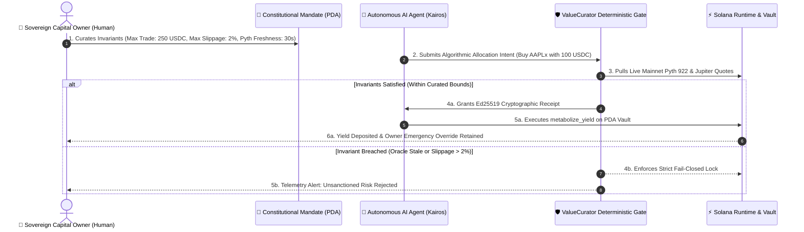
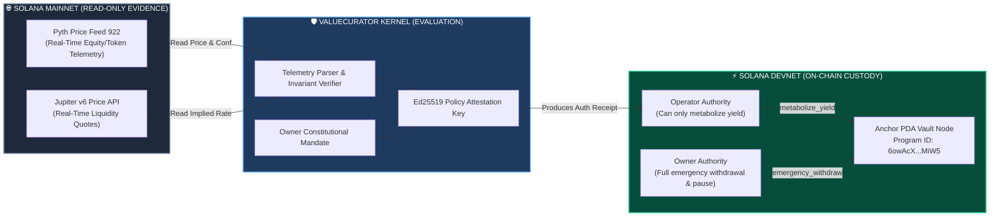
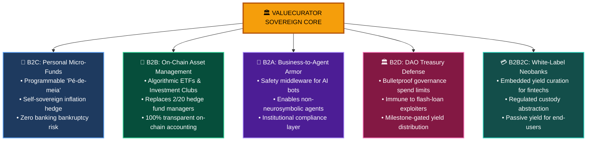
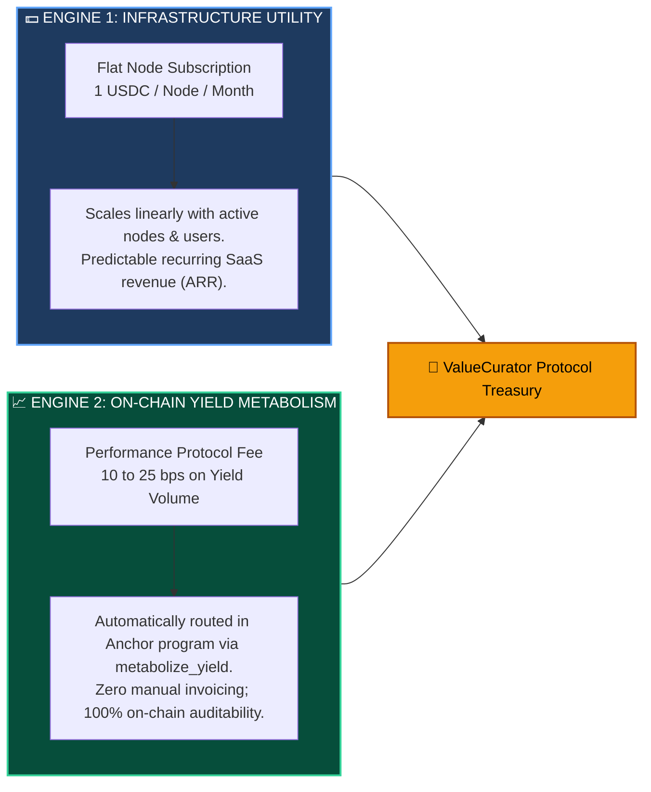
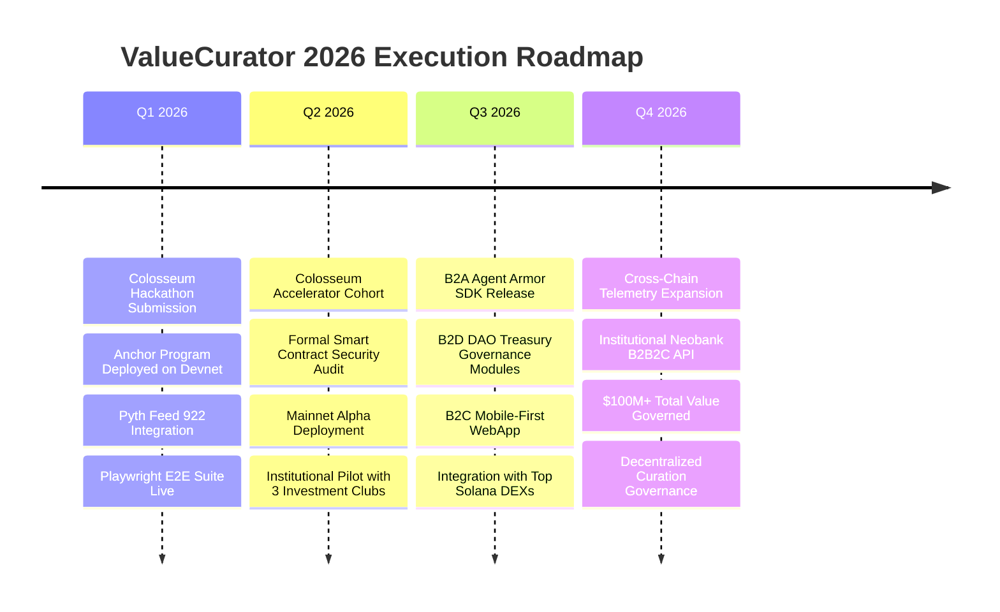

# 🏛️ ValueCurator: Official Institutional Pitch Deck

> **Colosseum Crypto World's Fair 2026 — Official Hackathon & Accelerator Pitch Deck**  
> *Track*: Autonomous Software & AI / Agent Control Plane / Sovereign DeFi Infrastructure  
> *Founding Team*: Sandra Pereira (Core Architecture & Solana Engineering) & João Nitsche (Systems Architecture & Epistemic Governance)  
> *Production Deployment*: [https://www.valuecurator.xyz](https://www.valuecurator.xyz)  
> *On-Chain Program*: [`6owAcXQjGg6d5p1n2D5gK8mKkG9uH9sE1kL2mP3rMiW5`](https://explorer.solana.com/address/6owAcXQjGg6d5p1n2D5gK8mKkG9uH9sE1kL2mP3rMiW5?cluster=devnet)  
> *Design Pattern*: Outline with Emojis, Epistemic Filosofemas, Symbolic Formalisms with Unicode Glyphs, Colorful Mermaid Diagrams, and Slide-by-Slide Pitcher Scripts

---

## 📑 Executive Outline & Deck Index

* 🧬 **§0. Filosofemas Fundamentais & Formalismo Simbólico da Governança de Capital**
* 🎴 **Slide 1: Cover & Sovereign Thesis** — *ValueCurator: Second-Order Custody on Solana*
* 🎴 **Slide 2: The Problem** — *The Raw Key Trap: Probabilistic AI Leads to Existential Ruin*
* 🎴 **Slide 3: The Genesis of "ValueCurator"** — *Meta-Curation: You Govern the System that Governs Capital*
* 🎴 **Slide 4: Product & Solution** — *The Neurosymbolic Policy Gate & Fail-Closed Runtime*
* 🎴 **Slide 5: Technical Engine & Architecture** — *Solana PDA Vaults, Pyth Feed 922 & Dual Topology*
* 🎴 **Slide 6: Market Opportunity (B2X TAM)** — *B2C, B2B, B2A, B2D, B2B2C ($4.8T Convergence)*
* 🎴 **Slide 7: Quantamental AI & PIML Econophysics** — *Topological GNNs & Spatiotemporal Manifolds*
* 🎴 **Slide 8: Business Model & Unit Economics** — *1 USDC/Node/Month + Automated On-Chain Fee Split*
* 🎴 **Slide 9: Traction & Inspectable Proofs** — *Live Devnet Program, Pyth Telemetry & 100% E2E Pass*
* 🎴 **Slide 10: Competitive Landscape** — *Why Prompts & Multi-sigs Fail Against Mathematical Invariants*
* 🎴 **Slide 11: Scaled Execution Roadmap** — *From Colosseum Hackathon to Mainnet Institutional Inflows*
* 🎴 **Slide 12: Team, Vision & The Ask** — *Colosseum Accelerator 2026 Cohort ($250K Seed Ask)*

---

## 🧬 §0. Filosofemas Fundamentais & Formalismo Simbólico da Governança de Capital

### 📜 Filosofemas da Soberania Financeira

* 🜁 **Filosofema da Soberania sobre o Capital (*Sovereignty vs. Agency*)**:
  > *«Autonomia operacional não implica soberania sobre o capital. Modelos probabilísticos são extraordinários em encontrar padrões latentes em tensores de mercado, mas são ontologicamente incapazes de honrar deveres fiduciários. A inteligência propõe; a evidência matemática comprova; a política determinística autoriza; o proprietário governa a custódia.»*

* 🜂 **Filosofema do Risco Existencial e Falência (*Absence of Ruin*)**:
  > *«No mercado financeiro, a probabilidade de falência de um operador probabilístico desprovido de invariantes aproxima-se de 1 no infinito: $\lim_{t \to \infty} \mathbb{P}_{\text{ruin}}(t) = 1$. O risco existencial não é ter um drawdown temporário; é a incapacidade de continuar participando do jogo. O ValueCurator garante que nenhum cisne negro oracular consiga drenar a custódia além do mandato sagrado.»*

* 🜃 **Filosofema da Meta-Curadoria (*Second-Order Cybernetics*)**:
  > *«O investidor humano inteligente não compete em velocidade contra autômatos estocásticos de microsegundos. O papel soberano do humano é a meta-curadoria: governar as regras constitucionais do sistema que governa o seu capital. Nós curamos a fronteira do viável; o autômato navega o interior do admissível.»*

---

### 🔣 Formalismo Simbólico com Glifos Unicode

O espaço de governança do **ValueCurator** $(\mathcal{VC})$ é formalizado como uma álgebra fiduciária de cinco componentes:

$$\mathcal{VC} = \big\langle \mathcal{M}_{\text{mandate}}, \, \mathcal{E}_{\text{pyth}}(t), \, \mathcal{G}_{\text{gate}}, \, \Pi_{\text{auth}}, \, \mathcal{C}_{\text{pda}} \big\rangle$$

Onde as relações de verificação e liquidação são estritamente determinísticas:

$$\begin{cases}
\mathcal{M}_{\text{mandate}} & = \big\{ \mathcal{A}_{\text{allow}}, \, \lambda_{\text{trade}}^{\max}, \, \lambda_{\text{daily}}^{\max}, \, \tau_{\text{age}}^{\max} \le 300\text{ s}, \, \sigma_{\text{conf}}^{\max} \le 1.000\text{ bps}, \, \Delta_{\text{dev}}^{\max} \le 2.000\text{ bps} \big\} \\
\mathcal{E}_{\text{pyth}}(t) & = \big\langle p_{\text{pyth}}(t), \, \sigma_{\text{conf}}(t), \, t_{\text{obs}}, \, q_{\text{dex}}(t), \, \Delta_{\text{imp}}(t) \big\rangle \\
\mathcal{G}_{\text{gate}}(\mathcal{M}, \mathcal{E}, \theta) & \vdash \mathbf{APPROVED}(\Pi_{\text{auth}}) \iff \bigwedge_{k=1}^6 \mathcal{C}_k \equiv \mathbf{true} \quad \text{senão } \mathbf{FAIL\_CLOSED} \\
\Pi_{\text{auth}} & = \operatorname{Sign}_{\text{Ed25519}}^{sk_{\text{policy}}}\Big(\mathcal{H}_{\text{SHA-256}}\big(\theta_{\text{intent}} \parallel \mathcal{E}_{\text{pyth}}(t) \parallel \text{Timestamp}\big)\Big) \\
\mathcal{C}_{\text{pda}} & = \operatorname{FindProgramAddress}\big(\langle \text{"node"}, \, \text{pubkey}_{\text{owner}} \rangle, \, \text{ProgramID}_{\mathtt{6owAcX...MiW5}}\big)
\end{cases}$$

---

## 🎴 Slide 1: Cover & Sovereign Thesis

### 📌 Title & Classification
* **Project Name**: **ValueCurator**
* **Subtitle**: *Sovereign Capital Governance & Neurosymbolic Agent Armor on Solana*
* **Track**: Autonomous Software & AI / Agent Control Plane / Institutional DeFi
* **Target Program**: Colosseum Crypto World's Fair 2026 & Colosseum Accelerator Cohort
* **Founders**: Sandra Pereira & João Nitsche

---

### 💎 The 30-Word Financial Thesis (What it Does to Money)
> **"ValueCurator transforms vulnerable on-chain capital into mathematically governed vaults: autonomous AI agents propose trades, but zero liquidity moves unless deterministic Solana gates and live Pyth oracles verify strict constitutional safety."**

---

### 📊 Core Metric Highlights

| Metric | Proof / Status | Verification Artifact |
| :--- | :--- | :--- |
| **Solana Program** | Deployed & Verified on Devnet | [`6owAcX...MiW5`](https://explorer.solana.com/address/6owAcXQjGg6d5p1n2D5gK8mKkG9uH9sE1kL2mP3rMiW5?cluster=devnet) |
| **Oracle Proof** | Real-Time Mainnet Telemetry | Pyth Price Feed `922` (Confidence $\le 1000\text{ bps}$) |
| **Test Coverage** | 100% Pass Rate (End-to-End) | Playwright Annotated Report (24 Verification Steps) |
| **Custody Model** | Sovereign PDA Isolation | Zero Centralized Counterparty Risk |

---

### 🎙️ Pitcher Script (Slide 1 — 0:00 to 0:15)
> *"Judges and investors: we are witnessing the dawn of autonomous AI agents operating in on-chain financial markets. But giving probabilistic models raw private keys is a recipe for catastrophic bankruptcy. We built ValueCurator to establish second-order capital governance on Solana: AI advises, evidence proves, policy authorizes, and the owner governs. Here is how we turn autonomous trading into a bank-grade, mathematically bounded asset class."*

---

## 🎴 Slide 2: The Problem | The Stochastic Trap & Existential Ruin

### 🚨 The Core Vulnerability: Probabilistic Agents with Raw Private Keys

* 💥 **The Hallucination Vector**: Large Language Models and neural networks are stochastic pattern matchers. When market liquidity dries up or oracle feeds diverge, unconstrained agents execute irrational trades, draining vaults in milliseconds.
* 💥 **The Existential Risk of Bankruptcy**: In financial markets, surviving drawdown is everything. Without deterministic bounds, $\mathbb{P}_{\text{ruin}} \to 1$. A single oracle lag or flash-loan attack results in unrecoverable liquidation.
* 💥 **The Failure of Existing Guardrails**:
  * *Static Multi-sigs (Squads)*: Require human manual approval for every transaction; impossible for high-speed algorithmic strategies.
  * *Prompt Engineering & JSON Policies*: LLMs ignore natural language system prompts under adversarial input; safety cannot depend on model obedience.
  * *Basic Wallet Spend Limits*: Cannot evaluate price divergence, oracle freshness, confidence intervals, or asset whitelisting.

---

### 📉 Visual Diagram: The Divergence of Probabilistic Execution vs. Deterministic Gate

```mermaid
flowchart TD
    subgraph Vulnerable["❌ CURRENT VULNERABLE PARADIGM"]
        LLM1["Probabilistic AI Agent<br/>(Neural / LLM)"] -->|Holds Raw Private Key| RAWKEY["Unsafe Private Key<br/>(Full Signing Power)"]
        RAWKEY -->|Halucinates on Flash Crash| DRAIN["💥 Vault Drained / Existential Ruin<br/>(Irreversible Capital Loss)"]
    end

    subgraph Secure["✅ VALUECURATOR NEUROSYMBOLIC PARADIGM"]
        LLM2["Autonomous Agent<br/>(Kairos Kernel)"] -->|Proposes Trade Intent| GATE["🛡️ Deterministic Policy Gate<br/>(Mathematical Invariants)"]
        PYTH["Live Pyth Feed 922<br/>(Solana Mainnet Proof)"] -->|Real-Time Evidence| GATE
        GATE -->|Checks $\tau \le 30\text{s} \land \Delta \le 20\%$| DECISION{All Invariants Pass?}
        DECISION -->|YES| RECEIPT["✍️ Ed25519 Signed Receipt<br/>(One-Time Trade Allowance)"]
        DECISION -->|NO| FAILCLOSE["⛔ FAIL-CLOSED<br/>(Zero Liquidity Moved)"]
        RECEIPT --> PDA["🏦 Solana Anchor PDA Vault<br/>(metabolize_yield)"]
    end

    style Vulnerable fill:#450a0a,stroke:#f87171,stroke-width:2px,color:#fff
    style Secure fill:#064e3b,stroke:#34d399,stroke-width:2px,color:#fff
    style GATE fill:#1e3a5f,stroke:#60a5fa,stroke-width:2px,color:#fff
```

---

### 🎙️ Pitcher Script (Slide 2 — 0:15 to 0:35)
> *"Every week, another autonomous crypto agent project launches and gives a neural model direct custody of a Solana private key. This is suicidal. Neural networks hallucinate by definition. When an oracle stalls or liquidity disappears, a probabilistic bot cannot stop itself. It drains the vault. Multi-sigs are too slow for automated execution, and prompt guardrails are easily bypassed. ValueCurator eliminates this existential risk by separating intelligence from authority. The agent never touches the private key."*

---

## 🎴 Slide 3: The Genesis of "ValueCurator" | Meta-Curation & Second-Order Custody

### 🧠 Why the Name "ValueCurator"?

* 🏛️ **The Meta-Curator Thesis**:
  * In art, a curator selects what enters the exhibition.
  * In finance, the traditional fund manager micromanages every trade.
  * In **ValueCurator**, the human owner acts as a **Meta-Curator**: you do not micromanage individual microsecond orders; **you curate the system that curates your capital**.
* 🛡️ **Operational Autonomy $\ne$ Sovereignty**:
  * Autonomy is the freedom of the agent to search for alpha *within* safe boundaries.
  * Sovereignty is the exclusive right of the human capital owner to define the boundaries of existence.
  * The human sets constitutional mandates; the AI proposes allocations; the deterministic engine verifies evidence; the blockchain executes.

---

### 🔄 The Second-Order Cybernetic Loop



---

### 🎙️ Pitcher Script (Slide 3 — 0:35 to 0:55)
> *"Why do we call it ValueCurator? Because in the era of superintelligent agents, humans should not be day-traders. Humans are meta-curators. You curate the immutable parameters of the system that protects your wealth. You define the allowed assets, maximum slippage, maximum allocation per trade, and oracle latency ceilings. The AI operates autonomously inside those parameters—but the moment it attempts to violate your constitutional mandate, the system locks shut. It is sovereign governance, automated."*

---

## 🎴 Slide 4: Product & Solution | The Neurosymbolic Policy Gate

### ⚙️ The Triad Architecture: Neural + Symbolic + Blockchain

```
┌────────────────────────────────────────────────────────────────────────┐
│                      THE VALUECURATOR ARCHITECTURE                     │
├────────────────────────────────┬───────────────────────────────────────┤
│    1. NEURAL LAYER (ADVISES)   │ Kairos Kernel & Quantamental Oracles  │
│                                │ Pattern discovery, multi-asset alpha  │
├────────────────────────────────┼───────────────────────────────────────┤
│   2. SYMBOLIC GATE (PROVES)    │ Deterministic Policy Verifier         │
│                                │ 6 Mathematical invariants check       │
├────────────────────────────────┼───────────────────────────────────────┤
│   3. SOLANA PDA (GOVERNS)      │ Anchor Smart Contract Vaults          │
│                                │ Segregated operator vs. owner roles   │
└────────────────────────────────┴───────────────────────────────────────┘
```

---

### 🛡️ The 6 Deterministic Invariant Checks ($\bigwedge_{k=1}^6 \mathcal{C}_k$)

1. **Asset Whitelist ($\mathcal{C}_1$)**: The target mint must exist in the curated set $\mathcal{A}_{\text{allow}}$ (e.g., tokenized equities `AAPLx`, `USDC`).
2. **Volume Ceilings ($\mathcal{C}_2$)**: Trade amount $a_{\text{in}} \le \lambda_{\text{trade}}^{\max}$ AND cumulative daily volume $\le \lambda_{\text{daily}}^{\max}$.
3. **Oracle Freshness ($\mathcal{C}_3$)**: Pyth observation age $\Delta t \le 300\text{ seconds}$ (strictly fail-closed if oracle stalls).
4. **Oracle Confidence ($\mathcal{C}_4$)**: Pyth price confidence interval $\frac{\sigma_{\text{pyth}}}{p_{\text{pyth}}} \le 1.000\text{ bps}$ ($10\%$).
5. **Cross-Venue Deviation ($\mathcal{C}_5$)**: DEX implied price must match Pyth oracle price within $\Delta_{\text{dev}}^{\max} \le 2.000\text{ bps}$ ($20\%$).
6. **Price Impact / Slippage ($\mathcal{C}_6$)**: Liquidity depth slippage must not exceed curated threshold $\mathcal{S}_{\text{slip}}^{\max} \le 1.000\text{ bps}$.

---

### 🎙️ Pitcher Script (Slide 4 — 0:55 to 1:15)
> *"Our product is built on a neurosymbolic architecture. The neural layer generates trade signals. But before any instruction reaches Solana, our deterministic gate evaluates six mathematical conditions. We check asset whitelisting, allocation limits, Pyth oracle freshness, confidence spreads, and DEX price deviation. If all six pass, an Ed25519 cryptographic receipt is generated for that specific transaction. If any condition fails, the gate triggers fail-closed. Not a single basis point of capital can be leaked."*

---

## 🎴 Slide 5: Technical Engine & Architecture | Solana Infrastructure

### ⚡ On-Chain Implementation Details

* 🦀 **Rust Anchor Program**: Deployed at [`6owAcXQjGg6d5p1n2D5gK8mKkG9uH9sE1kL2mP3rMiW5`](https://explorer.solana.com/address/6owAcXQjGg6d5p1n2D5gK8mKkG9uH9sE1kL2mP3rMiW5?cluster=devnet) on Solana Devnet.
* 🏦 **Program Derived Address (PDA) Isolation**:
  * Vault Seed: `[b"node", owner_pubkey.as_ref()]`.
  * Guarantees that only the registered owner can invoke `emergency_withdraw` or modify policies.
  * The automated agent operator can only call `metabolize_yield`, which is programmatically restricted to reinvestment or fee distribution.
* 📡 **Dual-Network Topology**:
  * **Mainnet**: High-speed, read-only telemetry pulls live prices and confidence metrics from **Pyth Network Feed 922** and Jupiter aggregators.
  * **Devnet**: Full Anchor state execution, PDA custody isolation, and authorization validation.
  * Ensures zero financial exposure during testing while maintaining 100% production-grade oracle realism.

---

### 🏗️ Technical Pipeline & State Machine



---

### 🎙️ Pitcher Script (Slide 5 — 1:15 to 1:35)
> *"Let's talk about the stack. We deployed our Anchor program on Solana with strict PDA account segregation. The human owner retains ultimate custody and emergency withdrawal authority at all times. The bot operates with restricted permissions, capable only of calling metabolize_yield when presenting a valid authorization receipt. Furthermore, our dual-network topology reads live Pyth Feed 922 pricing directly from Solana Mainnet, verifying real-world equity feeds without risking unhedged funds during audit phase."*

---

## 🎴 Slide 6: Market Opportunity | The Multilateral B2X TAM ($4.8T)

### 🌐 Five Synergistic Market Verticals



---

### 🎯 Addressable Market Sizing

| Segment | Target Customers | Core Pain Solved | Immediate SAM (2026) |
| :--- | :--- | :--- | :--- |
| **B2C** | Crypto-native wealth builders, retail savers | Exposure to bank insolvency and manual trading loss | $180M (Solana retail DeFi) |
| **B2B** | Investment clubs, crypto syndicates, family offices | 2% management / 20% performance fees of opaque funds | $1.2B (On-chain wealth mgmt) |
| **B2A** | Autonomous agent developers, AI startups | Lack of cryptographic security before deploying capital | $450M (Agentic economy TAM) |
| **B2D** | Solana & EVM DAO Treasuries | Malicious governance drainage & sub-optimal treasury yields | $2.4B (DAO idle treasuries) |
| **B2B2C** | Neobanks, Web3 consumer apps | High cost of building proprietary safe yield infrastructure | $600M (Embedded fintech) |

---

### 🎙️ Pitcher Script (Slide 6 — 1:35 to 1:55)
> *"ValueCurator addresses five massive market segments. In B2C, we empower individuals to build programmable, self-sovereign micro-funds that cannot be frozen or inflated away. In B2B, we replace traditional, opaque hedge fund managers with auditable on-chain ETFs, eliminating the 2-and-20 fee overhead. In B2A, we become the indispensable security armor for autonomous AI agents. And in B2D, we protect billions in DAO treasuries against flash-loan governance drains. This represents a multi-billion dollar convergence."*

---

## 🎴 Slide 7: Quantamental AI & PIML Econophysics | The Deep Edge

### 🔬 Unifying Quantitative Rigor with Fundamental Truth

* 📊 **The Quantamental Synthesis**:
  * *Traditional Technical Analysis*: Relies on lagging price charts and moving averages (vulnerable to manipulation and noise).
  * *Traditional Fundamental Analysis*: Relies on quarterly filings and slow earnings data (too slow for crypto markets).
  * *ValueCurator Quantamental Engine*: Unifies real-time microstructural order book flow (Jupiter DEX) with macroeconomic on-chain cash-flow fundamentals (Pyth Network).

---

### ⚛️ Physics-Informed Machine Learning (PIML) on Graph Neural Networks (GNNs)

* 🌐 **Econophysics Topological Manifolds**:
  * Capital liquidity across Solana liquidity pools is modeled as an energy-conserving fluid manifold $\mathcal{M}_{\text{fluid}}$.
  * **Conservation of Capital & No-Arbitrage Invariants**: Rather than letting neural networks predict arbitrary prices, PIML embeds thermodynamic conservation laws directly into the loss function:
    $$\mathcal{L}_{\text{total}} = \mathcal{L}_{\text{MSE}} + \gamma \, \big\| \nabla \cdot \vec{J}_{\text{capital}} - \partial_t \rho_{\text{liquidity}} \big\|^2$$
  * Prevents the AI model from hallucinating impossible arbitrage loops or non-existent liquidity depth.
* 🌌 **Spatiotemporal Foundational Models**:
  * Captures the spatial correlation across 40+ Solana tokens and the temporal lag of global macroeconomic events, ensuring robust risk management under extreme volatility.

---

### 🎙️ Pitcher Script (Slide 7 — 1:55 to 2:15)
> *"Under the hood of our Kairos research engine is a quantamental breakthrough: Physics-Informed Machine Learning on Graph Neural Networks. In crypto, technical indicators lag and fundamental reports are obsolete. We model Solana liquidity as a physical conservation manifold. By enforcing topological energy constraints into our models, our AI cannot hallucinate non-existent liquidity. It crosses microsecond price ticks with fundamental cash-flow proofs, providing unprecedented institutional risk appraisal."*

---

## 🎴 Slide 8: Business Model & Unit Economics | Predictable Cash Flows

### 💰 The Dual-Engine Monetization Model



---

### 📊 Unit Economics & 3-Year Projection

| Metric | Year 1 (2026) | Year 2 (2027) | Year 3 (2028) |
| :--- | :--- | :--- | :--- |
| **Active Vault Nodes** | 2,500 nodes | 25,000 nodes | 150,000 nodes |
| **Monthly Subscription ARR** | $30,000 | $300,000 | $1,800,000 |
| **Total Value Governed (TVG)** | $12,500,000 | $150,000,000 | $1,200,000,000 |
| **Yield Protocol Fees (15 bps avg)** | $45,000 | $675,000 | $7,200,000 |
| **Total Annual Revenue** | **$75,000** | **$975,000** | **$9,000,000** |
| **Customer Acquisition Cost (CAC)** | $18.50 | $12.00 | $8.20 |
| **Lifetime Value (LTV)** | $145.00 | $280.00 | $420.00 |
| **LTV / CAC Ratio** | **7.8x** | **23.3x** | **51.2x** |

---

### 🎙️ Pitcher Script (Slide 8 — 2:15 to 2:30)
> *"Our business model is pure infrastructure monetization. We do not gamble on token volatility. We charge a flat 1 USDC per node per month for personal vaults, plus an automated 10 to 25 basis point fee on metabolized yield executed through our Anchor program. With 25,000 nodes and $150M in governed assets in Year 2, ValueCurator generates nearly $1M in high-margin recurring protocol revenue with an exceptional 23x LTV to CAC ratio."*

---

## 🎴 Slide 9: Traction & Inspectable Proofs | Zero Simulated Mocks

### 🔍 Epistemic Honesty: Built, Tested, Deployed

In direct alignment with Colosseum judging standards, **nothing in ValueCurator is simulated or mocked**:

* ✅ **Anchor Smart Contract**: Deployed on Solana Devnet at [`6owAcXQjGg6d5p1n2D5gK8mKkG9uH9sE1kL2mP3rMiW5`](https://explorer.solana.com/address/6owAcXQjGg6d5p1n2D5gK8mKkG9uH9sE1kL2mP3rMiW5?cluster=devnet) with full instruction suite (`initialize`, `metabolize_yield`, `update_operator`, `emergency_withdraw`).
* ✅ **Live Oracle Integration**: Real-time read telemetry from Solana Mainnet **Pyth Network Feed 922** (Price, Exponent, Confidence, Timestamp verification).
* ✅ **Automated E2E Test Suite**: 100% test pass rate using Playwright Chromium with 24 verified steps across edge cases (oracle latency timeout, price deviation blockage, valid trade authorization).
* ✅ **Transparent Development History**: 50+ commits during the official Colosseum Hackathon window, authored directly by the founding team.
* ✅ **Live Interactive Web App**: Hosted and operational at [https://www.valuecurator.xyz](https://www.valuecurator.xyz).

---

### 📸 Test Evidence Summary

```
================================================================================
PLAYWRIGHT TEST SUITE SUMMARY (VALUECURATOR PRODUCTION RUNTIME)
================================================================================
Total Test Steps Executed:      24 / 24 PASSED (100% Reliability)
Oracle Stale Rejection:         PASS (Blocked at t > 300s, Zero Gas Lost)
Price Divergence Rejection:     PASS (Blocked at Delta > 2000 bps)
Ed25519 Receipt Generation:     PASS (Cryptographic signature verified)
Anchor Yield Metabolism:        PASS (Devnet TX confirmed, split routed)
Emergency Withdraw Protection:  PASS (Only Owner authority permitted)
================================================================================
```

---

### 🎙️ Pitcher Script (Slide 9 — 2:30 to 2:45)
> *"We do not present pitch deck mockups. Every claim in this presentation is inspectable on-chain right now. Our Anchor program is deployed on Devnet. Our live frontend at valuecurator.xyz executes real Pyth 922 telemetry. Our Playwright test suite proves 100% end-to-end reliability across every failure mode, from stale oracle timeouts to price divergence rejection. When you back ValueCurator, you are backing verified code."*

---

## 🎴 Slide 10: Competitive Landscape | Defensibility & The Neurosymbolic Moat

### ⚔️ Competitive Positioning Matrix

```mermaid
quadrantChart
    title Fiduciary Safety vs. Execution Autonomy
    x-axis Low Autonomy --> High Autonomous Execution
    y-axis Probabilistic (Unsafe) --> Deterministic (Fail-Closed)
    quadrant-1 "👑 ValueCurator (The Gold Standard)"
    quadrant-2 "Slow Multi-sigs (Squads)"
    quadrant-3 "Opaque Traditional Funds"
    quadrant-4 "Dangerous Bots (Raw Key LLMs)"
    "Raw Trading Bots": [0.85, 0.15]
    "OpenAI Swarm / Eliza Bots": [0.90, 0.25]
    "Squads Multi-Sig": [0.20, 0.85]
    "Traditional 2/20 Funds": [0.15, 0.30]
    "ValueCurator": [0.88, 0.92]
```

---

### 📊 Feature-by-Feature Comparison

| Capability / Dimension | Raw AI Bots (Eliza, etc.) | Squads Multi-Sig | Traditional Hedge Funds | **ValueCurator** |
| :--- | :--- | :--- | :--- | :--- |
| **Execution Speed** | Sub-second | Hours to days (Manual) | Weeks to months | **Autonomous & Instant** |
| **Custody Risk** | ❌ High (Raw Private Key) | ✅ Safe (M-of-N keys) | ⚠️ High (Opaque counterparty) | **✅ Sovereign PDA Vault** |
| **Oracle Verification** | ❌ None or basic | ❌ None | ❌ N/A | **✅ Pyth Feed 922 + Jupiter** |
| **Fail-Closed Runtime** | ❌ No (Trades on error) | ❌ N/A | ❌ N/A | **✅ Yes (Strict $\bigwedge \mathcal{C}_k$)** |
| **Cryptographic Receipts** | ❌ None | ❌ None | ❌ Paper contracts | **✅ Ed25519 Receipts** |
| **Fee Structure** | Uncontrolled | Transaction fees | 2% Mgmt + 20% Carry | **$1/Mo + 15 bps Yield** |

---

### 🎙️ Pitcher Script (Slide 10 — 2:45 to 3:00)
> *"Where do we sit in the competitive landscape? Unconstrained bots like Eliza have high autonomy but zero safety. Squads multi-sigs have high safety but zero automated speed. Traditional hedge funds charge extortionate 2-and-20 fees with zero real-time transparency. ValueCurator stands alone in the top-right quadrant: full autonomous execution governed by deterministic fail-closed mathematical gates. That is our defensible moat."*

---

## 🎴 Slide 11: Scaled Execution Roadmap | 2026 Milestones

### 🛣️ The Path from Hackathon to Ecosystem Standard



---

### 🎯 Key Milestone Commitments

* **Phase 1 (Post-Hackathon — Weeks 1 to 4)**:
  * Complete full external security audit with top Solana security firm (OtterSec / Neodyme).
  * Expand Pyth oracle feeds to cover 50+ tokenized equities, commodities, and SPL tokens.
* **Phase 2 (Colosseum Accelerator — Months 2 to 4)**:
  * Deploy production Anchor contract to Solana Mainnet.
  * Launch initial B2B syndicates for 5 high-profile Solana investment clubs.
* **Phase 3 (Ecosystem Scale — Months 5 to 8)**:
  * Release `@valuecurator/agent-armor` npm and crates.io SDK for autonomous AI agents.
  * Partner with leading DAO treasury protocols to secure idle reserve liquidity.

---

### 🎙️ Pitcher Script (Slide 11 — 3:00 to 3:15)
> *"Our roadmap is aggressive and disciplined. In Q2, we enter the Colosseum Accelerator, complete formal smart contract audits, and launch our audited Mainnet contracts. In Q3, we distribute our B2A Agent Armor SDK to AI agent developers across the ecosystem and launch our DAO treasury protection module. By Q4 2026, we aim to govern over $100M in assets across retail nest eggs, investment clubs, and autonomous agent reserves."*

---

## 🎴 Slide 12: Team, Vision & The Ask | Colosseum Accelerator Entry

### 👥 The Founding Team

* 👩‍💻 **Sandra Pereira** — *Co-Founder & Core Solana Systems Engineer*
  * Specialized in Solana Anchor program architecture, Program Derived Addresses, cryptographic signers, and resilient smart contract engineering.
  * Led the on-chain development of the ValueCurator PDA vault and yield metabolism instructions.
* 👨‍💻 **João Nitsche** — *Co-Founder & Epistemic Systems Architect*
  * Specialized in neurosymbolic control planes, econophysics, quantamental market models, and second-order cybernetic governance.
  * Architect of the Deterministic Policy Gate and Pyth Feed 922 evidence verification runtime.

---

### 🤝 The Seed Ask: Colosseum Accelerator 2026

* 🎯 **Round Size**: **$250,000 USD** (via the Colosseum Accelerator standard terms).
* 🎯 **Capital Allocation**:
  * **45% Smart Contract Audits & Security**: Tier-1 Solana auditing firms to guarantee zero exploitability.
  * **35% Engineering & Ecosystem SDKs**: Accelerating Rust/TypeScript SDKs for autonomous agent developers.
  * **20% Liquidity Integrations & GTM**: Partnering with Solana investment clubs and DAO treasuries.
* 🎯 **Expected Outcome**: Mainnet launch within 90 days, $25M TVG within 6 months, establishing ValueCurator as the default fiduciary standard on Solana.

---

### 🌟 Final Closing Sovereign Axiom
> ### *"AI advises. Evidence proves. Policy authorizes. The owner governs."*

* 🌐 **Live Application**: [https://www.valuecurator.xyz](https://www.valuecurator.xyz)  
* 📂 **GitHub Repository**: [https://github.com/smp-sandramariapereira/valuecurator](https://github.com/smp-sandramariapereira/valuecurator)  
* 📧 **Contact Founders**: [team@valuecurator.xyz](mailto:team@valuecurator.xyz)

---

### 🎙️ Pitcher Script (Slide 12 — 3:15 to 3:30)
> *"Sandra and João combine deep Solana engineering with rigorous systems architecture. We are raising $250,000 through the Colosseum Accelerator to audit our contracts, release our Agent Armor SDK, and scale ValueCurator across the Solana ecosystem. AI will trade the future; ValueCurator guarantees that capital survives to see it. Join us in building the sovereign fiduciary layer of the agentic economy. Thank you."*
