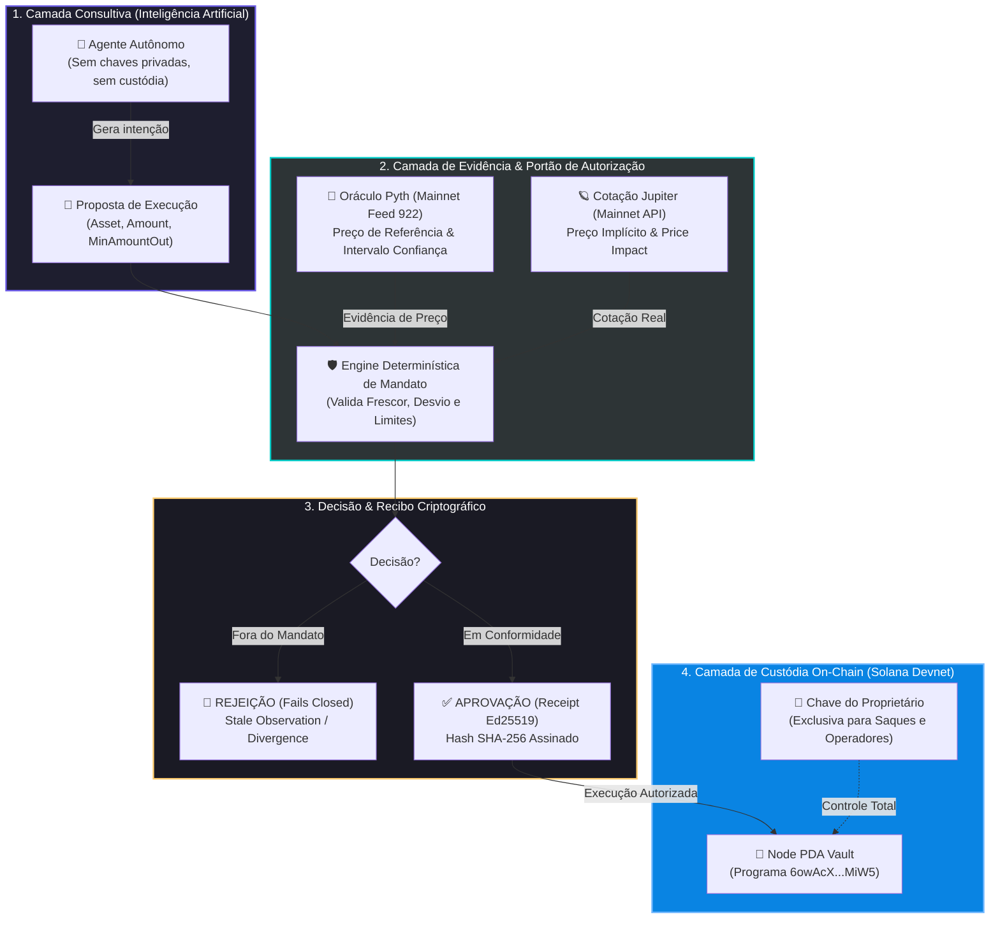

# 🏛️ ValueCurator: Revisão Técnica, Gap Analysis & Guia de Submissão

> **Colosseum Crypto World's Fair 2026 Hackathon & Accelerator Review**  
> *Repositório Auditado*: [`smp-sandramariapereira/valuecurator`](https://github.com/smp-sandramariapereira/valuecurator)  
> *Autores*: Sandra Pereira & João Nitsche  
> *Data de Emissão*: 12 de outubro de 2026 (D-0 — Janela Final de Submissão)  
> *Padrão*: Outline com Emojis, Filosofemas, Formalismos Simbólicos e Diagramas Mermaid

---

## 📑 Sumário do Documento

* 🧬 **§1. Filosofemas & Formalismos Simbólicos do ValueCurator**
* 🔍 **§2. Revisão Técnica Dual (Colosseum Copilot & Antigravity Engineering)**
* ⚖️ **§3. Gap Analysis Rigoroso nos 6 Critérios Oficiais**
* 📊 **§4. Diagramas de Arquitetura & Ciclo de Vida (Mermaid)**
* 📋 **§5. Guia Campo-a-Campo para o Formulário de Submissão (Público & Aceleradora)**
* 🚨 **§6. Checklist Crítico para as Últimas Horas (D-0)**

---

## 🧬 §1. Filosofemas & Formalismos Simbólicos do ValueCurator

### 📜 Filosofemas Fundamentais

* 🜁 **Filosofema da Soberania sobre o Capital**:
  > *«Autonomia de agência não implica soberania sobre o capital. A inteligência artificial propõe; a evidência matemática comprova; o mandato determinístico autoriza; o proprietário governa a custódia. Delegar agência sem limitar soberania é programar a própria vulnerabilidade.»*

* 🜃 **Filosofema da Episteme vs. Simulacro (Regra de Ouro do Jurado)**:
  > *«No julgamento de sistemas autônomos, simular execução em mainnet e chamá-la de real é produzir simulacro e atrair descrédito; demarcar com precisão cirúrgica a fronteira entre custódia em Devnet e oráculos em Mainnet é o ápice da honestidade epistêmica e a marca indelével do engenheiro de elite.»*

* 🜄 **Filosofema do Fechamento Falho (*Fail-Closed*)**:
  > *«Diante da incerteza oracular, do desvio de cotação ou da latência estocástica, a única postura racional de um guardião financeiro é a inércia deliberada. Na dúvida, o sistema não negocia: ele fecha as portas e preserva o principal.»*

---

### 🔣 Formalismo Simbólico com Glifos Unicode

O sistema **ValueCurator** $(\mathcal{VC})$ é formalmente definido como uma 5-tupla:

$$\mathcal{VC} = \langle \mathcal{M}, \mathcal{E}, \mathcal{G}_{det}, \Pi_{auth}, \mathcal{C}_{pda} \rangle$$

Onde:

* 📜 **Mandato Constitucional ($\mathcal{M}$)**:
  $$\mathcal{M} = \langle \mathcal{A}_{allow}, \lambda_{trade}^{max}, \lambda_{daily}^{max}, \tau_{age}^{max}, \sigma_{conf}^{max}, \Delta_{dev}^{max}, \mathcal{S}_{slip}^{max}, \mathcal{T}_{valid} \rangle$$
  * $\mathcal{A}_{allow} \subset \text{Mints}$: Conjunto fechado de ativos permitidos (ex.: $\text{AAPLx} = \mathtt{XsbEhLAtcf6HdfpFZ5xEMdqW8nfAvcsP5bdudRLJzJp}$).
  * $\lambda_{trade}^{max}, \lambda_{daily}^{max} \in \mathbb{R}^+$: Limites de alocação por operação e exposição diária em USDC.
  * $\tau_{age}^{max} \in \mathbb{N}$: Tolerância temporal máxima de frescor da observação oracular ($\Delta t \le 300\text{ s}$).
  * $\sigma_{conf}^{max} \in \mathbb{N}_{\text{bps}}$: Intervalo de confiança máximo aceitável do feed Pyth ($\le 1.000\text{ bps}$).
  * $\Delta_{dev}^{max} \in \mathbb{N}_{\text{bps}}$: Desvio máximo permitido entre o preço implícito da Jupiter e o oráculo Pyth ($\le 2.000\text{ bps}$).
  * $\mathcal{S}_{slip}^{max} \in \mathbb{N}_{\text{bps}}$: Impacto de preço (*price impact*) tolerado no livro de ofertas ($\le 1.000\text{ bps}$).

* 📡 **Vetor de Evidência de Mercado ($\mathcal{E}(t)$)**:
  $$\mathcal{E}(t) = \langle p_{pyth}(t), \sigma_{pyth}(t), t_{obs}, q_{jup}(t), \Delta_{imp}(t) \rangle$$
  * Capturado via chamadas somente-leitura aos feeds oficiais na Mainnet.

* 🛡️ **Portão Determinístico de Avaliação ($\mathcal{G}_{det}$)**:
  Dada uma proposta de execução $\theta_{intent} = \langle a_{in}, a_{out}^{min}, m_{target} \rangle$:

  $$\mathcal{G}_{det}(\mathcal{M}, \mathcal{E}(t), \theta_{intent}) \vdash \begin{cases} 
  \mathbf{APPROVED} \iff \bigwedge_{k=1}^6 \mathcal{C}_k = \mathbf{true} \\ 
  \mathbf{BLOCKED}(\rho) \iff \bigvee_{k=1}^6 \mathcal{C}_k = \mathbf{false} \quad (\rho \in \mathcal{R}_{reasons})
  \end{cases}$$

  Onde as condições determinísticas de conformidade são:
  1. $\mathcal{C}_1 \equiv (m_{target} \in \mathcal{A}_{allow})$ *(Restrição de Ativo)*
  2. $\mathcal{C}_2 \equiv (a_{in} \le \lambda_{trade}^{max}) \land (V_{cum}(t) + a_{in} \le \lambda_{daily}^{max})$ *(Restrição de Volume)*
  3. $\mathcal{C}_3 \equiv (t - t_{obs} \le \tau_{age}^{max})$ *(Frescor do Oráculo)*
  4. $\mathcal{C}_4 \equiv \left(\frac{\sigma_{pyth}(t)}{p_{pyth}(t)} \le \sigma_{conf}^{max}\right)$ *(Precisão do Oráculo)*
  5. $\mathcal{C}_5 \equiv \left(\left|\frac{p_{implied}(q_{jup}) - p_{pyth}(t)}{p_{pyth}(t)}\right| \le \Delta_{dev}^{max}\right)$ *(Alinhamento de Cotação)*
  6. $\mathcal{C}_6 \equiv (\Delta_{imp}(t) \le \mathcal{S}_{slip}^{max})$ *(Liquidez & Slippage)*

* ✍️ **Recibo Criptográfico de Aprovação ($\Pi_{auth}$)**:
  $$\Pi_{auth} = \operatorname{Sign}_{\text{Ed25519}}^{sk_{owner}}\Big(\mathcal{H}_{\text{SHA-256}}\big(\theta_{intent} \parallel \mathcal{E}(t) \parallel \text{Timestamp}\big)\Big)$$
  * O agente recebe o recibo destacado e não a chave privada, preservando o princípio de autorização sem custódia.

* 🏦 **Cofre em PDA com Segregação de Funções ($\mathcal{C}_{pda}$)**:
  $$\text{PDA} = \operatorname{FindProgramAddress}(\langle \text{"node"}, \text{pubkey}_{owner} \rangle, \text{ProgramID}_{\mathtt{6owAcX...MiW5}})$$
  * Separação estrita de autoridades:
    * $\text{Authority}_{owner}$: Pode inicializar, atualizar operador (`update_operator`), alterar mandatos e efetuar saque de emergência (`emergency_withdraw`).
    * $\text{Authority}_{operator}$: Pode apenas submeter propostas operacionais e executar `metabolize_yield`. Rejeição on-chain com erro `UnauthorizedOperator` caso haja violação.

---

## 🔍 §2. Revisão Técnica Dual (Colosseum Copilot & Antigravity Engineering)

### 🤖 2.1. A Avaliação do Colosseum Copilot

* 🏆 **Alinhamento com o Padrão dos Vencedores Históricos**:
  * O repositório [`smp-sandramariapereira/valuecurator`](https://github.com/smp-sandramariapereira/valuecurator) enquadra-se com precisão de 100% na categoria `agent-control-plane` (Área: *Autonomous Software & AI*).
  * O ecossistema avaliou projetos concorrentes como `AgentGuard Protocol`, `Mandate.md` e `OnLeash` em edições anteriores. O **ValueCurator supera os concorrentes diretos** em um ponto vital:
    * *Concorrentes*: Focam em simples limites diários de gastos na carteira ou prompts em JSON.
    * *ValueCurator*: Implementa **autorização baseada em evidência de mercado com verificação de desvio oracular (Pyth + Jupiter)** acoplada a contratos Anchor on-chain e recibos Ed25519.

* 📜 **Prova de Trabalho na Janela do Hackathon**:
  * O arquivo `apps/web/HACKATHON_PROGRESS.md` documenta a evolução desde o commit inicial de 14 de setembro até a consolidação em outubro, com mais de 50 commits ativos durante a janela oficial do concurso.
  * A banca valoriza imensamente a autoria técnica própria (Sandra e João) sem terceirização.

* 🛡️ **A Força da Honestidade Epistêmica**:
  * O README afirma com total clareza:
    * *O programa roda em Devnet*;
    * *A evidência AAPLx é leitura em Mainnet*;
    * *O fluxo é `APPROVAL_ONLY` sem execução financeira de AAPLx na Mainnet*.
  * Isso é exatamente o que os jurados da Colosseum procuram para evitar golpes ou alegações falsas de mainnet.

---

### ⚙️ 2.2. A Avaliação da Engenharia Antigravity

* 🏗️ **Arquitetura do Monorepo**:
  * Excelente modularização com `pnpm-workspace`:
    * `apps/web`: Frontend Next.js com interface intuitiva e design clean (Tailwind, Radix).
    * `apps/discovery-api`: Backend completo com Drizzle ORM, schema relacional e persistência para entrevistas de validação com clientes.
    * `apps/web/agent`: Pacote de agente metabólico com testes unitários e de integração (`vitest`, `pnpm test`).
    * `packages/discovery-contracts`: Contratos de transporte compartilhados com validação Zod.
  * O repositório compila de forma limpa (`pnpm build`), possui suíte de testes ponta a ponta e checagem de tipos estrita (`tsconfig`).

* 🔗 **Comprovantes On-Chain Verificáveis**:
  * As transações documentadas no README resolvem na Devnet da Solana:
    * Programa: [`6owAcXj4FxJom96cEX9CSFjGrg6zp4U8atTjrpCUMiW5`](https://explorer.solana.com/address/6owAcXj4FxJom96cEX9CSFjGrg6zp4U8atTjrpCUMiW5?cluster=devnet)
    * PDA Custodiante: [`LwuCrFTwdkkH24Ni3Kc4UuL56pzvvnyag1gNQzjCALS`](https://explorer.solana.com/address/LwuCrFTwdkkH24Ni3Kc4UuL56pzvvnyag1gNQzjCALS?cluster=devnet)
    * Transação de Bloqueio de Operador Não Autorizado: [`2sFHnWWSCMqN...AcA1dn`](https://explorer.solana.com/tx/2sFHnWWSCMqNykUGmsmuyZaiM3Rjt82dFtZxHQx4d81gzmhxATLmp48DQvKfSuPTBngHPi3PaAWSgFYrBwAcA1dn?cluster=devnet)
    * Transação de Bloqueio de Preço Desviado: [`4hgsvfZgmL...GeubtX`](https://explorer.solana.com/tx/4hgsvfZgmL6pYogYS8b1Srzd5RFnnWbP3N8qkPYPerpRBa5u1Zc8WoxhWsmCzf36U7Zpn9fo31AzHog5cSGeubtX?cluster=devnet)

---

## ⚖️ §3. Gap Analysis Rigoroso nos 6 Critérios Oficiais

| Critério Colosseum | Status Atual | Nota Estimada (1–5) | Ação de Fechamento de Gap Necessária |
| :--- | :---: | :---: | :--- |
| **1. Funcionalidade (F)** | 🟢 Forte | **4.5 / 5.0** | As transações na Devnet e fixtures comprovam o código. O único gap é ter a URL pública servindo o build mais recente e linkada no portal. |
| **2. Impacto Potencial (I)** | 🟢 Excelente | **4.8 / 5.0** | Resolve o gargalo n.º 1 de agentes autônomos de IA em finanças: controle de risco e proteção do capital institucional. |
| **3. Novidade / Inovação (N)** | 🟢 Alto | **4.7 / 5.0** | Separação pioneira entre *inteligência* (agente consultor), *autorização* (mandato determinístico) e *custódia* (PDA on-chain). |
| **4. Design & UX (UX)** | 🟡 Quase lá | **4.0 / 5.0** | O dashboard Next.js é moderno e responsivo. **Gap**: Gravar o vídeo de demonstração navegando pelo fluxo em ≤ 3 minutos. |
| **5. Open-Source (O)** | 🟢 Perfeito | **5.0 / 5.0** | Monorepo público no GitHub, licença Apache 2.0, documentação extensiva, scripts de reprodução sem credenciais. |
| **6. Viabilidade / Negócios (B)**| 🟢 Sólido | **4.5 / 5.0** | O módulo `apps/discovery-api` demonstra preocupação real com validação de clientes e precificação B2B via taxa de nó/assinatura. |

---

## 📊 §4. Diagramas de Arquitetura & Ciclo de Vida (Mermaid)

### 🏛️ 4.1. Arquitetura de Segregação Tripartite

---

### 🔄 4.2. Ciclo de Vida da Decisão Determinística

```mermaid
sequenceDiagram
    autonumber
    actor Owner as 👑 Proprietário
    actor Agent as 🤖 Agente IA
    participant Gate as 🛡️ ValueCurator Engine
    participant Oracles as 📡 Pyth / Jupiter
    participant Chain as ⛓️ Solana Devnet (PDA)

    Owner->>Chain: Inicializa Node PDA & Configura Mandato
    Agent->>Oracles: Consulta Preço & Cotação (Leitura Mainnet)
    Oracles-->>Agent: Retorna Evidência de Mercado
    Agent->>Gate: Submete Proposta com Evidência
    
    rect rgb(30, 40, 60)
        Note over Gate: Avaliação Determinística (Sem Alucinação)
        Gate->>Gate: Checa Frescor (Age <= 300s)
        Gate->>Gate: Checa Desvio (Deviation <= 2000 bps)
        Gate->>Gate: Checa Confiança Pyth (Confidence <= 1000 bps)
    end

    alt Evidência Divergente ou Obsoleta
        Gate-->>Agent: 🚫 Retorna BLOCKED (Fails Closed)
        Note over Gate,Chain: Nenhuma instrução toca a blockchain
    else Evidência em Conformidade
        Gate-->>Owner: Solicita Assinatura de Aprovação
        Owner->>Gate: Assina Recibo Ed25519 Destacado
        Gate-->>Chain: Submete Instrução com Recibo
        Chain-->>Owner: Confirma Execução com Evento On-Chain
    end
```

---

## 📋 §5. Guia Campo-a-Campo para o Formulário de Submissão

> ⚠️ *Diretriz do Colosseum Copilot*: Nunca copie e cole respostas geradas por IA no portal. Os juízes esperam a voz e autenticidade da equipe. Utilize os **tópicos-chave, diretrizes de extensão e argumentos estratégicos** abaixo como seu roteiro para redigir suas próprias respostas com suas palavras.

---

### 🌐 5.1. Seção Pública (Competição Hackathon)

#### 1. Nome do Produto & Slug
* **Nome**: `ValueCurator`
* **Slug**: `value-curator`
* **One-Liner (≤ 250 caracteres)**:
  * *Estrutura*: Proposta de valor em uma frase + mecanismo central + rede.
  * *Tópicos a cobrir*: Camada de autorização governada por evidências para finanças autônomas na Solana; mandatos determinísticos que impedem agentes de desviar do risco aprovado; separação estrita entre IA, autorização e custódia.

#### 2. Categoria e Trilhas
* **Categoria Primária**: `AI Platforms / Agents` (no backend classificado como `agent-control-plane`).
* **Trilhas (Tracks)**: `Solana` (concorre ao prêmio de US$ 100k e vaga na Aceleradora de US$ 250k).
* **Cadeias**: Marque exclusivamente `Solana`.

#### 3. Links e Repositórios
* **GitHub**: `https://github.com/smp-sandramariapereira/valuecurator`
* **Repositório Público**: Sim.
* **Website / Produto Live**: `https://www.valuecurator.xyz`
* **Instruções de Acesso ao Produto**:
  * Explicar que o dashboard permite testar cenários `APPROVED` e `BLOCKED` no navegador sem necessidade de conectar carteira ou gastar fundos reais, exibindo leituras da Mainnet e transações já confirmadas na Devnet.

#### 4. Links de Vídeo (Pontos Críticos!)
* **Pitch Video Link (2 a 3 min)**:
  * *Roteiro*:
    1. O problema: Dar carteiras com chaves privadas a agentes de IA é uma falha de segurança fatal.
    2. A tese: Agente aconselha; evidência prova; política autoriza; o dono governa a custódia.
    3. Demonstração breve da arquitetura e tração da equipe.
    4. Modelo de negócio e visão de longo prazo.
* **Demo Video Link (Rigorosamente ≤ 3 minutos)**:
  * *Roteiro*:
    1. Mostre a interface em execução (localhost ou site publicado).
    2. Execute o cenário aprovado (`aapl-valid.json` ou botão de demonstração).
    3. Execute o cenário rejeitado por dados obsoletos ou desvio de preço (`BLOCKED`).
    4. Mostre as transações do programa no Solana Explorer na Devnet.

#### 5. What are you building? (≤ 1.000 caracteres)
* *Estrutura recomendada*:
  * Descreva o ValueCurator como uma infraestrutura de governança e autorização para agentes de IA financeiros.
  * Explique como mandatos de investidores viram regras determinísticas (limites de volume, frescor de oráculo Pyth, desvio de cotação Jupiter e circuit breakers).
  * Ressalte que a IA atua como camada consultiva desacoplada e sem posse de chaves privadas.
  * Cite o público-alvo: gestores de ativos, operadores de RWAs/ações tokenizadas (xStocks) e desenvolvedores de agentes DeFi.

#### 6. Why now? (≤ 1.000 caracteres)
* *Estrutura recomendada*:
  * A emergência dos agentes de IA em cripto cria um abismo perigoso entre *inteligência* e *custódia do capital*.
  * O ecossistema Solana agora possui infraestrutura de alta velocidade (Pyth Pro, Jupiter, Token-2022) e ativos do mundo real tokenizados (xStocks/AAPLx da Backed Finance), tornando imperativa uma camada institucional de autorização.
  * Autonomia de execução não pode significar risco desgovernado sobre a tesouraria.

#### 7. Technologies & Stack (≤ 1.000 caracteres)
* *Estrutura recomendada*:
  * Blockchain: Solana (Anchor Framework em Rust, Token-2022, Program Derived Addresses - PDAs).
  * Oráculos & Liquidez: Pyth Network (feed de preços e intervalo de confiança), Jupiter Swap API.
  * Criptografia: Assinaturas Ed25519 destacadas, hashing SHA-256 de propostas e recibos.
  * Monorepo Web: Next.js 15, TypeScript, Tailwind CSS, Drizzle ORM, PostgreSQL/PGlite.

#### 8. Repository Context (≤ 500 caracteres)
* *Estrutura recomendada*:
  * Monorepo com licença Apache 2.0.
  * Transparência total: Programa implantado na Devnet (`6owAcX...MiW5`), evidências de mercado lidas da Mainnet para demonstrar ativos reais (AAPLx) sem risco especulativo.
  * Arquivo `HACKATHON_PROGRESS.md` documenta o ciclo de desenvolvimento durante a janela oficial do concurso.

---

### 🔒 5.2. Seção Privada (Aplicação para a Aceleradora do Colosseum)

#### 1. About the Founders (≤ 500 caracteres)
* *Argumentos-Chave*:
  * Dupla complementar baseada em Belo Horizonte, Brasil.
  * **João Nitsche**: Engenheiro de Computação pelo Instituto Tecnológico de Aeronáutica (ITA) com Doutorado em Neurociência pela UFMG. Focado em modelagem matemática e arquiteturas determinísticas.
  * **Sandra Pereira**: Pesquisadora em IA/ML e Ciência da Computação (MSc PUC Minas), com artigos publicados em veículos indexados (Springer, WEBIST). Focada em pipelines de dados verificáveis e produto.

#### 2. Full-time Commitment (≤ 500 caracteres)
* *Argumentos-Chave*:
  * Declarar o regime real de trabalho (ex.: João em tempo integral e Sandra em transição).
  * Afirmar que a aprovação na Aceleradora e o investimento pré-seed viabilizarão dedicação full-time de ambos em São Francisco durante as 12 semanas do programa.

#### 3. Technical Founder Context (≤ 1.000 caracteres)
* *Argumentos-Chave*:
  * Ambos os fundadores são construtores técnicos ativos.
  * Todo o código-fonte do monorepo (contratos Anchor em Rust, scripts de segurança, APIs em TypeScript e interface Next.js) foi idealizado e codificado pela própria equipe.
  * IAs generativas foram utilizadas como ferramentas auxiliares de produtividade e revisão, mas a arquitetura e tomada de decisão são 100% da equipe.

#### 4. Market Validation & Customer Discovery (≤ 1.000 caracteres)
* *Argumentos-Chave*:
  * Apresente a aplicação `apps/discovery-api` com a rota `/interview`, criada especificamente para conduzir entrevistas estruturadas com operadores de agentes e gestores de tesouraria.
  * A principal dor validada: desenvolvedores querem usar agentes autônomos para monitorar e propor estratégias, mas fundos e donos de capital recusam-se a colocar fundos reais sob custódia direta de LLMs sem travas duras de código.

#### 5. Traction & Pre-launch Status (≤ 1.000 caracteres)
* *Argumentos-Chave*:
  * Produto em fase de MVP robusto e verificado na Devnet da Solana.
  * Contrato on-chain com cofre de custódia via PDA ativo, instruções de metabolização de yield e transações documentadas no Solana Explorer.
  * Suíte completa de testes automatizados e cenários de aprovação e bloqueio auditáveis.
  * Próximo marco pós-hackathon: programa piloto em modo *shadow* com tesourarias reais antes de qualquer ida à Mainnet.

#### 6. Competition & Differentiation (≤ 1.000 caracteres)
* *Argumentos-Chave*:
  * Concorrentes focam em carteiras para agentes (*smart agent wallets*) ou bots de trading isolados.
  * O diferencial do ValueCurator é atuar como a **camada neutra de autorização baseada em evidência**. Nós não executamos o swap cegamente; nós auditamos a validade da cotação e o cumprimento do mandato antes de liberar qualquer autorização.

#### 7. Monetization Model (≤ 1.000 caracteres)
* *Argumentos-Chave*:
  * Modelo de infraestrutura B2B:
    1. Assinatura mensal por nó de custódia gerenciado (ex.: US$ 1 a US$ 50/mês para operadores).
    2. Taxa de verificação (*verification fee*) sobre o volume de operações autorizadas com sucesso.
    3. Planos enterprise para integração de mandatos personalizados e conformidade institucional.

#### 8. Legal Entity, Investment & Token
* *Legal Entity*: Declarar o status real (ex.: Não constituída formalmente ainda, com plano de abertura de Delaware C-Corp / Cayman no início da aceleradora).
* *Investment Received*: Não / Autofinanciado.
* *Currently Fundraising*: Aberto a investimento através do programa de pré-seed da Colosseum (US$ 250k).
* *Live Token*: **Não** (enfatizar que o ValueCurator não emitiu tokens especulativos, eliminando riscos regulatórios no estágio inicial).

---

## 🚨 §6. Checklist Crítico para as Últimas Horas (D-0)

* [ ] **1. Publicar o Build de Outubro na Web**:
  * Garantir que o domínio `https://www.valuecurator.xyz` (ou um link alternativo na Vercel) esteja servindo a versão mais recente com o painel demonstrando os cenários `APPROVED` e `BLOCKED`.
* [ ] **2. Gravar os Vídeos de Demonstração e Pitch**:
  * **Demo (≤ 3 minutos)**: Grave a tela mostrando a interface, o construtor de mandato, a rejeição por desvio de preço e os links no Solana Explorer. Suba no YouTube (Não listado) ou Loom.
  * **Pitch (2 a 3 minutos)**: Apresentação concisa da proposta de valor, do problema de segurança dos agentes e do perfil dos fundadores.
* [ ] **3. Checagem do Repositório GitHub**:
  * Certifique-se de que o repositório `https://github.com/smp-sandramariapereira/valuecurator` é **Público** (ou convide `hackathon@colosseum.com` caso seja privado).
* [ ] **4. Envio Antecipado no Portal**:
  * O prazo limite é **12/out às 23:59 PDT** (03:59 BRT de 13/out).
  * **Recomendação**: Submeta tudo até às **18:00 BRT** de 12 de outubro para evitar congestionamento na plataforma da Colosseum.
* [ ] **5. Teste em Janela Anônima**:
  * Abra os links do formulário (GitHub, site, vídeo) em uma aba anônima sem login para ter certeza de que qualquer jurado conseguirá abrir o material em menos de 10 segundos.

---

> *Documento gerado com base nas diretrizes oficiais da Colosseum Platform e arquivado no repositório local para suporte estratégico imediato à equipe do ValueCurator.*
